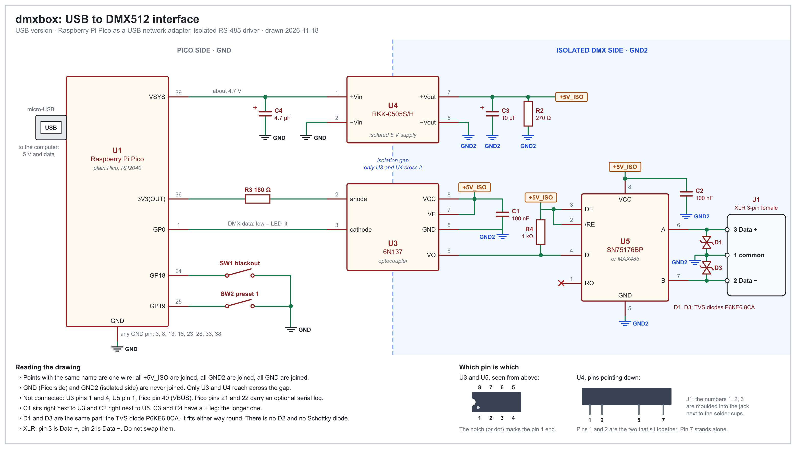
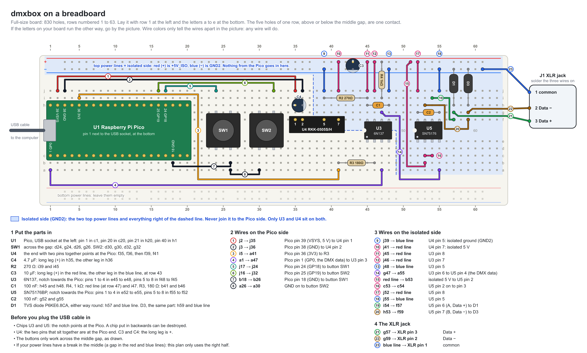
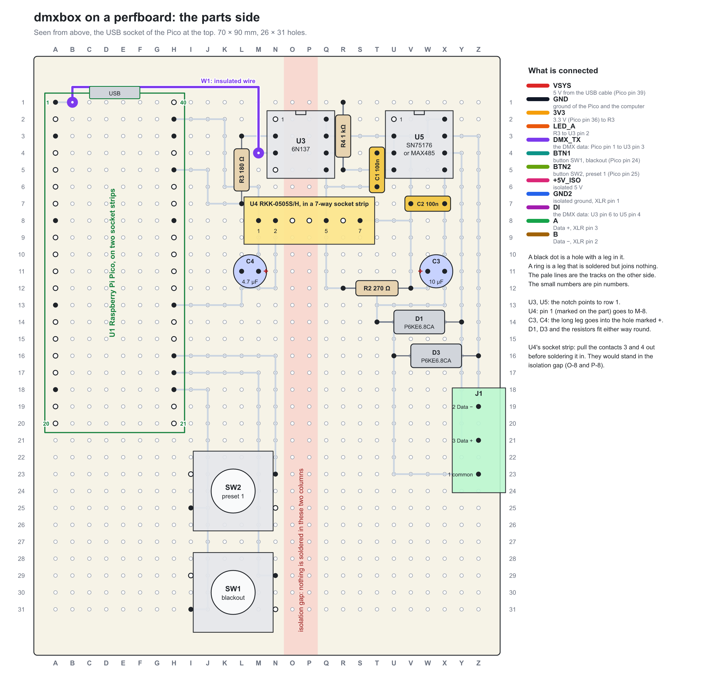
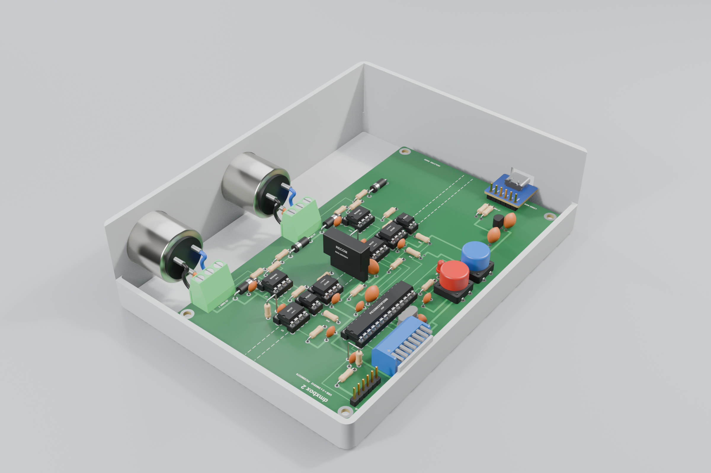
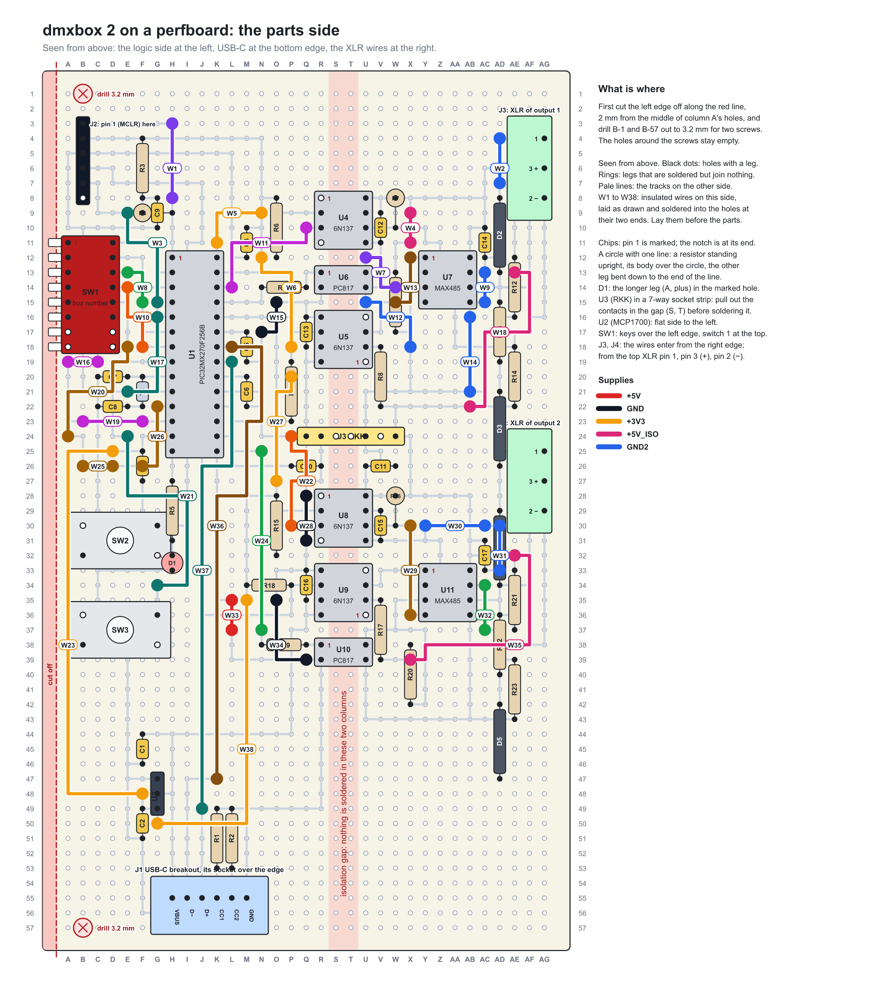

# Building and changing Lumenet

For people who build the dmxbox or change the code: the box's hardware and firmware, the PC side, how the
desk is built and tested, the DX protocol, Art-Net, sACN and the DMX USB Pro, and what has been tried so far. The [README](README.md) says what
Lumenet is and how to get it; the [manual](MANUAL.md) describes the desk.

## The dmxbox in short

A small box with a **USB socket** on one end and a **3-pin XLR DMX output** on the other.
One USB cable powers it and carries the data.

When you plug it in, the computer sees a new network adapter with exactly one device behind it: the box,
at **192.168.7.1**. So the box is controlled over UDP like a network device, but there is no network to set up:

* **Art-Net** (UDP 6454) is supported, so QLC+ and other lighting software work with it.
* The **DX protocol** (UDP 7000) is a custom, reliable command protocol. It uses sequence numbers, ACKs,
  retransmits and duplicate detection. Fades run on the Pico, so they stay smooth even if the PC hiccups.

```
 PC ──USB──► Pico core 0: USB network link, protocols, buttons, flash
             Pico core 1: fade engine ──► PIO + DMA ──► 6N137 ──► SN75176 ──► XLR-3
```

A second box, **dmxbox 2**, is drawn and its firmware builds, but it has not been built yet: a PIC32
microcontroller in a DIP socket instead of the Pico, a USB-C socket, **two DMX outputs** ready for RDM, and a
switch that gives each box its own number and address (10.1.n.1), so that several boxes can work on one
computer. See [dmxbox 2: the PIC32 box](#dmxbox-2-the-pic32-box).

## What is where

| Folder / file | Contents |
|---|---|
| `firmware/common/` | The C code both boxes share: the network stack, the address server, Art-Net, the DX protocol, the fade engine, the presets and the USB network adapter. |
| `firmware/pico/` | The box with the Pico: a Pico SDK project (C). Builds `dmxbox.uf2`; `flash.cmd` puts it onto the Pico. `test/` tests the network code on a PC. |
| `firmware/pic32/` | The PIC32 box with two outputs (dmxbox 2): its own C code (board, DMX outputs, flash) and `build.cmd`, which builds `dmxbox2.hex` with Microchip's XC32. |
| `firmware/sim/` | The **same** engine and protocol C code as the firmware, running on a PC over normal sockets: the box with the Pico and dmxbox 2, each with one output and with two. Use them to develop software before the hardware exists. |
| `backend/` | .NET: the `DmxBox` library, the `dmxbox` command-line tool, the server of the Lumenet desk, `Lumenet.exe` (`backend/Lumenet`), the simulated devices of `sim.cmd` (`backend/DmxBox.Sim`), and the tests. |
| `frontend/` | Angular: the page of the Lumenet fader desk. |
| `run.cmd` | Starts the Lumenet desk: backend and frontend together. |
| `sim.cmd` | Starts a simulated device, as if it were plugged in: a dmxbox, an Art-Net node, an sACN receiver, an Enttec DMX USB Pro, or a MIDI controller with its page in the browser. |
| `publish.cmd` | Makes `Lumenet.exe`, the whole desk in one file. |
| `.github/` | The workflow that makes `Lumenet.exe` after every push to `main` and puts it on the Releases page. |
| `examples/` | The example projects of the desk, which its Load window lists, and an example show file of a theatre console, to import. |
| `docs/` | The screenshots of the README and the manual. |
| `hardware/pico/` | The box with the Pico: `schematic-1-universe/` (the schematic, the breadboard plan and the perfboard plan in SVG, PNG and PDF for printing, and the scripts that draw them), `3d/` (Blender model, renders, and a drawing of the board's tracks) and [BOM.md](hardware/pico/BOM.md), the parts list for ordering. |
| `hardware/pic32/` | The PIC32 box (dmxbox 2): `schematic-2-universes/` and `schematic-1-universe/` (for two outputs and for one: the net list, the schematic, the breadboard plan, the perfboard plan, the EAGLE files, and the scripts that draw and check them), `3d/` (Blender model of the finished box and its pictures) and [BOM.md](hardware/pic32/BOM.md). |
| `hardware/eagle.py` | Writes EAGLE schematics and boards; the scripts of both boxes use it. |
| `hardware/datasheets/` | Datasheets of parts of the box. |
| `hardware/archive/` | Earlier designs with an Ethernet port. Not needed for this box. |

Where things stand: [Verification status](#verification-status), at the end.

---

## 1. Hardware

Parts: see [BOM.md](hardware/pico/BOM.md). Pictures: [top](hardware/pico/3d/dmxbox_usb_top.png), [solder side](hardware/pico/3d/dmxbox_usb_bottom.png),
[USB end](hardware/pico/3d/dmxbox_usb_usb_side.png), [DMX end](hardware/pico/3d/dmxbox_usb_dmx_side.png), [closed box](hardware/pico/3d/dmxbox_usb_closed.png).

Schematic: [drawing](hardware/pico/schematic-1-universe/dmxbox_schematic.png). To try the circuit on a breadboard first:
[breadboard plan](hardware/pico/schematic-1-universe/dmxbox_breadboard.png). Both are in [one PDF](hardware/pico/schematic-1-universe/dmxbox_drawings.pdf) for printing.
To solder it on a perfboard: [perfboard plan](#building-it-on-a-perfboard).

Tracks: the board is 100 × 66 mm and has every track on the solder side
([drawing](hardware/pico/3d/dmxbox_usb_routing.png), [SVG](hardware/pico/3d/dmxbox_usb_routing.svg)).

Everything with many pins sits in a socket (Pico, 6N137, RS-485 transceiver, DC-DC converter), so it can be
replaced. U5 can be an SN75176BP or a MAX485: same pins, same socket (see [BOM.md](hardware/pico/BOM.md)).

The Pico sits at the left end of the board, with its micro-USB socket at the wall of the box. The cable plugs
straight into the Pico through an opening in the wall.

### Pin map

| Pico pin | GPIO | Connects to |
|---|---|---|
| 1 | GP0 | 6N137 pin 3 (LED cathode) |
| 24 | GP18 | Button SW1 "blackout" to GND |
| 25 | GP19 | Button SW2 "preset 1" to GND |
| 36 | 3V3(OUT) | R3 (180 Ω) to 6N137 pin 2 (LED anode) |
| 39 | VSYS | DC-DC converter U4 pin 1, and capacitor C4 |
| 23, 28, 33 | GND | Ground. The other five ground pins have no track: the Pico joins all eight itself. |
| 21, 22 | GP16, GP17 | Serial log (TX, RX, 115200 baud). No track; connect a serial adapter only if you want to read the log. |
| 40 | VBUS | Not connected |

All pins can be changed in `firmware/pico/src/config.h`.

### Schematic (signal level)



The same in text:

```
              LOGIC SIDE (Pico GND)                   ║           ISOLATED SIDE (GND2)
                                                      ║
 USB 5 V ──►|── VSYS (Pico 39) ──┬── U4 pin 1 (+in)   ║   U4 pin 7 ── +5V_ISO ──┬── U3 pin 8 and pin 7
     (diode on the Pico)      C4 ┴ 4.7µ               ║   (RKK-0505S/H)         ├── R4 1k ── U3 pin 6 ──► U5 pin 4 (DI)
 GND (Pico 23, 28, 33) ──────────┴── U4 pin 2 (−in)   ║                         ├── U5 pin 8, pin 3 (DE), pin 2 (/RE)
                                                      ║                         ├── R2 270R ── GND2
 Pico 3V3 ── R3 180R ── U3 pin 2 (LED anode)          ║                         └── C1, C2 100n and C3 10µ ── GND2
 Pico GP0 ───────────── U3 pin 3 (LED cathode)        ║   U4 pin 5 ── GND2 ── U3 pin 5, U5 pin 5, XLR pin 1
 Pico GP18 ── SW1 ── GND                              ║   U5 pin 6 (A) ── XLR pin 3 (Data+)   and D1 to GND2
 Pico GP19 ── SW2 ── GND                              ║   U5 pin 7 (B) ── XLR pin 2 (Data−)   and D3 to GND2

 U3 = 6N137, U4 = Recom RKK-0505S/H, U5 = SN75176BP or MAX485
 D1, D3 = P6KE6.8CA, a TVS protection diode (both the same part, either way round)
```

U4 has seven pin positions, of which four have a pin: 1 and 2 on the logic side, 5 and 7 on the isolated side.

How the data path works: GP0 low lights the optocoupler LED, the 6N137 output goes low, the transceiver
drives the line low. An unlit LED means "line idle", so the line stays quiet while the Pico boots.
DE is tied high: the box only transmits.

Rules that matter:

* **A = Data+ = XLR pin 3, B = Data− = XLR pin 2**, pin 1 is the common. Swapping A and B is the most common DMX build mistake.
* **Never connect GND2 to the Pico's GND.** That would defeat the isolation. The Pico's ground is the
  computer's ground now, so the isolation is also what protects the computer from faults on the DMX line.
* **No 120 Ω terminator in the box.** The box is the start of the line. Terminate at the last fixture.
* Keep the logic and the isolated side apart on the board. Only the 6N137 and the DC-DC converter bridge the gap.
* DMX512 officially uses 5-pin XLR. Many fixtures have 3-pin; the wiring of pins 1 to 3 is the same.

### Building it on a breadboard



The picture lists every part and every wire with its holes. It is drawn for one full-size breadboard
(830 holes, rows 1 to 63). The circuit does not fit on a half-size board (400 holes).

* Lay the board with row 1 at the left and the letters a to e at the bottom. If the letters on your board
  run the other way, go by the picture.
* **The two power lines at the top edge are the isolated side:** red (+) is +5V_ISO, blue (−) is GND2.
  Nothing from the Pico goes into them. The two power lines at the bottom edge stay empty.
* The plan only uses the right half of the power lines, so it also works on boards whose lines have a break
  in the middle.
* The chips sit across the middle gap with the notch towards the Pico. U4 sits with its two close pins
  towards the Pico. The buttons only work across the middle gap.
* On the breadboard the Pico's ground comes from pins 38 and 18. Any ground pin will do: the Pico joins them.
* A breadboard keeps the two sides only one hole apart. That is fine for a test on the desk, but it is not
  the isolation the real board will have.

A safe order:

1. Put in the parts, but leave U3 and U5 out. Put in wires 1 to 20.
2. Plug in the USB cable. Between the red and the blue line there should be about 5 V (4.6 to 5.5 V).
   If not, unplug and check U4, C3 and wires 1, 2, 9 and 10.
3. Unplug. Put in U3 and U5. Solder three wires to the XLR jack and plug them in (wires 21 to 23).
4. Plug in again and measure with a multimeter (DC volts) from XLR pin 3 (red probe) to pin 2 (black probe).
   What to expect depends on the Pico:
   * **Without firmware** the line rests: pin 3 is 2 V or more above pin 2 (4.28 V on the first build).
   * **With the firmware** the Pico sends DMX all the time, and the meter shows the average of it. With all
     channels at 0 that is about −2.5 V (pin 3 *below* pin 2). Now set all channels to full, in
     PowerShell: `dmxbox set 1 (,255 * 512)`. The reading turns positive, about +3.5 V.
     `dmxbox set 1 (,0 * 512)` brings it back. If the reading follows like this, the whole path from the Pico
     to the jack works. If the signs are the other way round, Data + and Data − are swapped.
   * **A steady positive reading that never changes** although the firmware runs means the data does not
     reach U5. First press the Pico firmly into the board: one pin without contact is enough.
5. If the firmware is not on the Pico yet, [flash](#flash) it. Then go on with [Check that it works](#check-that-it-works).

The plan is checked by the script that draws it (`hardware/pico/schematic-1-universe/draw.py`): every leg and wire end has a hole of
its own, and the holes joined by the board and the wires give exactly the connections of the schematic.

### Building it on a perfboard



The soldered version, on a 70 × 90 mm perfboard with 26 × 31 holes (lettered A to Z, numbered 1 to 31), the
kind where every hole has a solder pad of its own. If the pads of your board are joined in strips or in
groups, this plan does not fit it.

* [The solder side](hardware/pico/schematic-1-universe/dmxbox_perfboard_solder.png) shows the tracks, as you see them with the board
  turned over.
* [The lists](hardware/pico/schematic-1-universe/dmxbox_perfboard.md) give the holes of every part and every track from hole to hole.
* [One PDF](hardware/pico/schematic-1-universe/dmxbox_perfboard.pdf) has both drawings for printing.

The 50 × 70 mm board (18 × 24 holes) is not used: the Pico alone takes 8 of its 18 columns and 20 of its 24
rows, which leaves too little room for the isolated side behind a gap.

How to read the plan:

* A hole is written with a dash: N-3 is column N, row 3. (C1, R3 or U4 without a dash are parts.)
* **Columns O and P stay empty from top to bottom.** That is the isolation gap. Everything left of it belongs
  to the Pico and the computer, everything right of it to the DMX line. Only U3 and U4 reach across.
* The Pico stands at the left edge with its USB socket at row 1. Everything with many pins sits in a socket.
* A track is a line of neighbouring pads joined on the solder side: lay a bare wire along them, or run solder
  from pad to pad. A pad in a track with no leg in it is just a place the track passes.
* One connection is an insulated wire (W1, from B-1 to M-4), because it has to get past the Pico's socket
  strip. Run it on whichever side you like.
* Each button has four legs. Its signal goes to one corner and ground to the opposite corner; the other two
  legs are soldered for a firm seat but join nothing. That works whichever way the button is joined inside.
* The screw terminal J1 has, from the top: XLR pin 2 (Data −), pin 3 (Data +), pin 1 (common).
* U4's socket strip has seven contacts, the converter only four pins. Pull contacts 3 and 4 out of the strip
  before soldering it in: they would stand in the gap (O-8 and P-8).

A safe order:

1. Solder the socket strips and sockets, then the resistors and diodes, then the capacitors, the buttons
   and J1. Mind the notch of U3 and U5 (towards row 1) and the plus leg of C3 and C4.
2. Join the pads track by track after the solder-side drawing, and tick each track off in the list.
3. Before anything is plugged in, test with a multimeter set to continuity. Every track must conduct from end
   to end. Tracks of different colors must not conduct to each other. **Nothing left of the gap may conduct
   to anything right of it.**
4. Plug in the Pico and U4, leave U3 and U5 out, and connect the USB cable. Between S-8 (plus) and Q-8 (minus)
   there should be about 5 V (4.6 to 5.5 V).
5. Unplug, put in U3 and U5 (pin 1 at the notch), wire J1 to the XLR jack, and go on with step 4 of the
   breadboard list above: the measurement between XLR pin 3 and pin 2.

How the plan is made: the places of the parts are chosen by hand, and `hardware/pico/schematic-1-universe/perfboard.py` finds the
tracks. A separate check in the same script then confirms that the joined pads give exactly the connections
of the schematic (whichever way the buttons are joined inside), that every leg has a hole of its own, that
nothing reaches across the gap, and that no two parts stand in each other's way. Run with `--selftest`, the
script plants 19 mistakes (a missing piece of track in each connection, Data + and Data − swapped at J1, U5
turned round, a solder bridge, a track across the gap, and others) and confirms that the check notices each.

### Power

* **From the USB cable.** The box draws about 0.2 A (estimate: about 30 mA for the Pico and 100 to 150 mA
  into the DC-DC converter). A normal USB port gives 0.5 A. The box tells the computer it may take up to 0.3 A,
  so a port that only allows 0.1 A (an unpowered hub, some phones) refuses it.
* **While the computer sleeps** the box keeps drawing its normal current and keeps the DMX line going. Strictly,
  USB asks a sleeping device to draw almost nothing; computers do not enforce that.
* **Without a computer:** any USB charger or power bank. The buttons and the stored presets keep working.
* **Why U4 hangs on VSYS and not on VBUS.** VSYS is the USB voltage behind the Pico's own diode, about 4.7 V.
  U4 is not regulated: its output follows its input and rises a few percent when little current is drawn.
  Fed from VSYS, the isolated side ends up close to 5 V.
* **3.3 V:** the Pico's regulator only feeds the optocoupler LED (about 9 mA).
* **Isolated side:** R2 is a base load for U4. It keeps the output voltage from rising when the line is idle.

### Box

* The model's box is 108 × 75 × 38 mm outside (103 × 70 × 33 mm inside).
* The opening for the USB plug is 12 × 8 mm, so that the plug's plastic grip fits into the wall. The Pico's
  socket ends 0.2 mm short of the wall's inner face when the board's left edge is 1.5 mm from it.
* One of the four board screws is under the Pico, between its pin rows. Put it in before you plug the Pico in.
* The two buttons are on the board, inside the box. The lid in the model has no openings for them.

### dmxbox 2: the PIC32 box



**Not built yet.** Everything here is drawn and checked by scripts, and the firmware compiles; none of it has
run on a real board. It comes in two versions with the same board design:

* **Two outputs** (two universes): `hardware/pic32/schematic-2-universes/`, files `dmxbox2_*`.
* **One output** (one universe): `hardware/pic32/schematic-1-universe/`, files `dmxbox2_1_universe_*`. The same
  box with output 2 left out (U8 to U11, R15 to R23, C15 to C17, D4, D5, J4): U1 pins 16, 17 and 18 stay free,
  and the firmware is built with `build.cmd 1`.

The box with the Pico has its drawings in `hardware/pico/schematic-1-universe/`: each folder's name says how
many universes the box plays.

* **Chip:** a Microchip PIC32MX270F256B in a 28-pin DIP socket: 256 KB flash, 64 KB RAM, full-speed USB and
  two UARTs. It runs at 40 MHz from an 8 MHz crystal; USB gets its own 48 MHz from the same crystal.
* **Power:** from the USB-C socket, which sits on a small breakout board, about 0.25 A. U2 (MCP1700) makes the
  3.3 V of the chip; U3, the same Recom RKK-0505S/H as on the Pico box, the isolated 5 V of both outputs.
* **Two outputs**, each with its own XLR jack: box n plays Art-Net universes 2n and 2n + 1, and the desk
  gives its two outputs two universes.
* **Ready for RDM**, which the firmware does not speak yet: each output can also listen to the line, through
  a second optocoupler, and the chip switches the line driver between sending and listening.
* **The box number:** switches 1 to 6 of SW1 give the box its number n and its address 10.1.n.1
  ([BOM.md](hardware/pic32/BOM.md#the-box-number)). The desk looks for the boxes by itself. SW1 is a piano
  DIP switch with long keys (ONPOW DPL08RGT) at the left edge of the board, which is cut off right beside
  it: its keys reach into the box's left wall and end level with the floor of a pocket in it, so the number
  is set from outside, with a fingernail or a pen ([picture](hardware/pic32/3d/dmxbox2_box_number.png)).
* **Buttons and LED** as on the Pico box: SW2 blackout, SW3 preset 1, D1 the state. The two buttons share
  the chip's programming pins: do not press them while a programmer writes the firmware.
* **J2** is the programming header: a new PIC32 takes its first firmware only through a programmer (see
  [flashing it](#the-pic32-box-flashing)).

In each folder the drawings are made from one net list, `circuit.py`, and each script checks its drawing
against it before writing it. The files of the box with two outputs (the other folder has the same ones):

| What | Files in `hardware/pic32/schematic-2-universes/` | Made by |
|---|---|---|
| Schematic | [PNG](hardware/pic32/schematic-2-universes/dmxbox2_schematic.png), [PDF](hardware/pic32/schematic-2-universes/dmxbox2_schematic.pdf) | `draw.py` |
| Breadboard plan | [parts](hardware/pic32/schematic-2-universes/dmxbox2_breadboard.png), [wires](hardware/pic32/schematic-2-universes/dmxbox2_breadboard_wires.png), [lists](hardware/pic32/schematic-2-universes/dmxbox2_breadboard.md), [PDF](hardware/pic32/schematic-2-universes/dmxbox2_breadboard.pdf) | `breadboard.py` |
| Perfboard plan | [parts side](hardware/pic32/schematic-2-universes/dmxbox2_perfboard.png), [solder side](hardware/pic32/schematic-2-universes/dmxbox2_perfboard_solder.png), [lists](hardware/pic32/schematic-2-universes/dmxbox2_perfboard.md), [PDF](hardware/pic32/schematic-2-universes/dmxbox2_perfboard.pdf) | `perfboard.py` |
| EAGLE files: schematic and a printed board with tracks on both sides | `dmxbox2.sch`, `dmxbox2.brd` | `eagle_export.py` |

The box with one output: [schematic](hardware/pic32/schematic-1-universe/dmxbox2_1_universe_schematic.png),
[breadboard plan](hardware/pic32/schematic-1-universe/dmxbox2_1_universe_breadboard.png),
[perfboard plan](hardware/pic32/schematic-1-universe/dmxbox2_1_universe_perfboard.png), and
`dmxbox2_1_universe.sch` / `.brd`.

The finished box with two outputs, the printed board in it: [Blender file](hardware/pic32/3d/dmxbox2.blend),
[from above](hardware/pic32/3d/dmxbox2_top.png), [the board from below](hardware/pic32/3d/dmxbox2_bottom.png),
[the USB end](hardware/pic32/3d/dmxbox2_usb_side.png), [the DMX end](hardware/pic32/3d/dmxbox2_dmx_side.png),
[the box number side](hardware/pic32/3d/dmxbox2_box_number.png), [closed](hardware/pic32/3d/dmxbox2_closed.png).
The parts are KiCad's 3D models (SW1 is KiCad's piano DIP switch with its keys made as long as a DPL's); the
box is 123 × 163 × 44 mm. Its left wall stands 0.3 mm from the cut edge of the board; around the window for
SW1's keys it has a pocket 1.4 mm deep, and the lid comes down over the keys through a notch that a tab of
the base fills below the window.
The parts list for both versions is [BOM.md](hardware/pic32/BOM.md).

Run a script with `uv run --no-project --python 3.13 --with resvg-py --with pillow python
hardware/pic32/schematic-2-universes/<script>`. `perfboard.py` and `eagle_export.py` take a minute, because they
look for the tracks; `perfboard.py --selftest` plants mistakes and confirms that its check notices each of them.

**EAGLE files.** `.sch` and `.brd` are EAGLE's own format (XML), which EAGLE, Fusion Electronics and KiCad
(File, Import) open; the box with the Pico has them too (`hardware/pico/schematic-1-universe/dmxbox.sch` and
`.brd`, its carrier board from the 3D model, written by `eagle_export.py` there from `dmxbox_board.json`).
The schematic is a working one: every part a box with its pins, joined by the names of the nets. The board of
dmxbox 2 has the parts where the perfboard plan has them, 87.6 × 150 mm (the perfboard with its left edge cut
off as the plan cuts it, the screw holes where the plan drills them), with plated holes and tracks on both
sides (the router of the perfboard plan with the top side as copper); the script checks it as it checks the
perfboard, and reads both files back and compares them with the net list. They are not fabrication data yet:
no design rule check of a board maker, no ground plane, and they have not been opened in EAGLE here.

#### Pin map of dmxbox 2

| PIC pin | Port | Connects to |
|---|---|---|
| 26 | RB15 (UART 1 send) | output 1: U4 pin 3, the send optocoupler |
| 25 | RB14 | output 1: direction, through R10 to U6 pin 1 |
| 24 | RB13 (UART 1 receive) | output 1: U5 pin 6, the receive optocoupler |
| 18 | RB9 (UART 2 send) | output 2: U8 pin 3 |
| 16 | RB7 | output 2: direction, through R19 to U10 pin 1 |
| 17 | RB8 (UART 2 receive) | output 2: U9 pin 6 |
| 2, 3, 6, 7, 11, 12 | RA0, RA1, RB2, RB3, RB4, RA4 | SW1, switches 1 to 6 (the chip's own pull-ups) |
| 4 | RB0 (PGED1) | SW2 blackout, and J2 pin 4 |
| 5 | RB1 (PGEC1) | SW3 preset 1, and J2 pin 5 |
| 14 | RB5 | through R5 to the LED D1 |
| 1 | MCLR | R3 and R4 (C9 behind R4), J2 pin 1 |
| 9, 10 | OSC1, OSC2 | the crystal Y1 with C7 and C8 |
| 21, 22 | D+, D− | the USB-C breakout |
| 15 | VBUS | 5 V from USB: the chip sees the cable |
| 13, 28, 23 | VDD, AVDD, VUSB3V3 | 3.3 V, each with a 100 nF capacitor |
| 20 | VCAP | C6, 10 µF ceramic: the chip's own core supply |
| 8, 19, 27 | VSS, AVSS | ground |

The send and receive pins are fixed by which pins the chip can give its UARTs; the others are set in
`firmware/pic32/src/board.c`.

#### One output

```
 PIC send pin ──► 6N137 (send) ──────► MAX485 DI      MAX485 A ──► XLR pin 3 (Data +)
 PIC receive  ◄── 6N137 (receive) ◄─── MAX485 RO      MAX485 B ──► XLR pin 2 (Data −)
 PIC direction ─► PC817 ─────────────► MAX485 DE, /RE    GND2 ──► XLR pin 1
```

* **Direction:** low sends, high listens (the PC817 lit pulls DE and /RE down). While the chip starts, its
  pins are not driven: the PC817 stays dark, R11 keeps the driver on and the dark send optocoupler keeps the
  line at rest. So the line is quiet from power-up on.
* **Bias and termination:** 560 Ω from A up to the isolated 5 V, 560 Ω from B down to GND2 and 130 Ω between
  A and B. A line that nobody drives rests at about +0.26 V with the terminator at its far end, above the
  0.2 V that RS-485 needs, so that the box can listen for RDM answers. The last fixture still gets its 120 Ω
  terminator.
* **TVS diodes** (P6KE6.8CA) from A and from B to GND2, at the jack's side.
* The rules of the Pico box hold: A = Data + = XLR pin 3, B = Data − = XLR pin 2; GND2 never meets GND; only
  U3 and the optocouplers cross the gap.

#### dmxbox 2 on a perfboard



The board is 90 × 150 mm with 33 × 57 holes, every hole with a pad of its own: columns A to Z and AA to AG,
rows 1 to 57. Read the plan as the one of the Pico box (a hole is written with a dash, AB-12; tracks are
joined pads on the solder side), with these differences:

* **Columns S and T stay empty from top to bottom:** the gap. The logic side (USB, chip, switch, buttons) is
  at the left, the two DMX outputs at the right.
* **Resistors with a circle** stand upright: the body over the circled hole, the other leg bent down beside it.
  The others lie flat.
* **Insulated wires** (W1, W2 ...) on the parts side join what the tracks cannot: where nets have to cross on a
  single side, a wire goes over the top, laid along the holes the plan draws and soldered into the hole at each
  end. The plan needs 38 of them (the box with one output 26); the lists give each one's way. Lay them before
  the parts. The printed board (the EAGLE files) needs none.
* **J3 and J4**, the screw terminals of the XLR wires: from the top XLR pin 1, pin 3 (+), pin 2 (−); the wires
  enter from the right edge.
* **U3's socket strip** has seven contacts, the converter four pins: pull contacts 3 and 4 out of the strip
  before soldering it, they would stand in the gap (S-24 and T-24).
* **J2**, the programming header, at the top left: pin 1 (MCLR) at B-3.
* **SW1**, the box number, at the left edge in the columns A and D: its keys towards the edge, switch 1 at the
  top (row 11).
* **The left edge is cut off** along the red line, 2 mm from the middle of column A's holes (the board is then
  about 87.6 mm wide), so that SW1's keys reach the wall of the box. Its left corners go with it: **B-1 and
  B-57 are drilled out to 3.2 mm** for the two screws at the left; the right corners keep their own holes.
  The holes around each screw stay empty.
* **The USB-C breakout** stands on its own six pins in row 55, straight below the PIC, its socket over the
  bottom edge of the board: D+ and D− run straight down to it.

A safe order:

1. Cut the left edge off and drill B-1 and B-57, before anything is soldered (a saw or a sharp knife and a
   file; the cut runs 1 mm beside the pads of column A). Then solder the insulated wires, then the resistors,
   diodes and the crystal, then the sockets (without the chips),
   the capacitors, SW1, the buttons, the terminals, J2, U2 and the USB-C breakout. Mind the notches (towards
   row 1, or towards the bottom for U5 and U9 as the plan shows them) and the flat side of U2.
2. Join the pads track by track after the solder-side drawing and tick each one off in the lists.
3. Before anything is plugged in, test with a multimeter set to continuity: every track conducts from end to
   end, tracks of different colors do not conduct to each other, and **nothing left of the gap conducts to
   anything right of it**.
4. Plug in the USB-C cable, still without chips and without U3. Between the socket contacts of U1 pin 13 (H-24)
   and pin 8 (H-19) there should be 3.3 V (3.2 to 3.4 V).
5. Unplug, put in U3 and plug in again: between the socket contacts of U7 pin 8 (AB-12) and pin 5 (AB-15)
   about 5 V (4.6 to 5.5 V).
6. Unplug, put in the chips (pin 1 at the notch), and [flash the firmware](#the-pic32-box-flashing).

The plan is made like the Pico box's: the places of the parts by hand, the tracks found by the script, then a
separate check of the result. The script lays the tracks on two layers, the solder side and the wires over
the top; a wire's two ends cost it as much as a long track, so it uses as few as it can. When the nets cannot
agree where to go, it starts again with them in another order. The check also looks at the parts themselves:
every leg in a hole of its own, the legs of each resistor, capacitor, diode and the crystal as far apart as the
part allows, no part standing on another (a socket covers all the holes between its pins, a screw terminal the
two columns behind its pins), no wire over a leg or under a socket, and nothing where a screw goes.

---

## 2. Firmware

### Build

You need the Pico SDK (2.1.0 or newer, with its TinyUSB submodule), an ARM toolchain (`gcc-arm-none-eabi`),
CMake, and Ninja or Make. It is built and tried with Pico SDK 2.3.1 and Arm GNU Toolchain 14.2.Rel1.

**Windows:** `firmware\pico\build.cmd` does it in one step. It expects the tools in the folder `.pico-sdk` in your
user folder, laid out the way the VS Code "Raspberry Pi Pico" extension lays them out:

| Folder in `.pico-sdk` | What it holds |
|---|---|
| `sdk\2.3.1` | The Pico SDK from GitHub, with its submodule `lib/tinyusb` |
| `toolchain\14_2_Rel1` | Arm GNU Toolchain for Windows, from arm.com |
| `picotool\2.3.1\picotool` | `picotool`, ready-made in Raspberry Pi's `pico-sdk-tools` releases on GitHub |
| `tools\2.3.1\pioasm` | `pioasm`, from the same place |

CMake and Ninja are taken from the PATH, or from Visual Studio if it is installed.

**Linux and macOS** (this line has not been run yet):

```bash
cd firmware
mkdir build && cd build
PICO_SDK_PATH=/path/to/pico-sdk cmake ..
make -j
```

Both produce `build/dmxbox.uf2`; `build.cmd` also puts a copy into `firmware/pico/`, next to `flash.cmd`. For a
Pico W or Pico 2 add `-DPICO_BOARD=pico_w` or `-DPICO_BOARD=pico2` after `build.cmd` or to the `cmake` line,
and start with an empty `build` folder. On a Pico W the LED stays dark.

### Flash

Flashing replaces whatever was on the Pico before, for example MicroPython and the scripts stored with it.

**Windows:** `firmware\pico\flash.cmd` does it. It takes the `dmxbox.uf2` in its own folder, so the two files can
also be copied together to another computer. Start it, then unplug the box, hold **BOOTSEL** on the Pico and
plug the USB cable in again. It finds the Pico's drive by itself (if there are several, it asks which one),
writes the file, waits until the Pico has restarted and then until the box answers at 192.168.7.1, showing
each of the four steps as it goes. At the end it says whether it was successful and waits for a key.

**By hand:** hold **BOOTSEL** while plugging the Pico into USB. It mounts as a drive named RPI-RP2; copy
`dmxbox.uf2` onto it. The Pico then restarts by itself and the drive disappears. If the drive stays, wait a
few seconds and copy the file again.

### Configure

Edit `firmware/pico/src/config.h`:

* The address of the box (default **192.168.7.1**) and the address it gives the computer (192.168.7.2)
* Art-Net universe (default 0)
* Number of channels sent per frame (default 512)
* Pins, and the button preset and fade time

### Check that it works

* **Plug it in.** A new network adapter appears on the computer and gets the address 192.168.7.2 from the
  box within a few seconds.
* **Ping:** `ping 192.168.7.1` is answered by the box.
* **Control:** `dmxbox ping` shows the firmware version and the state of the box (see [Command line](#command-line)).
* **Windows shows "This device cannot start (code 10)":** the firmware was built without the correction
  described under `usb_net.c` below. Build it from the current sources.
* **On-board LED:**

| LED | Meaning |
|---|---|
| slow blink (1 Hz) | Powered, but no computer attached (for example on a charger) |
| on | Connected to a computer, idle |
| flicker | Art-Net or control packets arriving |

There is no USB serial port any more. The log goes to the serial pins GP16 / GP17 instead.

### How it works

* **`dmx_tx.pio`:** a 9-instruction PIO program. It generates the break (176 µs), the mark-after-break (12 µs)
  and 250 kbaud 8N2 bytes, with exact timing and no CPU involvement. DMA feeds it the 513-byte packet.
  A full universe refreshes at **43 Hz**. Lower `DMX_CHANNELS` for a faster refresh.
* **`usb_net.c`:** makes the Pico a USB network adapter, using the USB library that comes with the Pico SDK
  (TinyUSB, class CDC-NCM). It only moves raw Ethernet frames between the USB cable and `net.c`.
  One question of the computer it answers itself instead of leaving it to TinyUSB: how the blocks of frames
  are laid out. TinyUSB up to 0.18 (the version in Pico SDK 2.3.1) gives numbers there that Windows has
  refused since an update of September 2026.
* **`dhcp_server.c`:** hands the computer its address, so nothing has to be configured by hand.
* **`net.c`:** the network stack, about 200 lines: it answers ARP and ping, and receives and sends UDP.
  The box never starts a conversation, so every packet goes straight back to where the request came from.
  No ARP cache, no gateway setting.
* **`engine.c`:** two layers, merged:
  * The **cue layer** is driven by the DX protocol and the buttons. Every channel has its own fade,
    computed in 16-bit at frame rate.
  * The **Art-Net layer** holds the last ArtDmx data.
  * `output = merge(cue, artnet) × master`, or 0 during blackout.
* **Merge modes:**
  * **HTP** (default): the highest value wins. The Art-Net look is *held* even if the PC goes to sleep,
    until you call `release-artnet`.
  * **Override:** Art-Net replaces the cue layer while packets keep arriving. After 3 s of silence, the
    cue layer takes over again.
* **Presets:** 16 snapshots of the current look, stored in the last 12 KB of flash with a CRC.
  They survive power cycles. While flash is being written, core 1 is paused safely (`flash_safe_execute`),
  and the DMX line just idles for about 150 ms, which the DMX standard allows.
* **Losing the computer:** as long as the box has power, it keeps outputting the last state. The buttons work
  without a computer: GP18 toggles blackout, and GP19 fades to preset slot 0 in 2 s.

> **The box's own master and blackout act on every channel.** That is right for dimmers and RGB PARs; with
> moving heads a blackout of the box also sends pan and tilt to 0. Lumenet therefore does its master and
> blackout in the levels it sends, on the light only (see the Fixtures view), and keeps the box's own
> master at full; the box's blackout is only that of its button.

### Testing the network code on a PC

`firmware\pico\test\build.cmd` (Visual Studio C compiler) builds and runs a test program. It runs the real
network stack, the address server, the USB glue and the firmware's main program on pretend hardware, and
checks ARP, ping, UDP, DHCP, Art-Net and the control protocol, including damaged packets (198 checks). On Linux or macOS use the `cc` line at the top of `test_net.c`.

### The PIC32 box: building the firmware

`firmware\pic32\build.cmd` builds `firmware\pic32\build\dmxbox2.hex` and puts a copy next to itself. It needs
three things, all free:

| What | Where `build.cmd` looks for it | Tried with |
|---|---|---|
| MPLAB XC32, Microchip's C compiler | `C:\Program Files\Microchip\xc32\v...`, or the variable `XC32` set to the folder of one version | v6.00 |
| The PIC32MX device pack (PIC32MX_DFP) | `%USERPROFILE%\.mchp_packs\Microchip\PIC32MX_DFP\...`, where MPLAB X puts its packs, or `DFP` | 1.7.380 |
| TinyUSB, the USB library | the copy in the Pico SDK of the Pico box (`%USERPROFILE%\.pico-sdk\sdk\2.3.1\lib\tinyusb`), or `TINYUSB` | 0.18 |

It compiles the shared code of `firmware/common` with the box's own files in `firmware/pic32/src`:

* `config.h`: the numbers (addresses, Art-Net universes, two outputs of 512 channels, 8 presets, USB names).
* `board.c`: the configuration bits (the crystal, 40 MHz, the USB clock, JTAG off because its pins are pins of
  the board), the pins, the switch, the buttons, the LED, a 1 ms timer and the USB interrupt.
* `dmx_out.c`: each output on a UART of its own, driven by interrupts, both at the same time. The break is a 0
  sent at 50,000 baud: its nine low bits are the 180 µs break, its stop bits the 40 µs mark after it. Then the
  start code and the 512 levels at 250,000 baud with two stop bits: about 44 frames a second.
* `storage_flash.c`: the 8 presets, 1024 levels each, in the chip's own flash.
* `main.c`: puts it together like the Pico's main program. The box number from the switch gives the
  addresses, the Ethernet addresses and the USB serial number ("box-07").

The firmware takes about 40 KB of the 256 KB flash and 48 KB of the 64 KB RAM (both outputs' levels and fades,
and the USB network buffers). It builds without warnings; TinyUSB's own files get two warnings switched off.
`build.cmd 1` builds the firmware of the box with one output, `dmxbox2-1-universe.hex` (36 KB flash, 32 KB
RAM): it drives UART 1 only, leaves U1 pins 16 to 18 alone and tells the desk 512 channels.
TinyUSB has a driver for the USB port of the PIC32MX, but its authors list it as untested.

The simulator plays this box too: `firmware\sim\dmxbox_sim2.exe` has two outputs (`--show` prints both).

### The PIC32 box: flashing

A new PIC32 has no USB drive to copy the firmware to, as the Pico has. The first firmware goes on with a
programmer, a Microchip MPLAB Snap (PG164100), PICkit 4 or PICkit 5, and MPLAB IPE, the programming tool that
comes with the free MPLAB X IDE.

1. Put the chips into their sockets and plug the box into USB: the programmer does not power it.
2. Plug the programmer onto J2, its pin 1 (the arrow) on J2 pin 1 (MCLR, at B-3, the top of J2).
3. In MPLAB IPE choose the device PIC32MX270F256B and Apply, then the tool and Connect. Browse to
   `firmware\pic32\dmxbox2.hex` (the box with one output: `dmxbox2-1-universe.hex`) and press Program. Do not
   press the box's buttons meanwhile.
4. Unplug the programmer. The box starts: the computer finds a new network adapter, which gets 10.1.n.2 from
   the box (n is the number on its switch).

Then `dmxbox -H 10.1.0.1 ping` (for box 0) shows the firmware version and 1024 channels, and the desk finds the
box by itself. There is no boot loader yet, so every new firmware needs the programmer.

---

## 3. PC side (.NET)

Needs the .NET 10 SDK.

### Connection

Plug the box in. There is nothing to set up: the computer gets 192.168.7.2 from the box, and the box is at
192.168.7.1.

Windows 11, macOS and Linux have the driver for this kind of USB network adapter (CDC-NCM) built in.
So far the box has been tried on one Windows 11 computer only.
Windows 10 has the driver too, but usually does not pick it by itself. The firmware sends a hint that names
the driver. On Windows 11 that hint is what selects the driver; on Windows 10 it is untested. If the device shows as unknown, choose the driver by hand in Device Manager:
update the driver of the unknown device, pick from the list, then Network adapters, Microsoft,
"UsbNcm Host Device". Tablets: iPads and many Android tablets accept USB network adapters, but this box has
not been tried on one.

### Command line

```powershell
dotnet build backend/DmxBox.sln -c Release     # once; gives backend\DmxBox.Cli\bin\Release\net10.0\dmxbox.exe

dmxbox discover                  # ArtPoll: lists every Art-Net node
dmxbox ping
dmxbox set 1 255 0 0             # ch1=255, ch2=0, ch3=0
dmxbox fade 1 0 80 255 -t 3      # 3-second fade, computed on the box
dmxbox preset save 0
dmxbox preset go 0 -t 2
dmxbox master 128
dmxbox blackout on
dmxbox get 1 12                  # what is on the DMX line right now
dmxbox merge override            # or: htp
dmxbox artnet 1 255 255          # one raw Art-Net frame
dmxbox release-artnet
dmxbox demo cues                 # demos for 4 RGB PARs at channels 1-12 (also: demo stream)
```

The tool talks to 192.168.7.1 unless you name another address with `-H <address>` or in the environment
variable `DMXBOX_HOST` (for example `-H 127.0.0.1` for the simulator).
`dmxbox --help` lists everything. Without building first: `dotnet run --project backend/DmxBox.Cli -- ping`.
In the first seconds after plugging in, `discover` can come back empty: try again. If it stays empty
although `ping` works, let the program through the Windows firewall.

### Library

Reference the project `backend/DmxBox/DmxBox.csproj`.

```csharp
using DmxBox;

using var box = new DmxBoxClient("192.168.7.1");
box.Fade(1, [255, 120, 20, 255, 120, 20], TimeSpan.FromSeconds(2.5));   // two RGB PARs at channels 1-6
box.PresetSave(3);
Console.WriteLine(box.Ping());

using var art = new ArtNetSender("192.168.7.1", universe: 0);           // for effects computed on the PC
art.Send(frame);                                                         // up to 512 bytes, about 40 times per second
```

A rejected request throws `DmxBoxException` (with the box's status, e.g. `BAD_ARG`); no answer after all
retransmits throws `DmxBoxTimeoutException`. `backend/DmxBox.Cli/Demos.cs` has a cue demo (box-side fades) and a
streaming rainbow demo (Art-Net).

For other DMX hardware the library has `SacnSender` (sACN, E1.31: data packets with a sequence per universe,
and the packets that end a universe) and `EnttecPro` (the messages of the Enttec DMX USB Pro, both ways).
`ArtNetSender` also sends through a socket shared by many senders, with the Port-Address of a node's port
(`ArtNetSender.PortAddress(net, subNet, universe)`), and `ArtNetDiscovery` gives every port a node has.

### QLC+ (or any Art-Net software)

Add an Art-Net output on the network adapter with the address 192.168.7.2 (that is the box's USB link), for
universe 0 and IP 192.168.7.1. `discover` (or QLC+'s own scan) should find a node called `dmxbox`.

To control the lights from a tablet or phone over Wi-Fi, run the lighting program on the computer the box is
plugged into and open that program's remote page on the tablet (QLC+ has a web interface for this). The box
itself cannot be connected to a router.

### Simulator and tests

```powershell
firmware\sim\build.cmd                                  # builds the four box simulators (see below)
firmware\sim\dmxbox_sim.exe --show 12                   # prints channel values as they change
# another terminal:
dmxbox -H 127.0.0.1 fade 1 255 128 0 -t 2

dotnet test backend/DmxBox.sln                 # the client against the simulator, and the desk server
```

The box simulators run the firmware's own engine and protocol code, built for a PC:

| Program | Box | sim.cmd |
|---|---|---|
| `dmxbox_sim.exe` | the box with the Pico: one output, channels 1 to 512 | `pico-1-universe` |
| `dmxbox_sim_pico2.exe` | a box with the Pico and two outputs (no such hardware exists yet) | `pico-2-universes` |
| `dmxbox_sim2_1.exe` | dmxbox 2 with one output | `pic32-1-universe` |
| `dmxbox_sim2.exe` | dmxbox 2 with two outputs: channels 1 to 1024, 513 on is output 2 | `pic32-2-universes` |

`--drop 0.3` loses 30 % of control packets in each direction. Use it to test the reliability layer; the test
suite does exactly this. `--host 127.0.0.1` binds the simulator to one address (all of them without it; on
127.0.0.1 Windows does not ask about its firewall), and `--parent PID` ends it with that process. They are
built with the Visual Studio C compiler; on Linux or macOS use `make -C firmware/sim`.

### Simulated devices: sim.cmd

`sim.cmd` at the root starts a simulated DMX device or MIDI controller as if it were plugged into this PC:
the desk (`run.cmd` or Lumenet.exe) finds it by itself. It needs the .NET 10 SDK; the box simulators are
built the first time (and again when the firmware changed), with Visual Studio's C compiler.

```powershell
sim.cmd                        # the devices and the options
sim.cmd pico-1-universe        # the box with the Pico; also pico-2-universes, pic32-1-universe, pic32-2-universes
sim.cmd artnet --ports 2       # an Art-Net node with two ports (--at 0:0:0, --name "Sim node")
sim.cmd sacn --universes 1-4   # an sACN receiver (--multicast takes the desk's multicast too)
sim.cmd enttec                 # an Enttec DMX USB Pro (--serial 12345678)
sim.cmd apc-mini-mk2           # an Akai APC mini mk2; also nanokontrol2, x-touch-mini, x-touch-compact
```

* **Keys:** U pulls the device out and plugs it in again, Q (or Ctrl+C) ends it; a box also has B, its
  blackout button, and P, its preset button (preset 0 fades in over 2 seconds). A script can give the keys
  as lines on the input instead ("u", "b", "q").
* **What each writes:** the levels of each output, port or universe when they change (`--show 16`), and
  what happens: a box its DMX lines, the node the frames of each port and its first poll, the receiver each
  source of a universe with its name, priority and sequence, and when it ends its stream or falls silent
  for 2.5 seconds, the interface its frames and the questions that stop its DMX.
* **How the desk finds them:** a simulator claims its address in `%LOCALAPPDATA%\Lumenet\simulators` (one
  small file each, `DmxBox.SimulatorRegistry`), and says there when its device is plugged in or pulled out.
  The desk reads that folder (`Simulators`, beside its LAN password, so a test desk with its own
  `--Lan:PasswordFile` has its own; `sim.cmd ... --folder` points a simulator there). A simulated box is
  looked for like a box on a USB cable; a simulated node answers the search of the Outputs panel; a simulated USB interface is a
  serial port "SIM1" in the list. A simulator that was killed is passed over once its process is gone.
* **Where they are:** every box at 127.0.0.1 on two free ports (its DX port is its address, "127.0.0.1:52011");
  the node and the receiver at an address of their own, 127.0.0.2, 127.0.0.3 and on, at the usual ports
  6454 and 5568; the USB interface behind a named pipe, `lumenet-sim-SIM1` (no serial port can be made
  without a driver; `PipeDmxPort` plays it in the desk). None of them is on the network, and Windows does not
  ask about its firewall, except for the receiver with `--multicast`, which listens on every address.
* **MIDI controllers:** a MIDI device "APC mini mk2 (simulator)" (a second one of the same kind "APC mini
  mk2 2 (simulator)") behind a named pipe, `lumenet-midi-MIDI1` (no MIDI port can be made on Windows without
  a driver; `SimulatedMidiPorts` plays it in the desk). Its controls are on a page of its own, which the
  simulator serves at a free port of 127.0.0.1 (`--port` for a fixed one) and the browser opens
  (`--no-browser` does not; O opens it): the pads, keys, faders and knobs of the real one, sending what it
  sends, and the desk's messages read as it reads them (`MidiControllers.cs`: the APC's 128 colors and its
  brightness by channel, the lights of the X-Touch on other notes, motorized faders and rings).
* The box simulator is a C program started by `backend/DmxBox.Sim` (`dmxbox-sim`); the others are C# in that
  program, which `SimulatorTests` runs in the test's own process.

---

## 4. The desk: how it is built

From the sources the desk needs the .NET 10 SDK and Node.js 22:

```powershell
run.cmd            # starts the backend and the frontend; then open http://localhost:4200
```

Ctrl+C stops both. The desk also works without a box: it shows "Outputs connected: 0" and sends the whole
state as soon as a box answers.

* `backend/DmxBox.Server` is the desk itself. It holds the state (levels, memories, sequences, effects, the
  stack, notes, the project), works out the output and sends it to the boxes through the `DmxBox` library. A
  small clock in it lets time pass about 30 times a second, for the sequences, the stack and the fades of
  the effects. Its settings are in
  `appsettings.json`: the address of the box with the Pico (`Box:Host`, at first 192.168.7.1), whether it
  looks for the boxes on the PC's network adapters (`Box:Discover`, at first true), the projects folder
  (`Projects:Folder`), the folder of the examples (`Projects:Examples`, at first `examples` beside the
  program), the built page it hands out (`Ui:Folder`), the file with the LAN password (`Lan:PasswordFile`)
  and the autosave file (`Autosave:File`; the autosave's own settings go beside it).
* **Universes:** a project has 1 to 8 (`Desk.Universes`, project file version 5: `universes`); the channels
  are numbered on through them inside, 1 to 4096, and the arrays are made for 4096 once. The user never
  sees that number: the page and the desk's messages write a channel 1 to 512 in its universe, "113 (U2)"
  for channel 625 (`frontend/src/app/desk/universes.ts`, `Desk.ChannelLabel`).
* **Boxes:** `BoxNetwork` keeps a `BoxLink` (a thread of its own, 40 rounds a second) for every box it looks
  for: the one of `Box:Host`, the ones the project lists (`boxes` in the project file), and 10.1.n.1 for
  every adapter of the PC with an address 10.1.n.x, where a box with the number n on its switch gives the PC
  10.1.n.2. A box says its outputs in its ping (channels / 512). `BoxWiring` says what each output plays:
  while the project lists none, the boxes that answer in their order (192.168.7.1, then by address), each
  output the next universe; else as the list says, and a box that is not on it plays zeros. A link sends one
  SET of 512 per output, so that no packet is split on the way. The pages get all boxes at once
  (`BoxesChanged`), and `SetBoxes` changes the list (undoable). A test desk beside the real one gets
  `--Box:Discover=false`, so it never finds the real boxes.
* **The box's own master and blackout:** the desk's output already has the master, Black out (light only,
  attributes kept), solo and the limits in it, so a link sets the box's own master to 255 and keeps its own
  blackout (which darkens everything, attributes too) off. A link pings its box 10 times a second; a ping
  that finds the box's blackout on means its button was pressed: the link switches the desk's blackout over
  (`Desk.ToggleBlackout`), sends the frame, and only then switches the box's own blackout off, so the light
  does not flash. Without a desk program the button darkens the box by itself, as the firmware has it.
* **Outputs besides the boxes** (`OutputPlan`, `outputs` in the project file, no new version; undoable,
  locked while the stack is live, kept by New like the boxes): Art-Net nodes, sACN and DMX USB interfaces,
  each with ports that play a universe at an address (the 15-bit Port-Address of Art-Net, the universe of
  sACN). `OutputNetwork` (a hosted service, beside `BoxNetwork`) plays them and keeps their states
  (`OutputsChanged`; `GetOutputs`, `SetOutputs`, `FindArtNetNodes`, `GetSerialPorts`, `GetNetworks`). The page
  shows the boxes and these outputs in one table, the Outputs panel of Settings (`outputs-panel`: a line for
  each output of a box and each port of the others, two columns of the panels wide, as its table needs
  about 650 pixels; it asks for the networks, the serial ports and the nodes only once the page is
  connected; the top left, `outputs-status`, only counts them). `FindArtNetNodes` takes a second and a
  half and answers as a stream of one (`DeskConnection.ask`): SignalR takes one call of a page at a time,
  and a call that long would hold up that page's faders and keys, while a stream runs beside them. The
  packets are in [section 6](#6-art-net-sacn-and-the-dmx-usb-pro):
  * `NetworkOutputs`, one thread of 40 rounds a second for Art-Net and sACN: a port sends when its 512 levels
    change, twice more in the next rounds (a lost packet is made up), and every 0.8 s while they stay the
    same (sACN receivers give a source up after 2.5 s). A port at Off sends nothing. It polls every unicast
    Art-Net node every 2 s (`ArtNetSocket`: one socket, bound to port 6454 with the port shared, else any
    port, and a thread that keeps the latest ArtPollReply of each node; answered within 5 s means
    connected). A broadcast goes to the directed broadcast of the chosen network (`ThisPc.Networks`, with
    their masks), a multicast out of the chosen adapter (`MulticastInterface`); the networks of the boxes'
    cables (10.1.n.x, 192.168.7.x) never count. sACN (`SacnSender` in the library) has one sequence number
    per universe and the CID of `sacn-cid.txt` beside the LAN password, made at the first packet; a
    universe that stops (Off, taken out, the program ending) gets three packets with Stream_Terminated.
  * `UsbLink`, a thread for each USB interface (System.IO.Ports, which works on Windows, Linux and macOS;
    framing in `EnttecPro` in the library): label 10 (serial number) once after the port opens, because
    every other question but label 3 stops the interface's DMX, then label 6 frames on change and once a
    second, label 3 (parameters) every 2 s; answered within 5 s means connected. The list of ports (each
    second) and a failing write tell that it was pulled out; it opens again when it is back. The baud rate
    is a dummy value to these interfaces (115200 here).
  * **dmxbox and Art-Net:** `SetOutputs` refuses Art-Net to the address of a box (192.168.7.1, 10.1.n.1 and
    every box the desk looks for, `BoxNetwork.IsBoxAddress`), and a node that answers as "dmxbox..." gets no
    frames (state "conflict"), so one box never gets DX and Art-Net at once.
  * Settings for a test desk: `--Outputs:Bind=127.0.0.1` sends from loopback only (no broadcast, no
    multicast), `--Outputs:ArtNetPort`, `--Outputs:ArtNetReplyPort` (0: any port) and `--Outputs:SacnPort`
    send to pretend receivers. The tests use these.
* `frontend/` is an Angular app. It only shows the desk and passes on what you do, over SignalR (`/hub/desk`).
  Because the state lives in the backend, reloading the page loses nothing.
  * **Zoom** (Settings, per device, 50 % to 200 %) is CSS `zoom` on `<html>` (`DeskSettings`), and the same
    number as `--zoom`. The style sheets have plain sizes; what zoom does not reach is made up for: window
    units are divided by it (`calc(100dvh / var(--zoom))`), the window classes "medium", "narrow", "mobile" and
    "phone" are worked out from the limits of `desk-types.ts` times the zoom (`DeskStore.followWindowSize`),
    two parts that go by their own width use container queries (the top bar, the live values of an
    effect), and code that turns rectangles (window pixels) into lengths of the page divides by `pageZoom()`
    (`desk/zoom.ts`). The pointer and the rectangles agree in every zoom, so faders and drags need nothing.
  * **Windows** are `<dialog>`s opened with `showModal`. Each has `lmDialog` (`desk/dialog-dismiss.ts`),
    which asks the component to close it (`dismiss`) on a press that begins and ends outside the window, and
    a ✕ of the class `dialog-close` (styles.css) at its top right; Esc closes it as the browser does.
* The backend listens on every network card (`Urls` is `http://*:5080`), but serves another device only while
  LAN is on and only with the password; while LAN is off it closes such a connection before reading it. Two
  more rules keep other websites that are open in a browser from operating the desk: the backend answers only
  to the names of this PC (`AllowedHosts`, plus this PC's own addresses and computer name), and the hub only
  to the pages listed in `Server:AllowedOrigins`, plus the page the backend hands out itself. With `Urls` set
  to `http://localhost:5080` the desk stays on this PC for good.

### Effects

An effect is no list of steps: the desk program works it out anew for every frame, from its shape and the
time. The rules of how it mixes with the rest stand at the top of `Desk.Effects.cs`.

* **Where:** `Effect.cs` is an effect as the project keeps it (number 1 to 64, kind, shape, its lights or a
  group, speed, size, spread, direction, order, blocks, wings, fades, colors, a center or a point) and its
  check. `EffectRig.cs` finds its lights in the stage plan, the channels it plays on each (the dimmers and
  the colors of every cell, pan and tilt with their fine channels, a shutter, a color wheel) and each
  light's place in the run. `EffectEngine.cs` holds the shapes, waves, colors and patterns, as plain
  functions of the phase. `Desk.Effects.cs` plays the effects and mixes them in; `EffectPlayback.cs` is what
  the pages get.
* **Time:** the phase counts cycles since the start, at the effect's speed in cycles a minute (BPM), times
  the tempo / 120 while Rate is lit. A change of the speed or of the tempo goes on from where the effect is.
  Each light runs the phase moved on by the spread times its place in the run (order, blocks, wings,
  direction). The random shapes take a hash of the effect's seed, the light and the cycle (`Random01`), so
  that every output gets the same value at the same moment.
* **A frame:** `GetOutput` first gives the light of the faders, memories, sequences and the stack, highest
  wins, as before. Then the intensity, color and pixel effects (`EffectFrame.PutLight`): each light is read
  once from that output (`LightState`: its dimmers, or else the strongest color of each cell, as its
  brightness, and its colors as shares), changed, and written back once. Then solo, the limits, the master
  and Black out, on light only. Then the attributes, the latest taking precedence, and on them the
  movement effects (`PutAttributes`): pan and tilt from where the head points, in 16 bits where its kind
  has fine channels. An intensity effect opens the closed shutter of a head from a library; a color effect
  turns a color wheel to its nearest slot. A color effect lights a light the rest leaves dark (under 16 of
  255, `DarkBelow`) up to its fader, blending smoothly into the brightness of a light just above that
  (`LiftOver`), opens its shutter where it gives the light, and leaves the brightness of a lit light alone;
  a light an intensity effect plays (`Pulsed`, also at the bottom of its wave) it only colors. Every output
  works the frame out at its own rate, a box 40 times a second.
* **Playback:** each effect has a run (`EffectRun`): whether it runs, its fader (and the move of it its key
  started), its live speed, size and spread. Like the faders it is no part of the project: not saved and no
  step of Undo. The fader from 0 starts the effect at once, at 0 it stops; it says how much of the effect
  there is, and for a movement around a center of its own also how far the heads have gone there. The key
  moves the fader up to full in the fade-in time and down to 0 in the fade-out time (from half way in half
  the time); `SettleEffects` moves it on every tick of the clock, and the pages hear of every move as of a
  fader the stack moves. The live values hold for this run; Reset takes the stored ones again, and Keep
  stores them (a change of the effect, one step of Undo). The effects cannot be changed while the stack is
  live; their playback can.
* **The stack:** a step of the kind effect moves the effect's fader as a memory step moves a memory's: up in
  its up time, which starts the effect, and down in the down time of the step that takes it off, which stops
  it at 0. The stack's fader of an effect is `Fader(Memory: false, Number, Effect: true)`: it gives no light
  to the crossfade, and Add and Release work for it as for the others. A sequence cannot play an effect.
* **The pages** get the playback of each effect in `Playback.Effects` (about 30 times a second while one
  runs: `DeskClock` then sends the playback every round instead of every third, `Desk.PlaysEffects`),
  and in `Playback.EffectLevels` the channels the effects change, at what the effects make of them before
  solo, the limits, the master and Black out. The page lays these over the faders it shows; the Stage view
  takes them for the lights. `PreviewEffect` gives one cycle in 48 frames (where the heads point, the level
  and color of every light or cell) for the preview of the Effects view, which shows it at no more than 2.5
  flashes a second. On the Stage view a change of a light in an effect shows at once and then stays at least
  167 ms (the time starts at a change, so that a short flash is never lost between two looks); while the
  effect flashes more than 3 times a second, once a second, with "⚡" and its real rate over it. A head with
  pan and tilt shows a beam there (`beamOf` in `stage-view.ts`): turned 90° + (pan - 0.5) × 540° (the middle
  of the pan faces the audience), 0.6 to 3 squares long by its tilt, in its color, dashed while it is dark.
  The plan knows neither how a head hangs nor its real ranges, so the beam is a sketch.
* **The page's parts:** `desk/effects.ts` (the types, in the first download), `desk/effect-shapes.ts` (the
  shapes, speeds and new effects, loaded only by the views that come later), `effects-view`,
  `effect-editor`, `effect-live`, `effect-preview`, and `effect-section`, the row of effect faders that the
  Effects view and Main share. On Main it is deferred, so that the first download stays under its warning
  limit of 520 kB (`angular.json`).
* **Project file version 7:** `effects` (the lights and the group of each by their places in the plan's
  lists, like the steps), `effectIndependents`, and steps with `"target": "effect"`. Only a project with
  any of them says version 7; others stay version 5 or 6, which older desks read.

### Effects from outside

For another program: the hub's `SetEffectControl(effect, control, value)` works one effect's playback, as
the page's keys and faders do. "Effect 3 speed = 120 BPM" is
`SetEffectControl(3, "speed", 120)`; over SignalR from a script,
`connection.invoke('SetEffectControl', 3, 'speed', 120)`.

| Control | Value |
|---|---|
| `go` | 1 brings the fader up to full in the fade-in time, which starts the effect; 0 down to 0 in the fade-out time, which stops it |
| `toggle` | Any: down when the effect runs and is not already on its way down, else up |
| `level` | Its fader, 0 to 100 per cent: from 0 it starts the effect, at 0 it stops it |
| `speed` | 0.5 to 600 BPM (cycles a minute) |
| `size`, `spread` | 0 to 100 per cent |
| `reset` | Any: the stored speed, size and spread again |

It returns the effect's playback after the change, and the pages hear of it (`EffectPlaybackChanged`). It
changes this run only, like the faders: no Undo, nothing saved, and it works while the stack is live. A
value out of its range is refused with the reason ("The speed of an effect goes from 0.5 to 600 BPM.").
The MIDI controllers call it through the targets `fader.effect.N`, `fader.effect-speed.N` and the like (see
[MIDI controllers](#midi-controllers)); OSC is to do the same.

### MIDI controllers

The desk program takes the MIDI controllers of the PC, not the page: several pages are often open at once
(Stage on a second screen, phones) and each would hear every message, Web MIDI works only in Chrome and Edge
and only on localhost or HTTPS, and a controller belongs to the PC it is plugged into.

* **Library:** [DryWetMIDI](https://github.com/melanchall/drywetmidi) 8 (`Melanchall.DryWetMidi`, MIT, kept
  up to date). It reads and sends MIDI on Windows and macOS through a small native library of its own,
  without a driver, and lists the devices by their names. Linux has no devices for it; the simulators work
  everywhere. It stays behind the desk's own `IMidiPorts` (`MidiPorts.cs`): `DryWetMidiPorts` lists and
  opens the devices of the PC (looked for every 2 seconds), `SimulatedMidiPorts` those of sim.cmd, and
  `CombinedMidiPorts` both, so another library could take its place there. Lumenet.exe carries the native
  library for 64-bit Windows inside and unpacks it when it starts (`IncludeNativeLibrariesForSelfExtract`);
  those for 32-bit Windows and macOS are left out (`LeaveOutOtherMidiLibraries` in `Lumenet.csproj`).
* **Where:** `MidiControl` (a hosted service) opens the devices that are used, opens again by its name one
  that was pulled out and is back, learns, keeps the last 40 incoming messages for the pages that show them,
  and every 50 ms sends what goes back. `MidiMapper` turns a message into a key press or a fader move,
  `MidiDeskFaders` moves the desk's faders (`IMidiDesk`), `MidiFeedback` makes the lights and values that go
  back, `MidiSetup.cs` holds the setup, its check and `midi.json`, `MidiPresets.cs` the ready-made mappings,
  and `ControlTarget.cs` the names of the targets and the scales of the faders.
* **Keys go through a page:** the desk program does not press the desk's keys itself. It sends a key
  (`MidiKey`) to the page on the PC that was used last (`ClaimMidi` when it connects, gets the focus, a click
  or a key; at most once a second), which presses it as its shortcut would (`Keyboard.midiKey`): the locks,
  the Record keys and the holds of a solo are the page's own. That page tells which pages of faders it shows
  (`ReportMidiPages`, for the slots) and how the keys the controllers have are lit (`ReportMidiLamps`, only
  what changed, at most every 40 ms; `desk/action-lamps.ts` works a lamp out from the store, also for a key
  that is not shown). Without such a page the keys do nothing; the faders still work. A phone never claims.
* **Faders** go straight to the desk (`SetChannel`, `SetMemoryLevel`, `SetMaster`, `SetRate`, the speed of a
  sequence as a step of Undo, `SetEffectControl`), and the pages hear of them as of any change.
* **The names of the targets**, which OSC is to use too: a key by its name in `desk-actions.ts`
  ("memory.5", "stack.play", "page.channel.next"), a key of the pages shown "slot.channel.3", and the faders:

  | Name | Fader | Its 0 to 255 |
  |---|---|---|
  | `fader.channel.N` | channel N, 1 to 4096 | its level |
  | `fader.memory.N` | memory N, 1 to 128 | its level |
  | `fader.master` | the master | its level |
  | `fader.rate` | Rate | 30 to 300 BPM |
  | `fader.sequence.N` | the speed of the sequence in memory N | 0.1× to 1× in the lower half, 1× to 10× in the upper, 1× at 127 and 128 |
  | `fader.effect.N` | the fader of effect N, 1 to 64 | 0 to 100 % |
  | `fader.effect-speed.N` | its live speed | 0.5 to 600 BPM, by octaves |
  | `fader.effect-size.N`, `fader.effect-spread.N` | its live size and spread | 0 to 100 % |
  | `fader.slot.channel.K`, `fader.slot.memory.K`, `fader.slot.effect.K` | the Kth fader of the page shown | as above |

* **Messages:** Note On and Off, Control Change (absolute; a pair N and N + 32 for 14 bits, the coarse one
  clearing the fine half; relative in three kinds: 1 up and 127 down, 65 up and 63 down, 1 up and 65 down,
  2 of 255 a click), Pitch Bend (14 bits) and Program Change (a press let go at once), each on a device and a
  channel. Running status is kept; SysEx and real-time bytes are passed over. **Pickup:** a fader takes over
  once its control comes within 3 of 255 of the desk's value or passes it; a move of the desk's fader from
  elsewhere makes it wait again. **Feedback:** a light goes only when it changed (on a channel and a note
  that may be others than the key's own, `MidiLights`); a value not while the hand moved its control in the
  last 0.4 s; a control that was pressed or moved gets its light or value again after it (a controller that
  lights its own key while it is held, a motor the desk did not follow). A light without a blink of its own
  is blinked by the desk, twice a second.
* **midi.json** beside the LAN password: `{ "format": "lumenet-midi", "version": 1, "devices": [...],
  "mappings": [...] }`, a mapping `{ "device", "channel", "message": "note|cc|cc14|pitchbend|program",
  "number", "target", "mode", "pickup", "feedback", "lights" }`. A file that cannot be read is kept as
  `midi.json.bad`, and the desk starts without one. Export puts the devices and mappings into its file as
  `midi`.
* **The hub:** `GetMidi`, `SetMidiDevice`, `SetMidiMappings`, `LearnMidi`, `UseMidiPreset`, `GetMidiSetup`,
  `SetMidiSetup` and `WatchMidi` only from the PC, `ClaimMidi`, `ReportMidiLamps` and `ReportMidiPages`; to the
  pages `MidiChanged`, `MidiMessages`, `MidiKey` and `MidiRole`.
* **The page:** `desk/midi.ts` (the types), `desk/desk-midi.ts` (the state, the keys it presses, the lamps and
  pages it tells), `desk/action-lamps.ts`, `desk/midi-targets.ts` (the list of the MIDI view, loaded only with
  it), and the components `midi-view` (the view, route `/midi`, after Notes), `midi-devices`, `midi-monitor`
  and `midi-targets`. **Listen** of the MIDI view is the Keyboard panel's (`Keyboard.listen('midi')`): its
  pick goes to `Keyboard.midiPicked`, which the list shows (marked, the focus on Learn) and nothing more.
  Listening for MIDI a fader can be picked too: a fader of the desk says its target as `data-fader`
  ("fader.channel.12", on the strips, the master, the rate, the speed of a sequence, the live faders of an
  effect and the faders of a light), and a press on it is held back like a press on a key, so it does not
  move; the double click of a pick is passed over (the rate fader's own goes back to 120 BPM).
* **The ready-made mappings** follow the manuals of the APC mini mk2 (pads: Note On with a color of its palette
  as the velocity and the brightness as the channel, 1 for 10 %, 3 for 50 %, 7 for full) and the
  nanoKONTROL2 (CC mode; its LEDs answer only in the LED mode External). Behringer's manuals do not say how
  the X-Touch Mini and Compact light their keys in Standard mode: as darktable sends it, the Mini by Note 0
  to 15 on channel 1 (8 below the key's own; 0 off, 1 on, 2 blinking), the Compact by the note 16 below the
  key's own on channel 2 with 2 for on. A knob of either is set, with its ring, by its own controller.

### Lumenet.exe and its releases

`publish.cmd` (with `publish.mjs`) builds the page and then publishes `backend/Lumenet` as one self-contained
file, `publish\Lumenet.exe` (about 60 MB, .NET included):

```powershell
publish.cmd        # builds the page, then publish\Lumenet.exe
```

* `backend/Lumenet` holds the tray, the log window, and the sources of `DmxBox.Server` compiled in as well (a
  program cannot be put into another one's single file), with its packages (System.IO.Ports, DryWetMIDI,
  whose native library goes into the exe too). The page and the examples are resources of the exe;
  `make-icon.ps1` there draws its icon (three faders with knobs in the colors of the keys), which is the
  page's icon too.
* The version is 0.1 and the number of commits (`backend/Version.props` has the 0.1); the page shows it in
  the top bar.
* `.github/workflows/release.yml` runs after every push to `main`: the tests of the page, the box simulator
  built with `firmware\sim\build.cmd` (GitHub's Windows machines have Visual Studio's C compiler) and the tests of the
  desk program, then `publish.mjs`, then a release on the [Releases](../../releases) page with `Lumenet.exe` as its
  only file, named `v0.1.<number of commits>`, whose notes are the messages of the commits since the release
  before (`.github/release-notes.mjs`; the first release, those since the workflow came). When a test fails,
  there is no release.

### Tests

`dotnet test backend/DmxBox.sln` (763 tests: the client, also against the simulator with two outputs, the
desk, solo, sequences and the stack with a clock the tests set by hand, the rate and its tempo, undo and the autosave, the
stage plan and its picture, fixtures, their attributes, their steps and their notes, the notes, the
universes, project files with Export and Import, the examples, the import of show files, the links to the
boxes and their wiring with the blackout button, the hub, LAN with a pretend PC and a pretend phone, the
crossfades of sequences and the stack, steps of the stack that add and releases, a level of a memory changed
from the Memories view, and the outputs besides the boxes: the packets of Art-Net, sACN and the DMX USB Pro
byte by byte, and Art-Net and sACN on 127.0.0.1 with a pretend node and receiver, a pretend USB interface; the simulated devices of sim.cmd, the four box simulators among them, and the desk finding them;
the effects: their rules frame by frame, their playback and the stack with the clock set by hand, the
shapes, the places in the run and the pixels, and project files of version 7; MIDI: the messages and their
bytes, the scales, 14 bits, the endless encoders, pickup, slots that follow the pages, held keys, the page
that presses the keys, Learn, lights and motors sent back, devices pulled out and plugged in again with
pretend ports (`MidiPretend.cs`), midi.json, the ready-made mappings, and the simulated controllers against
the desk's own ports), and in `frontend/`: `npm test -- --watch=false` (261 tests of the page; for MIDI the
keys of a controller pressed as shortcuts with their locks and holds, the keys of the pages shown, the lamps
and pages told, the panel, Listen, and Export and Import).

On Windows the first packets of a new UDP flow (a socket and a receiver) can be held back for a moment while
the firewall looks at the flow, and what follows meanwhile is dropped. The tests of the network outputs
therefore play their outputs for three rounds first and count only after that; the desk itself makes up for
it with the repeats of a change.

---

## 5. The DX protocol (UDP 7000)

All integers are **big-endian**. Every message has a 12-byte header:

| Offset | Size | Field |
|---|---|---|
| 0 | 2 | magic `"DX"` |
| 2 | 1 | version = 1 |
| 3 | 1 | type |
| 4 | 4 | session ID: random per client; 0 = no duplicate detection |
| 8 | 2 | seq: +1 per new request |
| 10 | 2 | payload length |
| 12 | n | payload |

Every request gets an **ACK** (type `0x80`) back to the sender's IP and port. The ACK echoes the
request's session and seq, and its payload is `status u8` followed by data.

| Type | Name | Request payload | ACK data |
|---|---|---|---|
| 0x01 | PING | none | fw major, fw minor, flags, master, uptime_ms u32, preset mask u16, channels u16 |
| 0x10 | SET | start u16 (1-based), count u16, values[count] | none |
| 0x11 | FADE | start u16, count u16, duration_ms u32, values[count] | none |
| 0x20 | PRESET_SAVE | slot u8 | none |
| 0x21 | PRESET_GO | slot u8, duration_ms u32 | none |
| 0x22 | PRESET_CLEAR | slot u8 | none |
| 0x30 | MASTER | level u8 | none |
| 0x31 | BLACKOUT | 0/1 | none |
| 0x32 | RELEASE_ARTNET | none | none |
| 0x33 | MERGE_MODE | 0 = HTP, 1 = override | none |
| 0x40 | GET_OUTPUT | start u16, count u16 | values[count] |
| 0x41 | GET_PRESET | slot u8 | values[channels]: 512 from the Pico box, 1024 from dmxbox 2 |

The PING flags byte: bit 0 = Art-Net live, bit 1 = blackout, bit 2 = override mode, bit 3 = Art-Net layer holding data.

Status codes: 0 OK, 1 BAD_LENGTH, 2 BAD_ARG, 3 UNKNOWN_TYPE, 4 STORAGE_ERROR, 5 EMPTY_SLOT.

### Reliability (TCP-ish, over UDP)

* **Client:** stop-and-wait. It sends a request and waits for the ACK with the same session and seq.
  If none arrives, it retransmits the identical packet with exponential back-off.
* **Box:** for each of the 8 most recent sessions, it remembers the last seq and the ACK it sent.
  * **Same seq again:** the request is a retransmit (the original or its ACK got lost). The box replays the
    cached ACK and does **not** execute the request again. Without this, a retransmitted FADE would restart
    the fade.
  * **Older seq:** the packet is stale and has been wandering the network. It is dropped silently.
  * **Newer seq:** the request is executed, and the ACK is cached.
* **Multiple threads or programs:** give each its own `DmxBoxClient` instance (its own session).

---

## 6. Art-Net, sACN and the DMX USB Pro

What the desk sends to DMX hardware other than the dmxbox (see "Outputs besides the boxes" in section 4).
The packets are made in the `DmxBox` library (`ArtNetSender`, `ArtNetDiscovery`, `SacnSender`,
`EnttecPro`), and `OutputProtocolTests` checks them byte by byte.

### Art-Net 4 (UDP 6454)

Every packet starts with `"Art-Net"` and a zero byte, then its OpCode, low byte first. **ArtDmx** (OpCode
0x5000) carries one universe:

| Offset | Size | Field |
|---|---|---|
| 0 | 8 | `"Art-Net\0"` |
| 8 | 2 | OpCode 0x5000, low byte first |
| 10 | 2 | protocol version 14, high byte first |
| 12 | 1 | sequence: 1 to 255, then 1 again (0 would mean "not numbered") |
| 13 | 1 | physical port: 0 |
| 14 | 1 | SubUni: Sub-Net × 16 + Universe |
| 15 | 1 | Net (0 to 127) |
| 16 | 2 | number of channels, high byte first: even, 2 to 512 |
| 18 | n | the levels, channel 1 first |

Net, Sub-Net and Universe together are the 15-bit Port-Address of a node's port (0:0:1 is 1, 1:0:0 is 256).

* **ArtPoll** (OpCode 0x2000) is 14 bytes, which every node answers: the header, the version, Flags 0 and
  DiagPriority 0. The desk sends it to each node it plays every 2 seconds, and to the broadcast of every
  network of the PC for the search of the Outputs panel (Settings).
* **ArtPollReply** (OpCode 0x2100): the desk reads the node's address (offset 10), firmware (16 and 17),
  NetSwitch (18), SubSwitch (19), short name (26, 18 bytes), long name (44, 64 bytes), the number of ports
  (173), each port's type (174 to 177; bit 7: it puts out DMX) and the low four bits of its universe (SwOut,
  190 to 193). A node with more than four ports answers more than once; the desk puts the answers together.
  A node that answered within 5 seconds is connected.
* Nodes answer at port 6454, so the desk listens there, sharing the port with other Art-Net programs on the
  PC (`SO_REUSEADDR`). Windows then hands a datagram that is sent to that port to only one of them, so an
  Art-Net program on the same PC is no reliable node for the desk (see [Checking by hand](#checking-by-hand)).

### sACN, ANSI E1.31 (UDP 5568)

One data packet for each universe, 638 bytes, every number high byte first:

| Offset | Size | Field |
|---|---|---|
| 0 | 2 | preamble size 0x0010 |
| 2 | 2 | postamble size 0 |
| 4 | 12 | `"ASC-E1.17"` and three zero bytes |
| 16 | 2 | 0x7000 + the length from here to the end (622) |
| 18 | 4 | vector 0x00000004: E1.31 data |
| 22 | 16 | CID: the desk's UUID, from `sacn-cid.txt` |
| 38 | 2 | 0x7000 + 600 |
| 40 | 4 | vector 0x00000002: data packet |
| 44 | 64 | source name "Lumenet", filled up with zeros |
| 108 | 1 | priority 0 to 200 |
| 109 | 2 | synchronization address: 0, none |
| 111 | 1 | sequence number: one count for each universe, 0 to 255 and round again |
| 112 | 1 | options: bit 6 (0x40) is Stream_Terminated |
| 113 | 2 | universe 1 to 63999 |
| 115 | 2 | 0x7000 + 523 |
| 117 | 1 | vector 0x02: set property |
| 118 | 1 | address and data type 0xa1 |
| 119 | 2 | first property address 0 |
| 121 | 2 | address increment 1 |
| 123 | 2 | property count 513 |
| 125 | 1 | start code 0 |
| 126 | 512 | the levels, slot 1 first |

* Multicast goes to 239.255.*high byte*.*low byte* of the universe (239.255.0.1 for universe 1), out of the
  adapter of the chosen network.
* A universe that stops gets three packets with Stream_Terminated and its last levels; a receiver lets go of
  the source at once instead of after 2.5 seconds.

### Enttec DMX USB Pro (a serial port)

Every message, both ways: 0x7E, the label, the length of the data (two bytes, low byte first), the data,
0xE7. The baud rate means nothing to these interfaces; the desk opens the port at 115200, 8N1.

| Label | Name | Data |
|---|---|---|
| 3 | Get Widget Parameters | asked with 0, 0 (no user data); answered with the firmware (low byte, high byte), break time, mark after break and rate |
| 6 | Output Only Send DMX Packet | start code 0 and 24 to 512 levels; fewer are filled up with zeros |
| 10 | Get Widget Serial Number | asked with no data; answered with 4 bytes of two decimal digits each, the lowest first |

The interface puts the last frame on its cable again and again. Every question but label 3 stops that until
the next frame, so the desk asks for the serial number once, right after the port opens and before the
first frame, and for the parameters every 2 seconds, to know that the interface is there.

### Checking by hand

`sim.cmd artnet`, `sim.cmd sacn` and `sim.cmd enttec` (see [Simulated devices](#simulated-devices-simcmd))
show what the desk sends without any hardware. Free tools that do it as other programs see it:

* **sACNView** (Windows, macOS, Linux) lists the sACN sources of a universe with their name, CID, priority
  and sequence errors, and shows the 512 levels. It can run on the PC of the desk: sACN to this PC's
  address, or by multicast, reaches it.
* **QLC+** (Windows, macOS, Linux) takes Art-Net and sACN in: in Inputs/Outputs, choose Art-Net or E1.31 as
  the input of a universe and tick Passthrough, and its DMX Monitor shows the levels. It answers the poll, so
  the search of the Outputs panel lists it. It also drives an Enttec DMX USB Pro, which tells whether the interface itself works.
* **DMX-Workshop** (Artistic Licence, Windows) lists the Art-Net nodes of a network and shows the frames each
  Port-Address gets.
* **Wireshark** shows every packet with its fields: Art-Net, and sACN through its ACN decoder. Capturing needs
  Npcap, whose installer asks for administrator rights.

Art-Net is best checked from a second computer in the same network: on one PC the desk and the tool share
port 6454, and a frame sent to that port reaches only one of them. sACN has no such trouble, because
receivers listen at 5568 and the desk sends from a port of its own.

---

## 7. Ideas for later

* **Wi-Fi:** a Pico W has the same size and pins and has Wi-Fi on board. With a Wi-Fi part in the firmware the
  box could join a wireless network itself, and USB would only supply power.
* **Open DMX USB and FTDI cables without a processor:** the PC has to make the DMX frame itself (a break, a
  mark after it, 250 kbaud 8N2). On Windows System.IO.Ports can do it through the FTDI driver's COM port
  (`BreakState`), and FTDI's D2XX would not time it better (both go through the same bus driver; D2XX may
  not be shipped with the program). But the end of a frame can still be in the chip when the next break
  begins (`BytesToWrite` counts only the driver's queue), so a sender has to wait for an empty queue and
  about 6 ms more, at 30 frames a second; QLC+ and others report flicker with such cables. On Linux
  `BreakState` holds a break of 250 ms and cannot be used (a small `ioctl(TIOCSBRK)` class can), and on
  macOS no driver is known to put the break on the wire. So it waits for a second step, tried on such a
  cable with a DMX tester, rather than going in untried.
* **The second universe of a USB interface:** the desk sends label 6, the one universe every DMX USB Pro
  and compatible plays. A DMXking ultraDMX Pro plays it on all its outputs; its own labels 100 and 101 would
  give its two ports a universe each. The Enttec DMX USB Pro Mk2 has a second port too, behind an API key.
* **More universes from one box:** the desk plays up to 8 universes on several boxes; the box with the Pico
  sends one, [dmxbox 2](#dmxbox-2-the-pic32-box) two. Its board is ready for **RDM**: with RDM in the firmware
  and the desk, the desk could find the fixtures on a line and set their addresses.
* **More for the effects:** a running text or a picture over the cells of LED bars (the pixel effects
  already work out each cell by where it is on the stage, so either would be one more pattern); a cycle given
  in beats of the tempo rather than in BPM of its own; where the heads point in degrees in the preview, for
  kinds of lights whose pan and tilt ranges are known.
* **More for MIDI:** MIDI clock, MIDI timecode and MIDI Show Control (with the beat and the sound), MIDI sent
  to other programs, and OSC on the same names of targets ([MIDI controllers](#midi-controllers)).
* **A boot loader for dmxbox 2,** so that a new firmware goes on over USB without the programmer.
* **Pushed state:** a "subscribe" message, so the box sends live output to your UI.
* **Fabrication files for the carrier board**, so it can be ordered instead of hand-wired.
* **A sturdier USB socket:** a USB-B socket in the panel with a short cable to the Pico inside the box.

## Verification status

* **Pin orders:** checked against the pinout of the Pico and the datasheets of the 6N137, the SN75176BP
  (same pins as the MAX485) and the Recom RKK-0505S/H (Rev. 5-2026).
* **Board routing:** 12 nets on 34 tracks, all on the bottom, pass a script check for clearance (0.25 mm),
  connectivity and the isolation gap. Supply tracks are 0.6 mm wide over their whole length. Three of the
  Pico's eight ground pins have a track. It is a drawing, not a manufacturing dataset, and no board has been built.
* **USB socket and box:** the socket's position comes from KiCad's 3D model of the Pico. The fit of a real
  plug in a real box has not been tried.
* **Network stack, address server and main program:** pass 198 checks on a PC (`firmware/pico/test`), built with
  the PC compiler against stand-ins for the Pico and the USB library.
* **Engine, Art-Net and DX protocol:** pass 14 end-to-end tests of the .NET client against the simulator,
  including a run with 30 % packet loss in both directions.
* **Firmware on a real Pico (2026-11-18):** built on Windows with Pico SDK 2.3.1 and Arm GNU Toolchain
  14.2.Rel1, without warnings, and flashed onto a Pico with nothing connected to its pins. On one Windows 11
  computer the box appears as a network adapter, hands out 192.168.7.2 and answers ping. These commands of
  the `dmxbox` tool work against it: `ping`, `discover`, `set`, `get`, `fade`, `master`, `blackout`, `artnet`,
  `release-artnet`, and saving, showing and clearing a preset. Windows first refused the adapter (code 10);
  the correction in `usb_net.c` cured that.
* **Circuit on a breadboard (2026-11-18):** built after the [breadboard plan](#building-it-on-a-breadboard).
  The isolated supply reads 5 V. A multimeter at the XLR jack (pin 3 against pin 2) shows what was calculated
  for a DMX signal with the right polarity: 4.28 V on the resting line, about −2.5 V with all channels at
  zero, and a positive reading with all channels at full. Both buttons work: SW1 switches blackout on and
  off, SW2 fades to preset 0 in 2 s.
* **Lumenet desk (2026-11-18):** the backend passes 212 tests and the page 36. The page was operated in Chrome
  against the real backend: levels, memories, the four functions, notes, the independent keys, and saving,
  loading and starting a project. The owner then used it with the box and a real light, and it worked.
* **Lumenet, second day (2026-11-19):** the two views, the master section, the channel faders that follow a
  memory fader and the two note lines were checked in Chrome on a test copy without a box, at five window
  sizes. Not yet used by the owner, and not with a box.
* **Sequences and the stack (2026-11-19):** the backend passes 274 tests and the page 43. On a test copy
  without a box a sequence of four steps was built and run (the channel faders followed it), and a stack of
  four steps was built, reordered by dragging and by typing a number, played, paused, and saved and loaded
  with a project. Not yet used by the owner; no light has been driven by a sequence or the stack.
* **Rec seq and the live stack (2026-11-19):** the backend passes 287 tests and the page 52. On a test copy
  without a box a sequence of eight steps was recorded with Rec seq (the keys showed their step numbers) and
  ran in a loop; the stack was taken live, went round from its last step to its first by itself, and the
  lock was tried in every view. The layout was looked at in Chrome at five window sizes, from 390 × 844 to
  1920 × 1080. The list of numbers itself, when open, is drawn by the browser and was not looked at in a
  picture. Not yet used by the owner, and not with a box.
* **A real DMX light (2026-11-18):** one light with four RGB cells (12 channels from address 5) on the
  breadboard build showed everything correctly: each of the 12 channels alone and in the right order, full
  white, a fade to dark, and a fade from red to blue, without flicker.
* **Perfboard plan (2026-11-19):** 89 legs, one insulated wire and tracks for all 12 connections pass the
  script's check, and the check notices all 19 planted mistakes. The sizes of the parts in the plan come from
  the parts list, not from measuring the parts.
* **Perfboard (2026-11-19, evening):** soldered by the owner after this plan, with the second Pico in it.
  The light stayed dark at first: two tracks were open, found with a multimeter (the data track from U3 pin 6
  to R4 and U5 pin 4, and the 5 V run that feeds U3 and R4). With both mended, their light at address 5
  follows the box.
* **Lumenet on small screens (2026-11-19):** the layout was looked at in Chrome at seven window sizes, from
  320 × 568 to 1920 × 1080, with an emulated finger and with the mouse.
* **Example project (2026-11-19):** made on a test copy without a box, through the hub and the template
  window of the page, and saved by the desk itself. The backend passes 319 tests, among them four that load
  the example, save it again unchanged and check that no step or key points at an empty memory; the page
  passes 70. The notes were checked in Chrome at 1920 × 1080: none is cut off under its fader.
* **Import of show files (2026-11-19):** the backend passes 367 tests, 48 of them for the import: the reader
  of the format, with the examples of Strand's "Guide to ASCII Cues" and ETC's labels, the making of the
  project, the hub, and a file of 3 MB. The page passes 75. On a test copy without a box the example show file
  was imported in Chrome at 1920 × 1080 and 1366 × 768: the report, the memories with their notes and the 14
  steps of the stack came out as planned, and a file that is no show was refused with a message.
* **Settings, keyboard and the stack on Main (2026-11-20):** the backend passes 384 tests (32 + 32 keys of
  the independents in project format 4, projects of versions 1 to 3 still read; the LAN address and password),
  the page 95. On a test copy without a box, in Chrome at 1920 × 1080: the stack section on Main and the
  previous step on the Stack view, Play 93 × 67 pixels beside Prev, Pause and Next at 58 × 50; 8 channels on
  a page (64 page keys in three columns, no scrollbar), 128 (the rows scroll sideways, the memories with the
  channels, the page itself does not); 32 + 32 independent keys in two columns; the lettering from ×0.7 to
  ×1.5 with every key's lettering inside its key; a shortcut recorded and used (Ctrl+B for Black out);
  listening picked a key without pressing it, a locked Play included. Phones of 390 and 360 pixels: the five
  view links fit, and no view scrolls sideways (before, the four links were 3 pixels too wide at 360).
* **The stack wheel, keys under the faders and the Keyboard view (2026-11-20):** the page passes 109 tests
  (the backend did not change). On a test copy without a box, in Chrome: at 1920 × 1080 the wheel of 3 and of
  9 steps with every key of the side column at full height and the master fader 260 pixels high, the wheel
  rolling to the next step; at 1366 × 768 a wheel of 3 (also when 9 are asked for) with all keys 28 pixels
  high (before, the stack keys were about 12). A channel key to full and back to zero; one row of channels
  over two of memories; 128 channels on a page with scrollbars 18 pixels high, the channels scrolled without
  the memories; the Memories and Sequences views unchanged by it, the notes in the cells of the Memories
  view; no independents with 0 + 0 keys; Listen picked a key low in the list of the Keyboard view, which
  scrolled to it while the page and its top bar stayed in place; at ×1.5 with 64 channel pages every key
  holds its lettering. Phones of 390 and 360 pixels: the six view links fit, nothing scrolls sideways.
* **Autosave, undo, Flash, Tap and settings in the project (2026-11-20):** the backend passes 411 tests and
  the page 116. On a test copy without a box, with its own autosave file, in Chrome: a change kept within
  five seconds, the test copy's desk program stopped hard and started again, and the work was back under its
  name and file, unsaved, with the message in the top bar; once saved, the file went. Undo took a note back
  and Redo made it again, also with Ctrl + Y. Flash (now Solo) held a channel at 255 while the mouse button
  was down and let it back to 0. Three taps 0.4 seconds apart set a running sequence (137 a minute, with the
  delay of the clicks; Tap became Rate the same day). Channel size 16 went into a saved project, stayed with
  a new one and came back with a load. At 1920 × 1080 every key of the side column at full height and the
  master fader 278 pixels high; at 1366 × 768 all keys 26 pixels or more and the fader 60. The top bar fits
  at 1920, 1366, 1280, 1000 and 800 pixels and on phones of 390 and 360.
* **Solo, Rate, the colors of the keys, the autosave setting and tabs in the Keyboard view
  (2026-11-20):** the backend passes 412 tests and the page 122. On a test copy without a box, with its own
  autosave files, in Chrome at 1920 × 1080: the master section from top to bottom Clear, Solo, Black out,
  the level, the fader (178 pixels), Rate, the wheel and ×1.00, every key 33 pixels high and nothing
  scrolling; Solo and Pause white on Main and in the Stack view. Rate dark: the mouse wheel did not turn the
  wheel. Rate lit: one notch gave ×1.06, a drag of 60 pixels to the right ×1.88 with the dot turned 165°, the
  desk program had Rate on at 1.88, and a double click gave ×1.00. Solo held a channel at 255 and let it back
  to 0. The stack wheel's numbers 19 pixels high (13 before), three steps in sight. The Keyboard view: eleven
  tabs in one line; "black" gave Master 1/4 and 0 in the ten others. Autosave every minute, then every 5
  seconds with the file written within them, then off with the file gone. Pause made pink went into the
  project and onto Main, and All the usual colors took it back. At 1366 × 768 every key 20 pixels or more,
  the fader 50 and the rate wheel in sight; phones of 390 and 360 pixels with Rate and its wheel in a line
  of their own and nothing scrolling sideways.
* **The Stage view (2026-11-20):** the backend passes 430 tests and the page 132. On a test copy without a
  box, in Chrome: the example show got its plan of 14 lights through the hub and was saved by the desk
  itself. With Full stage up and a few channels set by hand, the back lights glowed blue, the front wash
  warm white, the two pot lights red at two levels and the hazer showed its level; with the rainbow and the
  fire running, the LED bar and the pot changed color as they played. In Edit a light was chosen (the
  panel showed it) and a drag of one square moved the mirror ball by exactly one square. The plan fits at
  1920 × 1080 and 1366 × 768 and on phones of 390 and 360 pixels, and the seven view links fit at 1920,
  1366, 1280, 1000 and 800 pixels and on those phones (from 1300 to about 1330 pixels a project name like
  "Example show" loses its last letters, as names are meant to). Not yet compared with a real rig.
* **General, the rate fader, the lights' faders, shapes and a picture (2026-11-21):** the backend passes 435
  tests and the page 136. On a test copy without a box, in Chrome: RATE was said not to work; on the desk
  program of that day a looping sequence of the example changed its step 12 times in 4 seconds with RATE
  dark and 47 times lit at ×3.98 (with the wheel), then 48 times at ×4.00 with the new fader (six arrow
  keys up); the fader dragged to the bottom gave ×0.10 and a double click ×1.00. Main at 1920 × 1080:
  MASTER over RECORD, GENERAL over STACK, then IND, every key 32 pixels high, the rate fader 527 and the
  master fader 687 pixels, nothing scrolling; at 1366 × 768, 1600 × 900 and 1280 × 1024 every key 38 pixels
  or more and both faders 120 or more; phones of 390 and 360 pixels without sideways scrolling. On the
  Stage view a click on the LED bar showed its four faders; its red fader to full made it red and channel 11
  of the desk 255. Made square and four squares wide, it lay on the lines of the grid and turned red all
  over with its one cell. A picture of 2400 × 1500 pixels chosen as a file came out as a JPEG of 68 KB, the
  stage fitted to it, under the stage and then under the whole plan, and went again with Remove.
* **Solo up, Solo down, and the stage of the project (2026-11-21):** the backend passes 440 tests and the
  page 137. On a test copy without a box, in Chrome, with the example show and Full stage up: with Solo up
  lit, Channel key 3 held on Main, the desk program had that key as held and a second page's stage plan
  showed Front left lit and every other light dark; let go, all came back. With Solo down lit, memory key 4
  (Full stage) held: its fader went to 0 and its lights dark, and back to full when let go. New gave an
  empty stage; loading the example brought its 14 lights back. General holds its four keys and the rate
  fader at 1920 × 1080, at 1366 × 768 (keys 41 pixels, fader 76) and on a phone of 360 pixels.
* **The Stage panel always there, sizing on the plan, double click and Clear (2026-11-21):** the backend
  passes 440 tests (unchanged) and the page 140. On a test copy without a box, in Chrome at 1920 × 1080: the
  plan kept its place and size (1155 × 924 pixels) with no light chosen, with one chosen and in Edit. In
  Edit the cursor over the LED bar showed ew-resize at its left and right edges, ns-resize at the back and
  the front, nwse-resize and nesw-resize at the corners and move in its middle; its right edge dragged two
  squares out made it 6 squares wide with its left edge where it was, and its front right corner one square
  down made it 6 by 2. A double click on it put its four channels to 255 and the next one to 0, in Edit too
  (where it stayed put); Clear put the lights of the plan to 0. Made RGB in 10 cells, all eight fields stood
  beside their labels inside the panel. On a phone of 390 pixels the panel lies under the plan, with nothing
  scrolling sideways.
* **Fixtures (2026-11-21):** the backend passes 450 tests and the page 159. In the tests: of two memories that
  hold a moving head at two places, the one raised last gives the place, as stored (a memory fader at half
  does not move the head half way), and the one before gives it again when that one goes down; a fader
  moved later takes its own channel only; a memory that does not hold the head leaves it alone; a sequence
  of two memory steps gives the head what its step gives; the master and blackout leave pan and tilt where
  they are; limits of 60 and 50 per cent gave 153, 128 and an orange 128, 64, 0. On a test copy without a
  box, in Chrome at 1920 × 1080: a new light of the example was made an American DJ Inno Pocket Spot from
  the library on GitHub (it offered the 9- and 11-channel modes; 11 channels, PFTFXXSDXXX). On the
  Fixtures view its key brought its dimmer to full and opened its shutter (8), a press on the pad three
  quarters across and a quarter down gave pan 191/255 and tilt 64/0, and Red of its color wheel turned the
  wheel to 8. A group of the head and the LED bar was made, and its fader took both down. The eight view
  links fit in one line from 1920 down to 800 pixels, and in two rows of four on phones of 390 and 360
  pixels, where the panel lies under the strips.
* **Steps of fixtures and groups (2026-11-21):** the backend passes 455 tests and the page 163. In the tests:
  a sequence of a fixture in red and a group in white gave 255, 0, 0 and then both pars at 128 (the RGBW one
  in its white channel); a step of a moving head gave its dimmer, opened its shutter (8) and left its pan; in
  the stack a fixture step moved the par's faders up over 2 s and the next step opened the head's shutter at
  once while the par went down; the project file names fixtures and groups by their place in its lists (a
  light that is gone as 0) and keeps the color. On a test copy without a box, in Chrome: a sequence of the
  LED bar in red and a group of the four back lights was put together in the table (Fixture, Group and the
  color box), and played the LED bar in red only; Rec seq with the keys of the Fixtures view put in a fixture
  step and a group step, and the key showed its step number; a Chase template over the group in blue made
  four fixture steps; a stack step of the group put the faders of its four lights to 200.
* **The order of the views, the palette of the key colors and red ✕ keys (2026-11-21):** the backend passes
  456 tests and the page 168. In the tests: views left out of the top bar and put in another order with ▲
  and ▼, in Settings and in the top bar alike, with the keyboard focus going with the arrow; a desk without
  Main opened on the first view of the new order; ↺ brought every view back in the usual order; a key color
  taken from the palette and one from Other; a project file and settings that still spell color the British
  way kept their colors, and are written the new way. On a test copy without a box, in Chrome at 1600 × 1000: Enter on ▲
  of Keyboard moved it twice to the left in the top bar with the focus staying on the arrow, ▲ of Main at the
  top went dark and the focus went to ▼, and ↺ gave the usual eight links; the palette of Pause offered the
  six colors with White ringed, and Red took it; the ✕ keys of the Sequences, Stack and Keyboard views were
  red, with a red edge under the pointer. The two drawings whose notes spelled color the British way were
  made again by their scripts; everything else they draw came out the same.
* **The palette of a key color closes on a press outside (2026-11-21):** the page passes 168 tests; in them a
  press elsewhere on the page closed the palette, a press on Other in it did not, and Esc closed it with the
  keyboard focus back on the color. On a test copy without a box, in Chrome at 1600 × 1000: a click on the
  hint, on the title of the views and on an empty corner each closed it; a click on another color opened that
  one instead; Esc, and a color taken with Enter, put the focus back on the color with its ring, and a color
  taken with the mouse put it there without one.
* **Notes, Export and Import, settings per device and six examples (2026-11-21):** the backend passes 474
  tests and the page 184. In the tests: the notes of a project in its file, in the history (typing that goes
  on is one step), locked while the stack is live and gone with a new project; a file of an earlier version
  with the settings of the PC read without them; a project exported and imported back in place of the open
  one, a stage imported in place of the project's and undone; every example opens without a file, with
  notes, in the current format, without settings, and with every memory, light and group its steps and keys
  use; the notes shown with only their marks (a script, a picture and their handlers taken out); Export and
  Import with nothing checked at first, .ASC taken alone, and nothing imported when a checked part is
  missing. The example files were made by a script and written by the desk program's own code; their notes
  come through the page's cleaner unchanged. On a test copy without a box, in Chrome at 1600 × 1000: Load
  listed the six examples and opened "3 Fixtures and the stage" without a file and with nothing to save;
  Notes showed its notes, Edit went from faint to full and put the keyboard in the text; a word typed,
  chosen, made bold, red and large lit B and ringed red, and went to the desk program (the page loaded
  again showed it); Export with Project, Settings and Keyboard saved one file with those three parts; a new
  project took the stage of that file with Import (10 lights, and Undo offered "importing a stage"). At
  390 × 844 the tools of Notes went into two lines with Edit at the right, and nothing scrolled sideways.
* **The library of QLC+ beside the Open Fixture Library (2026-11-22):** the backend passes 475 tests and the
  page 187. In the tests: both lists in one, each light with its library, kept for a week each; one library
  out of reach leaves the other's lights; ADJ finds American DJ and "flatpro" finds Flat Pro; QLC+'s newer
  files (a preset per channel) and older ones (groups, a byte for the fine part, Colour and Color) made into
  letters, fine channels, ranges with their colors (none for a slot of two colors) and an open shutter; a
  name with a sign such as "+" written for its address, and a name that leads out of the library refused;
  the desk program takes QLC+'s names of files as where a kind of light is. With the real libraries: of 84
  lights of QLC+ (the user's Dotz Bar 1.4, Inno Color Beam Quad 7 and CLP Flat Pro series, and every
  21st light of the list) all were read, and all 247 of their modes passed the desk program's own check of
  a kind of light; the Dotz Bar 1.4 in 12 channels is four cells of red, green and blue. On a test copy
  without a box, in Chrome: the window counted 666 lights of the Open Fixture Library (7 of them have
  capitals in their file names, which it had left out before) and 1,781 of QLC+; "adj dotz bar" found the
  Dotz Bar 1.4 of QLC+, and its 12-channel mode made the light a bar of four cells.
* **What the channels of a fixture do (2026-11-22):** the page passes 189 tests. In the tests: the list of a
  strobe with the values of each choice; the line under the faders before a fader moved and after (a fader
  moved to 32 said "S (4) at 32: Open (32 to 63)", and a screen reader hears "32, Open"); the pointer on a
  letter with all its values; a strobe of the Open Fixture Library named with its speed and at random. The
  moving head of the examples "4 Moving heads" and "6 Concert" was read again from the library for these
  names. On a test copy without a box, in Chrome: the Ultra Hex Bar 12 of ADJ from the Open Fixture
  Library in 12 channels showed its strobe as Closed (0 to 31), Open (32 to 63), Strobe, slow to fast (64 to
  95), Open (96 to 127), Pulse, slow to fast (128 to 159), Open (160 to 191), Random strobe (192 to 223) and
  Open (224 to 255); a color opened it at 32 ("32, Open"), and the strobe moved to 64 said "S (8) at 64:
  Strobe, slow to fast (64 to 95)" under the faders.
* **A strobe on the Stage view (2026-11-22):** the page passes 194 tests. In the tests: no strobe with the
  shutter open or closed, or in a range that does something else; the kind (strobe, pulse, ramp, at
  random) and the speed from the range (Hz at the place of the value, "fast to slow" turned round); a light
  of letters strobing above 9; a strobe speed channel without ranges ignored beside a shutter with ranges;
  the flashes on the screen (1.5 a second as they are, 11 as 2.5, 20 and more as 3); on the plan a bar at 20
  Hz flashing every 0.333 s with "⚡ 20 Hz" over it and in its title, and nothing while it gives no light.
  On a test copy without a box, in Chrome, with the example "4 Moving heads": the left head, its dimmer up
  and its shutter at 96 ("Strobe, 0.3Hz to 19Hz"), flashed on the plan every 0.381 s with "⚡ 13.3 Hz"
  over it; with less motion asked for it stopped flashing and kept the mark.
* **The color window of a step (2026-11-22):** the page passes 194 tests. In the tests: a press on Blue, then
  Red, left the window open, said "Chosen: #ff0000" and sent nothing; Use gave the step red and closed it;
  the window opened again on the step's color, White chose no color, and Cancel sent nothing. On a test copy
  without a box, in Chrome, with the example "3 Fixtures and the stage": the window of step 2.0 opened on
  its blue, Red and a drag across the field changed the color chosen while the window stayed open (also with
  the drag ending outside it), and Use closed it.
* **Left and right Ctrl and Alt in shortcuts (2026-11-22):** the page passes 198 tests. In the tests: the side
  of Ctrl and Alt in a shortcut as their own presses said it, no side when both are down or the side was not
  seen, AltGr as Right Alt without its Ctrl (and with a right Ctrl held with it), and the names "Left Ctrl +
  Z" and "Right Alt + 1"; on the desk, Set with the left Ctrl and B gave Black out "Left Ctrl + B", the right
  Ctrl and B then did not press it, and Undo's Ctrl + Z, which has no side, worked with the right Ctrl;
  AltGr and B pressed a Black out set earlier as Ctrl + Alt + B, and Set with them gave "Right Alt + B",
  which they then pressed. On a test copy without a box, in Chrome at 1600 × 1000: Set gave "Right Ctrl +
  B" for Black out and "Left Alt + C" for Clear; on Main the left Ctrl and B left blackout off, and the
  right Ctrl and B switched it on and, pressed again, off. The keys came from the test script, not from a
  keyboard, and a real AltGr key was not tried in Chrome.
* **Lumenet.exe, its tray and its releases (2026-11-22):** `publish.cmd` made `publish\Lumenet.exe` alone,
  61 MB, version 0.1.25. Started as a test copy on port 5081 (folders of its own, the box at 127.0.0.1, no
  page opened), it handed out the page from inside itself (also under /stage), the new icon, the scripts with
  their types and /api/health with 0.1.25; in Chrome the desk connected, the top bar said v0.1.25, Load listed
  the six examples and opened "6 Concert" with its 15 lights, and the page had no error. Started on 5080 while
  the desk of `run.cmd` had it, it said "Lumenet could not start. Another program uses the port of
  http://*:5080: Lumenet itself, or the desk of run.cmd. Only one desk can run on this PC at a time." and
  ended with 1 without starting its desk. A check program drove the real tray and log window: the menu Open
  Lumenet (bold), Show the log, Exit; the log window in Cascadia Mono, dark with dark scroll bars, an error in
  red with its stack under it; five lines that came while the top was read left the top in sight, three that
  came at the bottom were in sight; Esc and the close box hid the window without ending anything, and a line
  that came meanwhile was there when it was shown again; Exit ended the program. The release notes, tried in
  a copy of the repository: with a release three commits back, those three, their lines joined again and
  without Co-Authored-By. The workflow's version and test steps ran in Git's bash (198 and 475 tests). Its
  first two runs on GitHub passed the 198 tests of the page and 458 of the desk program, and failed the 17
  that drive the box simulator, which is built on a PC and is no part of the repository: the workflow now
  builds it first with `firmware\sim\build.cmd`, and a first release lists the commits since the workflow came. The
  third run passed every step in four minutes and made release v0.1.28, the latest, with `Lumenet.exe`
  (61 MB) as its only file and the three commits since the workflow came as its notes. Lumenet started a
  second time (it then only opens the page) was not tried.
* **Universes and several boxes (2026-11-23):** the backend passes 513 tests and the page 212. In the tests:
  a box with two outputs gets U1 and U2, an output beyond the project's universes and a new box send zeros,
  a change of the wiring sends the output again, boxes found on the PC's adapters in the 10.1.n.x network,
  a project of version 5 with its universes and boxes written and read back, fewer universes refused while a
  step, a light or an independent key uses them, a show file with address 600 imported as two universes.
  On a test copy with discovery off and two box simulators (ports 7000 and 7001), in Chrome: the first box
  played U1 by itself, the second was added by hand in the Boxes window as 127.0.0.1:7001 and got U2, the
  top bar said "Boxes connected: 2 of 2", U2 above the faders showed channels 1 to 16 of the second universe,
  and channel 1 (U2) at full was 255 on channel 1 of the second simulator and 0 on the first (read with
  `dmxbox get`). The page had no error, also at 390 pixels. Not yet
  tried with a real box.
* **A "+" in the stack and fades without a dip (2026-11-23):** the backend passes 526 tests and the page 215.
  In the tests: a sequence and the stack go from step to step without a dip, a channel that both steps light
  stays up through the whole fade (also in a loop and in random order), a channel step and a memory step that
  share a channel crossfade too, a hand on a fader takes it out of the fade, Pause holds the fade where it is,
  Next in the middle of a fade goes on from where the light is, and "+" adds a step right after its row through
  the hub. Not yet tried in Chrome or with a light.
* **Add and Release in the stack, and the crossfade on the page (2026-11-23):** the backend passes 543 tests
  and the page 218. In the tests, with the owner's numbers: a channel at 120 in one step and 150 in the next
  never goes below 120 and is at 150 when the new step's up time is over, in the stack and in a sequence; from
  150 to 120 it goes down in the old step's down time and stays. A step with Add comes up on top and takes
  nothing down; the next step without it takes every step that is on down, each in its own down time; a
  release takes only its step down, in its own down time, then waits; Prev from a step that adds takes that
  one down and leaves the rest; round from the last step the first starts afresh; of two steps with the same
  fader the later counts, and the earlier again when it goes. Project files keep Add and what a release
  releases through renumbering, moving, saving, loading and undo; a file without them stays version 5. The
  page shows during a stack crossfade what the desk sends (before, it showed a dip the light did not have).
  On a test copy without a box, in Chrome: a project with a scene, a special light with Add, a release of it
  and a last step; live, the scene stayed marked on under the special light, the release counted its two
  seconds down ("Taking its step down") and left the scene on; the Stage view ticked the step that adds. No
  sideways scrolling at 1920 × 1080, 1366 × 768 and on a phone of 390 pixels, and no error on the page. Not
  yet tried with a light.
* **The stack across the top of Main, double clicks on Memories, notes on Fixtures (2026-11-24):** the backend
  passes 546 tests and the page 222. In the tests: a level of a memory changed through the hub is one step of
  Undo, an empty memory gets a look with that channel, a memory with a sequence and a live stack refuse it;
  the notes of fixtures and groups go into the project file only where there is one; on the page, a double
  click on a memory's note and on a cell of the Memories view (Enter keeps, Esc does not), the notes under
  the Fixtures keys, the tabs of the Keyboard view with their three numbers, the four panels of Settings, the
  big numbers of the stack cards and the Stack key asking for the whole screen and giving it back. On a test
  copy without a box, in Chrome with the example "6 Concert": at 1920 × 1080 and 1600 × 900 the stack's keys
  stand exactly over Black out, the wheel shows the notes, the Stage view's stack and panel are equally wide
  (334 and 429 pixels) with the plan in the middle, at 1600 × 900 the list of steps scrolled by itself when
  step 7.0 came on and kept the current and the next step in sight, the cell fields lay over their cell, and
  the Stack key put the page on the whole screen and took it back. No sideways scrolling on a phone of 390
  pixels or a tablet of 820, and no error on the page. Not yet tried with a light.
* **Rate as a tempo with Tempo taps, Keyboard in Settings (2026-11-24):** the backend passes 547 tests and the
  page 225. In the tests: while Rate is lit a sequence takes one step per beat (steps of 3 s at 60 BPM: one
  second each), steps of 1 s and 3 s keep their proportions, a sequence's own speed counts the steps of a
  beat and a change of the tempo or of the speed goes on from where the sequence is; the tempo goes from 30
  to 300 BPM and is no step of Undo; taps of Tempo give the average beat of the last four, start afresh after
  a pause of two seconds and count only while Rate is lit; the Keyboard panel opens one kind at a time, none
  at first, a search opens the first kind with keys it finds, and the old address /keyboard opens Settings.
  On a test copy without a box, in Chrome: the Keyboard link is gone, the wheel shows 7 steps, four clicks on
  Tempo about 0.44 s apart (as a script clicks) gave 134 to 136 BPM, Settings showed four panels of the same
  size with none of the kinds open, Listen came back to Settings with Blackout chosen under Master; on a
  phone the tempo fader lies across the width under the keys. No error on the page. Not yet tried with a
  light or with music.
* **Art-Net, sACN and DMX USB interfaces, the Outputs window (2026-11-24):** the backend passes 634 tests and
  the page 230. In the tests: ArtDmx, ArtPoll, the ArtPollReply with its ports, the E1.31 data packet and the
  messages of the DMX USB Pro byte by byte, as the specifications have them (section 6); on 127.0.0.1 a
  pretend node gets each port's universe at its Port-Address, a change
  three times and an unchanged universe every 0.8 s, numbered frames, its name when it answers and "not
  answering" when it does not, nothing when it is a dmxbox or at a box's address; a pretend receiver gets
  sACN with the desk's name, CID and priority, a sequence per universe, three ending packets for a universe
  taken out, set to Off or at the program's end; a pretend USB interface gets the serial-number question
  before the first frame, a frame on change and every second, is missing when pulled out or held by another
  program and opens again; a box, an Art-Net node, sACN and a USB interface give the same 512 levels with a
  moving head, a limit, the master and Black out; the box's button switches the desk's Black out and the box
  lets go of its own blackout after the frame. On a test copy sending from 127.0.0.1, with a pretend node
  and receiver (a Node.js script), in Chrome: Find nodes found the node with its two ports, Add made it
  connected with its name, sACN to 127.0.0.1 said Sending, Art-Net to 192.168.7.1 was refused with the
  reason, channel 1 at full reached both as 255 and Black out as 0, Undo took sACN away and the receiver
  got three ending packets; the window at 1600 × 1500 and on a phone of 390 pixels, without sideways
  scrolling or an error on the page. **Not yet tried with a real node, receiver or USB interface**, nor with a
  broadcast or a multicast on a real network (a test desk sends from 127.0.0.1 only).
* **Simulated devices, sim.cmd (2026-11-24):** the backend passes 649 tests and the page 230. In the tests:
  an address is one simulator's, also across kinds; a device pulled out is not there for the desk; the file
  of a killed simulator is removed and its address free again; the box network looks for a simulated box
  while it runs and drops it when it is pulled out; the four box simulators answer with their channels (512,
  1024) and Art-Net names ("dmxbox", "dmxbox 2" with one output or two); the two buttons; a box pulled out
  comes back on its port; Find nodes finds the simulated node and the desk plays on it; the simulated
  receiver takes the desk's sACN and hears it end; the simulated USB interface at a port SIM is connected
  with its serial number, pulled out and plugged in again. On a test copy, four simulators started at once
  by a script, each at an address of its own: the box was found within two seconds, and its blackout button
  switched Black out on and off; Find nodes listed the node and Add played U1 on its first port; the
  receiver showed universe 1 from "Lumenet"; SIM1 was listed and connected; channel 1 at full reached all
  four as 255; the box and the interface pulled out left "Outputs connected: 2 of 3", plugged in again "4 of
  4"; Q left no file and no process behind. Not tried yet in a terminal of its own, by hand.
* **Effects (2026-11-24):** the backend passes 703 tests and the page 243. In the tests, frame by frame with
  the clock set by hand: an intensity effect is a fader that moves by itself and the higher wins, its fader
  scales the wave and its size says how deep it goes, and a light without a dimmer keeps the mix of its
  colors; a color effect takes over the color, mixes with the color of the rest by its fader, leaves a dark
  light dark, mixes white and amber as the Fixtures view does and leaves ultraviolet out, and the one
  started last takes the light; a pixel pattern paints only where it is bright and lights dark cells itself;
  a movement moves a head from where it points with its fader scaling the shape, in 16 bits on a head from
  the library, or around a center of its own that it reaches in its fade-in, and of two the one started
  last takes each axis it uses; Black out, the master, a solo and a light's limit dim the light of effects
  and leave the heads moving; an intensity effect opens a closed shutter and a color effect turns a color
  wheel; a hazer takes no part. The key fades an effect in and out in its times, the fader starts it from 0
  and stops it at 0, Clear stops them all, with Rate lit an effect runs at its speed times the tempo / 120
  without a jump, live values hold until Keep or Reset, the stack moves an effect's fader in its step times
  with Add and Release, a sequence cannot play an effect, and while the stack is live the effects cannot be
  changed but play. The places in the run (by address, from the left, from the middle, at random and the
  same every time, blocks, wings), the shapes, the cells of a bar as pixels turned with it and the patterns
  over the plan; project files of version 7 read back whole, a file without effects still version 5, a bad
  effect in a file refused with the reason, an effect key bound elsewhere kept without effects; Undo, New
  and Load; the hub. On the page: an effect made of each kind and changed in the editor, keys, faders and
  live controls, the levels the desk program reports laid over the channels, the effect keys and the row
  from Settings, and a shortcut for every new key. On a test copy without a box, in Chrome: with the example
  "6 Concert" an effect of each kind was made and started; the live speed went to 31 BPM and Reset took it
  back to 15; on the Stage view the LED bar showed bars, the front lights a white wave, and the back lights
  stayed dark under the rainbow (a color effect leaves a dark light dark); on Main the effect row and the
  effect keys of the independents showed effect 1 running, and its key there stopped it, blinking through
  the fade-out. With the example "7 Effects" the pictures of the manual: the preview of the circle, the
  PARs in a rainbow over their blue, bars on both LED bars, the stack with its effect steps, the ticks of
  Add and the release named "Effect 3 (Chase)". The top bar with nine links at 20 sizes from 360 × 780 to
  1920 × 1080: two rows of five and four up to 470 pixels, one line from 471, two lines below 1366 pixels
  (before, below 1300), nothing outside the window and no sideways scrolling; Main at 1365 × 768 under the
  bar of two lines as at 1280 × 768, every key 20 pixels or more. No error on the page. AXE was not run, as
  axe-core is not installed; the labels, the roles and the contrast of the violet were checked by hand. Not
  yet tried with a light, a moving head or an LED bar.
* **The effect key, the layouts of small screens, zoom, windows, and the outputs in Settings (2026-11-24,
  evening):** the backend passes 703 tests and the page 244. In the tests: the key of an effect moves its
  fader up in the fade-in time (half way after half of it) and down in the fade-out time, turns back from
  where it is when pressed on the way, and the UIs hear of every move; a movement around a center of its own
  goes half way there with its fader at half; on the Effects view the key of an empty number chooses it and
  sends nothing; the zoom goes from 50 % to 200 % in steps of 10 %, and the size of the lettering of before
  is passed over; a window closes with its ✕ and with a press outside it, not with a drag that began inside
  it; the Outputs panel lists the outputs of the boxes and the ports of the others, adds a node the search
  found, sACN by multicast, a USB interface and a box by its address, and says what goes out twice. On a test
  copy, in Chrome: at 1100 pixels (mobile now) the project stands at the right of the top bar, the stack's
  keys in a column beside its wheel, Edit and the Record keys at the left; at 600 the stack's keys in a row
  over the wheel; on Memories and Sequences a line between the page keys and the memory keys. At 120 % a
  window of 1600 × 900 was laid out as one of 1333 × 750 (narrow, 16 faders a row) and Main filled exactly
  900 pixels; at 80 % it showed 32 faders a row; the same drag on a fader gave the same level from 80 % to
  150 %. The Load window closed with a press beside it and with its ✕, and stayed open after a drag out of
  it; the Export window on a phone has its ✕. The key of effect 1 of "7 Effects" (1 s in and out) moved its
  fader 0, 64, 132, 199, 255 in quarter seconds, and back down; the key of effect 12, empty, offered the
  kinds. With the simulators of sim.cmd (two boxes, a node, an sACN receiver, a DMX USB Pro) the panel found
  the node and added it, sACN and SIM1, and said that U1 goes out three times; no sideways scrolling at 390
  pixels, and no error on the page. AXE was not run. Seen on the way, older than this round: at 1366 × 768,
  and below 1366 pixels where the top bar takes two lines, the channel page keys go into a second column and
  the rows of channel faders get wider than their room by up to a fader (they scroll).
* **Effects on the Stage view, the color rule, page keys in one column (2026-11-24, night):** the backend
  passes 704 tests and the page 249. In the tests: a color effect lights a dark light up to its fader (with
  0, 4, 8, 12 and 16 of 255 under it, 255, 191, 128, 64 and 16 at full) and leaves the brightness of a lit
  one, under an intensity effect it gives only the color, a color wheel turns with it; while an effect runs,
  every round of the clock carries the playback; a new movement goes around a center of its own, which a
  press on the preview moves; the Stage view shows a short flash of an effect at once and keeps it 167 ms.
  On a test copy, in Chrome, with "7 Effects" and the effect row on Main: no sideways scrolling on any view at
  1920 × 1080, 1849 × 1000, 1536 × 864, 1400 × 800, 1366 × 768, 1280 × 720, 1210 × 650, 1000 × 800,
  850 × 900 and 390 × 844, but for the Stack view's table on a small screen, which scrolls by design. At
  1366 × 768 the independents take two columns and the strips are 57.5 pixels instead of 58.7 (before, the
  rows scrolled by 19 pixels); the page keys stand in one column that scrolls. On the Effects view at 1920
  the fields end 28 pixels before the preview. The rainbow alone lit the PARs in its colors, over memory 2
  they kept its level; the beams of the heads turned with the circle, dashed while dark; the live size grew
  the preview's circle; a press on the preview put the center at 25/75, a drag at 70/30; the pulse at 120 BPM
  lit PAR 1 every 483 to 513 ms with none lost (before the Stage's fix, one lost in three seconds). Then
  every page key got the size of all keys (41.4 pixels high at 1366 × 768, as a Record key), and a page
  chosen while its key was out of sight brought the key into sight (`desk/pressed-in-sight.ts`, tested with
  the scrolling of `bringIntoBox`). The Outputs panel stands among the other panels of Settings, two
  columns wide: at 1920 × 1080 under them (934 pixels), at 1366 × 768 beside Keyboard (880), with sim.cmd's
  simulators its table never scrolls sideways but on a phone, and #outputs brings it to the top. A page
  loaded at Settings showed "Cannot send data if the connection is not in the 'Connected' State." there:
  the panel now asks the desk program once the page is connected (a test holds the page offline first). No
  error on the page. AXE was not run.
* **MIDI controllers (2026-11-25):** the backend passes 763 tests and the page 261. In the tests: the bytes
  of every kind of message and running status; 0 to 127 as 0 to 255, 14-bit pairs, the pitch bend and the
  three kinds of endless encoders; pickup at the desk's value and by passing it, and again after the desk's
  fader moved elsewhere; slots that follow the pages and let go of a key on the page it was pressed on;
  held keys let go when a device is no more used; keys sent only to the page on the PC used
  last, none without one; Learn, also of a 14-bit pair; lights that follow the lamps, blink by the desk or
  by the controller, go on other notes, are sent again after a press; motors that wait while the hand moves
  them and go back where the desk did not follow; midi.json written, read back and put aside when broken;
  every ready-made mapping a setup the desk takes; the simulated APC and X-Touch Compact against the desk's
  ports, both ways. On the page: a controller's keys as shortcuts with their locks, holds of a solo, the
  keys of the pages shown, the lamps told and only their changes, the panel with Learn, ✕, the options and
  the search, Listen, Export and Import with MIDI, and a phone that cannot. On a test copy, in Chrome, with
  the simulators of an APC mini mk2 and an X-Touch Compact in the test desk's own folder and the example
  "6 Concert": both were listed within 2 seconds and used with their ready-made mappings (169 controls); the
  APC's pads were lit as the desk's keys (memory 1 red at half, channel page 1 green at full, Play yellow
  and dim); its pad of memory 1 brought memory 1 up and the pad to full; its first fader took channel fader 1
  of the page shown over at 0 and moved it to 255, and the Compact's motorized fader 1 followed to the top
  while its first knob showed memory 1 at full; Learn gave Blackout to the Compact's first knob pressed; the
  APC pulled out showed "Not plugged in", plugged in again "In use" with its lights back. Lumenet.exe built
  single-file holds the native library of DryWetMIDI and not those of 32-bit Windows and macOS, and a small
  single-file program built the same way listed this PC's MIDI devices through it. No error on the page.
  AXE was not run. **Not yet tried with a real controller**: the lights of the two X-Touch follow darktable's
  code, as Behringer's manuals do not say, and the nanoKONTROL2's need its LED mode External. Seen on the
  way and fixed, older than this round: while the Outputs panel searched for Art-Net nodes (1.5 s when
  Settings opens, and at Search again), the hub took nothing else from that page (SignalR handles one call
  of a connection at a time), so a controller's fader of the page shown still moved the page before; the
  search answers as a stream now, which runs beside the page's calls (a test moves a fader during a
  search and has its answer within a second).
* **MIDI as a view, Listen as in Keyboard (2026-11-25):** the owner's words: MIDI is a view of its own in the
  top bar (it was a panel of Settings), Listen only shows what was picked (it started Learn), and a fader
  can be picked with a double click. The page passes 261 tests: the views with MIDI after Notes, also in a
  kept order; Listen of a key, of the master fader and of the rate fader (no Clear, no move, no tempo back to
  120 BPM, nothing learned; the line marked and its Learn focused). On a test copy, in Chrome: the top bar
  with ten links at 19 sizes from 360 × 780 to 1920 × 1080, one line from 1366 pixels (from 1366 to about
  1440 the links 4 pixels apart instead of 6, so the project's name keeps the room it had beside nine), two
  rows of five links up to 470 pixels; the MIDI view at 1920 × 1080, 1366 × 768 and 390 × 844 without
  sideways scrolling (on a phone a control's name wraps); Listen, then a double click on channel fader 3 of
  Main showed "Channel fader 3 (U1)" marked, its Learn focused. No error on the page. The other pictures of
  the manual still show the top bar with nine links. Then the owner found that no fader from 10 up could
  be picked: the check of a fader's name took one digit at its end. It takes a number of any length now;
  a test picks channel fader 12 and memory fader 10 (it fails with the old check), and in Edge 158 a
  double click picked channel faders 3, 12 and 32 and memory faders 10 and 16.
* **dmxbox 2 on paper (2026-11-23):** both versions (two outputs and one) are drawn from their `circuit.py`,
  and each drawing passed its check against it: the schematic, the breadboard plan, the perfboard plan (38 and
  26 insulated wires, with SW1 at the cut left edge and the holes around the four screws kept empty;
  `--selftest` noticed all ten planted mistakes in both) and the EAGLE files, which were read back and compared
  with the net list (those of the Pico box too); none of them has been opened in EAGLE or KiCad. The firmware
  builds with XC32 v6.00 without a warning in both versions. The 3D box was rendered from the EAGLE board; in
  it the ends of SW1's keys lie level with the floor of the pocket in the left wall. SW1's sizes are APEM's
  DPL-08 (ONPOW's own drawing was not to be had). Nothing of dmxbox 2 has been built or run on hardware.
* **Show files of a real console (2026-11-19):** 30 show files that ETC SmartFades wrote (software 3.0.1 and
  3.0.2) went through the import. The first version read them wrongly: their "FOLLOWON 0" (no wait) as a
  follow at once, their patch the wrong way round, and it lost their labels. With the SmartFade's dialect
  (see Import) all 29 files that hold a show import without a line that could not be read; the 30th holds
  none and is refused with a message. Checked by hand in the results: the memories with their labels, the
  stack steps on the memories they play, waits of 50 s and 1:30 and a run of point cues, sequences with the
  same memory twice, labels with "Č", the independents. Each of the 29 also went into a desk and came back
  whole from a project file. The backend passes 377 tests, the page 75.
* **Templates, random order and speed (2026-11-19):** the backend passes 315 tests and the page 69. On a
  test copy without a box a Fire template on channels 1 and 2 was made and run: the two channels flickered
  each on its own (about 20 different levels each in 2 seconds), the running step was marked in the table
  in random order too, and the speed fader dragged with the mouse gave 5.80× and 0.50× without restarting
  the sequence. Not yet used by the owner, and not with a light.
* **Independents with memory keys (2026-11-19):** the backend passes 306 tests and the page 59. On a test copy
  without a box the new main layout (master and record in one column, the twenty independents at the right
  edge) and the notes under the memory keys of the Memories and Sequences views were looked at in Chrome at
  five window sizes, from 390 × 844 to 1920 × 1080: every key in its section, nothing out of the window.
  Not yet used by the owner.
* **LAN (2026-11-19):** the backend passes 303 tests and the page 55. The tests play a phone over this PC's
  own connection: refused while LAN is off, asked for the password, let in with the cookie (and not with the
  password as a cookie), cut off when LAN goes off, stopped after 5 wrong passwords, and all devices stopped
  after 20. On a test copy that listened on this PC only, the LAN key, the
  line with the address and the password, and the built page handed out by the backend (also under /stack,
  at phone size) were looked at in Chrome. **Not yet tried with a real phone**, and the Windows firewall
  question for `DmxBox.Server` has not been answered yet.
* **PIO program:** unchanged from the first version. That light accepts its signal; the timing has not been
  looked at with an oscilloscope or a DMX tester.
* **Not done yet:** more than one light or a long cable, the LED states, a preset surviving a power cycle on
  the real Pico, the two buttons on the perfboard, and any other computer (Windows 10, macOS, Linux, tablets).
  Next: check the LED, the buttons, and that a preset is still there after unplugging.
