# Lumenet manual

How to use the Lumenet desk: what every view, key and setting does. The [README](README.md) says what Lumenet
is and how to get it; [DEV.md](DEV.md) is for building the box and changing the code.

## Starting it

* **Lumenet.exe** (Windows 10 and 11, 64-bit): download it from the [Releases](../../releases) page and start
  it, see [Lumenet.exe](#lumenetexe) below.
* **From the sources** (the .NET 10 SDK and Node.js 22): `run.cmd` starts the desk program and the page; then
  open http://localhost:4200. Ctrl+C stops both. The top bar shows the version a release of the same commit
  has (0.1 and the number of commits, as Lumenet.exe does); without git it shows 0.1.0.

The desk also works without a box: it shows "Boxes connected: 0" and sends the whole state as soon as a box
answers.

## Lumenet.exe

The whole desk in one file, for Windows 10 and 11 (64-bit), with nothing to install: the desk program, the
page and the examples are inside it, and so is .NET. Every release on the [Releases](../../releases) page has it.

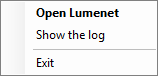

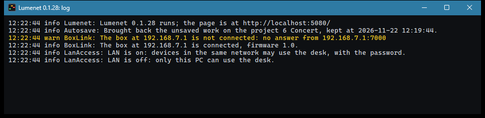

* Started, it opens the page in the browser (at http://localhost:5080, the desk program's own address) and
  sits in the notification area of the taskbar; Windows 11 may put the icon among the hidden ones, under ^. A
  click on the icon opens the page again. Its menu has **Open Lumenet**, **Show the log** and **Exit**.
* **Show the log** shows what the desk program writes, as its console would (there is no console): warnings
  in yellow, errors in red. The window can be closed (Esc or ✕) as often as wanted; only Exit ends Lumenet.
  The page itself has no output of its own here: it is built into the exe and comes from the desk program.
* Started again while it runs, Lumenet only opens the page. While the desk of `run.cmd` runs, it says that
  the port is taken and does not start: only one desk at a time may talk to the box.
* It keeps everything where the desk of `run.cmd` keeps it (the projects in My Documents, the autosave and
  the LAN password in `%LOCALAPPDATA%\Lumenet`), so both work on the same things. The examples are written to
  `%LOCALAPPDATA%\Lumenet\examples` at every start. Settings and the keyboard belong to the browser and the
  address: those of http://localhost:4200 are not those of http://localhost:5080 (Export and Import take
  them over).
* Settings are given as for the desk program, on the command line (`Lumenet.exe --Box:Host=127.0.0.1`) or
  in an `appsettings.json` beside the exe; `--Tray:OpenPage=false` starts it without opening the page.
* The exe is not signed: Windows may say that it does not know it (More info, then Run anyway), and the
  firewall asks once whether it may be reached from the network (for LAN).

## What is on the page

The top bar has eight links: **Main**, **Memories**, **Sequences**, **Stack**, **Stage**, **Fixtures**,
**Notes** and **Settings** (in this order until Settings gives them another). Main is the desk itself. Memories shows what is stored, and changes it with a double click. Sequences and Stack
are for the two things that run by themselves (see below), Stage shows the lights of the rig in their colors,
Fixtures plays them as fixtures, Notes holds the instructions for the show, Settings is
for how this device shows the desk and for its keyboard shortcuts (see [Settings](#settings) and
[Keyboard](#keyboard)). Under the name the
top bar says how many boxes answer (a click opens their window, see [Universes and boxes](#universes-and-boxes));
beside it stand **LAN**, **Undo** and **Redo**, at the right the keys of the project. At the right of Main the
**Stack** lies across the top, and under it stand three columns: the **Master** section (Black out and the
master fader with its level) over **Record**; the **General** section (Clear, Solo up, Solo down, Rate, the
tempo fader with the tempo on top, and Tempo under it); and at the right edge the **Independents** (unless Settings shows none of
their keys). On a phone the master section, the general section and the stack lie across the top, one line
each.

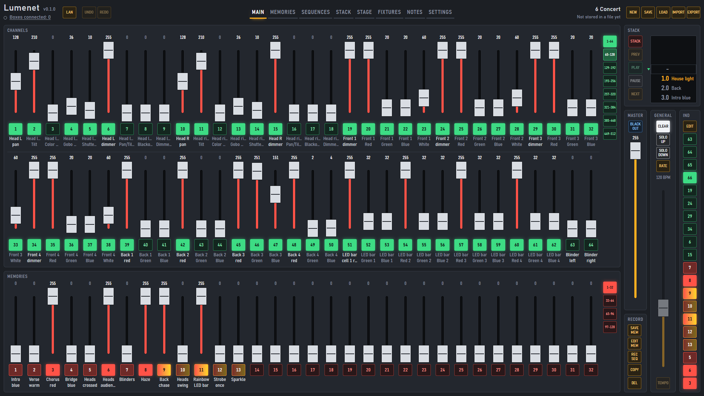

* **Channels:** two rows of faders (or one, as Settings says). The keys at the right choose which of the 512
  channels of a universe they show. When they do not fit into one column, they get flatter, and then they go
  on in another column beside it. In a project of several universes a key for each, U1, U2 and on, stands
  above the faders and chooses the universe (see [Universes and boxes](#universes-and-boxes)).
* **Memories:** one row of faders (or two), with page keys for the 128 memories. A memory holds a look:
  the levels the channel faders were set to at the moment it was saved. Its fader plays that look at the
  fader's level. For every channel the highest value wins, whether it comes from the channel fader or from
  a memory.
* **A memory fader moves the channel faders it uses.** A channel fader shows what goes out for its channel
  (before the master): its own level, or what the memories give it when that is higher. The slot is lit green
  up to the fader's own level and red above it, where a memory holds the channel. The own level is kept:
  bring the memory down, and the fader goes back to it. While a memory holds a channel up, its fader can
  still be moved; the handle stays where the memory holds it, and the green part shows what you set.
  Save mem stores the faders' own levels, not the part a memory adds.
* **Keys under the faders:** a press puts the fader to full, and back to zero when it is at full already (a
  fader somewhere between goes to full). It works the fader's own level: a channel that a memory holds at
  full still goes to full by its key. While a record key waits for a memory, the memory keys are for that
  (see Record); while a sequence is recorded, the channel keys put in steps. A channel key is lit when the
  channel is above zero. A memory key is half lit when something is stored in it and fully lit when its
  fader is up. A page key is fully lit for the page that is shown and half lit for another page with
  something on it.
* **Notes:** under each key are two lines to type into: which light or which look it is (11 characters per
  line). Each line stays where it was typed; the second can be used without the first.
* **Record** (under the master section) has Save mem, Edit mem, Rec seq, Copy and Del: press one, and the
  keys that can be used blink between their normal light and full.
  * **Save mem:** press a memory key, and the channel faders are stored there as a look.
  * **Edit mem:** press a memory that holds a look, and it is loaded into the channel faders. Change it, press
    Edit mem again, and it is stored back. A memory that holds a sequence does not blink: it is changed in
    the Sequences view.
  * **Rec seq** records a sequence key by key. Press it, then the memory for the sequence: an empty one, or
    one that holds a sequence already, which is then continued behind its last step. From then on every
    channel key, and every key of a memory that holds a look, puts in one more step: that channel or memory
    at full, with 1 second up, 1 second wait and 1 second down. A key shows the numbers of the steps it is in,
    small and yellow in its top left corner (the same channel can be used several times: 1, 5, 14). The keys
    of the Fixtures view put in steps of their fixture or group, in the color it shows at that moment.
    Press Rec seq again when the sequence is complete. A new sequence is played in a loop.
  * **Copy:** press the memory to copy from, then the memory to copy to. A sequence is copied like a look.
  * **Del:** press the memory to empty, whatever it holds.
  * Pressing the lit function again cancels it.
* **Clear** cancels an unfinished function and brings every channel fader and memory fader to zero.
* **Black out** darkens every light but leaves the desk as it is; the key blinks while it is active. The
  attributes of the fixtures of the stage plan (a pan, a tilt, a wheel) stay as they are, so no moving head
  moves. The blackout button on the box darkens the box itself, pan and tilt too; the desk shows it, and
  Black out switched off on the desk switches that off as well.
* **Master** dims the light, not the attributes of the fixtures.
* **Solo up** and **Solo down** (white, in General under Clear) change what a key under a fader or of the
  independents does while it is held; so does its shortcut. Lighting one darkens the other.
  * **Solo up:** the key puts its fader to full and every other light goes dark: only that channel (or that
    memory's look or sequence, at full) shines. Let go, the fader is back where it was and every light as
    before.
  * **Solo down:** the key takes only its own fader down, to zero; every other light stays. A channel goes
    dark even where a memory holds it up. Let go, it is back.
  * A solo changes what goes out, like Black out: the other faders do not move. The master still dims what a
    solo lets out, and Black out still darkens it. Several keys can be held at once; a key held on a phone
    counts for the whole desk, and the desk lets it go if that phone loses its connection. While a record
    key waits for a memory, the memory keys are for that, and while a sequence is recorded the channel keys
    put in steps, as always. Both dark again: the keys switch on and off as before. A solo is for the light:
    the key of an attribute of a fixture (a pan) does nothing while one is lit.
* **Rate** (in General, under Solo down) is a tempo for the sequences, in beats per minute (BPM). Dark,
  every sequence plays its own times; lit, every sequence takes one step per beat of the tempo. The steps
  of a sequence keep their proportions (on average a step, its fade and its wait, lasts one beat), and its
  own speed counts the steps of a beat: ×2 takes two steps per beat, ×0.5 one every two beats. The fader
  under the key sets the tempo, from 30 BPM at the bottom to 300 at the top in whole beats, with a line at
  120; the tempo stands on top of the fader (120 BPM), and a double click puts it back to 120. While Rate is
  dark the fader is dim; it can still be set, for the next time. A sequence goes on from where it is when
  the tempo changes. Like the master fader, the tempo is not saved with the project, and the other pages see
  it at once.
* **Tempo** (under the rate fader, only while Rate is lit) is tapped in time with the music: from the second
  tap on, the tempo is the beat of the taps, the average of the last four beats, and the fader moves to it.
  A pause of more than two seconds starts the count afresh. Its shortcut taps as well.
* **Undo** and **Redo** (top left) take back the last change of what the project holds, and make it again:
  storing, copying and emptying memories, sequences and their speed, the steps of the stack, notes and the
  channels and memories of the independent keys. Their tooltip says what they would do, for example "Undo
  storing memory 5", and the top bar says what they did. The faders, Clear, the master and the settings are
  no steps; changes of one kind in quick succession (the moves of a speed fader) are one.
  Up to 100 steps are kept, for the whole desk, whichever device made a change. Loading a project, a new
  one and an import start afresh, and while the stack is live they are locked. Ctrl + Z and Ctrl + Y are
  their shortcuts until the Keyboard panel of Settings gives them others.
* **Stack** (across the top of the three columns at the right) is the stack at hand on Main: its keys stand
  in a column at the left, over the master section. Stack takes it live, Prev, Play, Pause and Next go
  through it, as on the Stack view. Beside the keys, over the other two columns, stands a wheel of the
  stack's steps, each number with its note beside it (the note under the fader of its channel or memory, the
  name of its fixture or group, or for a step without one what it is, "Channel 5 (U1)"): the one that is on
  in the middle (green, with an arrow beside it, at the height of Play), the step before it above (blue),
  the one Play goes to below (yellow), the others grey, their numbers about half as high as a key is wide
  (15 to 22 pixels, times the lettering of Settings). It shows 3 steps, or 1, 5, 7 or 9 as Settings says,
  and rolls on when another step comes on. The stack goes round, and so does the wheel, but a step stands in
  it once only. While no step is on, the middle is empty and the step Play goes to stands under it. On a low
  window the keys of the column get flatter and the wheel shows fewer steps, always the one that is on.
* **The whole screen:** Stack, pressed to take the stack live, puts the page on the whole screen of this
  device, and pressed again to switch it off, takes it back (also on the Stack and Stage views, and with its
  shortcut). Esc leaves the whole screen at any time; the stack stays live. A stack switched on or off on
  another device leaves this screen as it is.
* **Independents:** keys in a column at the right edge, under the stack: green ones for channels and
  red ones for memories, ten of each unless Settings says otherwise (0 to 32 of each; with none of either
  the column is left out). A green key switches
  its channel between zero and full, and that channel's fader follows; a red key does the same with the fader
  of its memory. The keys start on channels 1, 2, 3 ... and memories 1, 2, 3 ... Press Edit there, type
  other numbers onto the keys (a channel of another universe as 113 U2), and press Edit again. In a
  project of several universes a green key shows its channel's universe under the number. A green key is lit when its channel's own fader is up (a
  memory that holds the channel does not light it); a red key is lit like the key under its memory's fader,
  and runs from red to yellow for a sequence. Keys that do not fit into the column go on in another one.

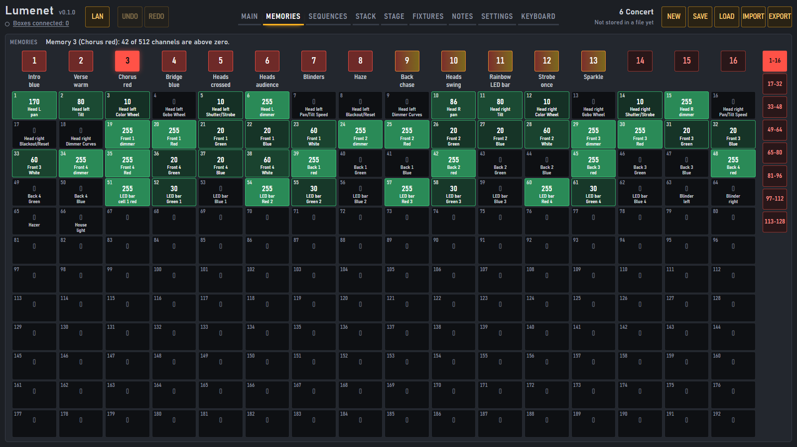

* **The Memories view** shows what is stored. The memory keys along the top choose a memory, each with the
  two lines of its note under it, and the table under them shows the level that memory holds for each of
  the 512 channels of a universe (the channel's number small in the corner of its cell), with each channel's
  note under its level, in rows of 32 (16 in a narrower window); in a project of several universes, U keys
  beside the title choose the universe (half lit where the memory gives a channel a level). All cells have
  the same size: when channels have notes, every cell keeps room for two lines of one. The page keys at the
  right choose which memories the keys show. This view and the Sequences view go by the window only: what
  Settings says about Main does not change them. Choosing a memory changes nothing.
  * **A double click changes it.** On the note under a memory key: two lines to type into, as under a fader
    on Main (here and on the Sequences view). On a cell of the table: fields over the cell for the level
    the memory gives that channel (0 to 255) and, under it, the two lines of the channel's note; the one
    double-clicked has the cursor. Enter, or a click anywhere else, keeps what was typed; Esc changes
    nothing. An empty memory gets a look with that one channel; the level of a memory that holds a sequence
    is changed on the Sequences view, so only the note can change here. Each change is a step of Undo, and
    while the stack is live nothing changes.

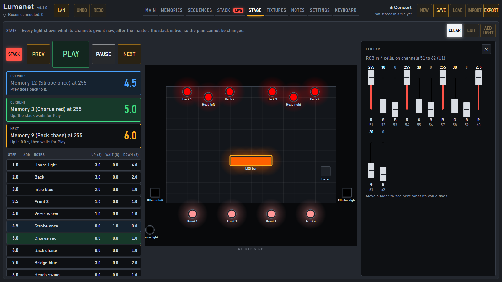

* **The Stage view** is a plan of the stage seen from above, for programming without the rig: a grid of
  squares (16 by 10 at first), the audience below it, and the lights of the rig on it, each in the color
  its channels give it at this moment, as it goes out: memories, sequences and the stack included, after
  the master, and dark during blackout. A light glows around itself, and where lights meet their light adds
  up. Every window shows the same desk, so the plan can stay open in a second window, on a second screen or
  on a tablet over LAN while you program on Main.
  * **The stack** stands at the left of the plan (under it on a phone), to run a show while the plan shows
    its lights: the keys of the Stack view (Stack, Prev, Play, Pause, Next), its cards Previous, Current and
    Next one under the other, each with the number of its step big at the right, and its steps with their
    notes and times, the current one green and the next one with an amber edge. When the list is longer
    than its room, it follows the stack: when the step that comes on or the next one is out of sight, the
    list scrolls so that the step before it stands at the top. Nothing about the steps can be changed there:
    the Stack view does that. The panel at the right is as wide as the stack, so the plan stands in the
    middle.
  * **Shutter and strobe:** a light whose shutter is closed is dark. A light that strobes flashes, as its
    strobe channel (S) says: a strobe flashes, a pulse swells and fades, a ramp rises or falls, and a random
    strobe flashes at uneven moments. A light of a library says in which range of its strobe channel it
    stands, and often how fast ("Strobe, 0.3Hz to 19Hz": by the place of the value in the range); a light
    of letters strobes above 9, slow to fast. The screen flashes as fast as the light up to 2 flashes a
    second, faster settings flash faster but never more than three times a second (more can set off a
    seizure in people with photosensitive epilepsy), and a mark over the light gives the real speed: ⚡ 13.3
    Hz, or ⚡ alone when the light does not say it. When the system asks for less motion, the mark alone
    shows it.
  * **The panel** at the right (under the plan on a phone) is always there, so the plan never changes its
    place or size. **A click on a light** shows it there: its name, its kind and its channels, and a fader
    for each of its channels (R red, D dimmer, ... under it, then the channel's number), colored as its
    channel is. They are the channel faders of Main: moving one there moves it here, and a memory that
    holds a channel up holds its fader up here too. A press beside the lights, Close or Esc lets the light
    go, and the panel says again what a click does. Its fields stand one in a row, the label at the left.
  * **A double click on a light** puts its faders to full, and the next one back to zero: those of its
    dimmer and its colors, not a strobe or a mode (of a device that gives no light: all its channels).
    **Clear** (top right) is the Clear of Main, with the same shortcut: it cancels an unfinished function,
    brings every channel fader and memory fader to zero and takes the stack off its step (a live stack stays
    live, and Play starts it at its first step again).
  * **Edit** (top right) places the lights: **Add light** puts one on the plan, on the channel after the
    last light, named after the note of that channel. Drag a light by its middle to move it (in half
    squares; the arrow keys move it too, with Shift by two squares; Delete takes it away), and by an edge
    or a corner to size it, in whole squares, with the edge across from it staying where it is; the cursor
    shows what a press does there. Click a light to change it in the panel, over its faders: its name, its
    address (first channel), its kind, its shape and size, and how it is turned (45° a step). While no light
    is chosen the panel sets the size of the stage and the picture under it. Lights can also hang beside
    the stage, behind it and over the audience.
  * **Shape and size:** a light is round (a circle, or an ellipse when it is wider than deep) or square (a
    square, or an oblong over several squares of the grid), 1 to 32 whole squares wide and deep. A square
    light lies with its edges on the lines of the grid (unless it is turned askew) and moves by whole squares.
    The size is not the cells: a bar four squares wide with one RGB cell turns all red with its red channel;
    with four cells, each quarter has its own color. Cells lie along the longer side.
  * **Picture:** a photo or a drawing of the stage under the grid and the lights (Edit, with no light chosen:
    Choose a picture). The page makes it smaller first (at most 1600 pixels on its longer side, as a JPEG),
    and the stage takes its proportions: its depth changes so that the picture fits. It lies under the stage
    or under the whole plan, shows through from 10 to 100 % (60 % at first), and Fit the stage to it and
    Remove the picture do what they say. It is saved with the project.
  * **Kinds of lights:** a dimmer of one color (you pick its color, like a gel; warm white until then),
    RGB, RGBW, RGBA, RGBWA, RGBW + UV and RGBWA + UV, each with or without a dimmer channel (first or last)
    and in 1 to 16 cells (a bar of four RGB cells is 12 channels from its address; each cell shows its own
    color), a device that gives no light (a hazer, a mirror ball: it shows the level of its channel), the
    channels typed as letters for any other fixture mode (D dimmer, R red, G green, B blue, W white,
    A amber, U UV, P pan, T tilt, and any other letter for a channel that gives no light, such as S for a
    strobe; a D dims the cell it stands in; one D in a light of several cells dims all of them), or a
    light **from the fixture library** (see the Fixtures view). **Limit** (1 to 100 per cent) and **Copy the
    light** are there too.
  * The plan belongs to the project: it is saved with it, and a project that is loaded brings its own. A
    new project, one from before plans and an imported show have an empty stage (no lights, no picture,
    16 by 10 squares). Changes of the plan are steps of Undo, and like everything stored the plan cannot be
    changed while the stack is live.

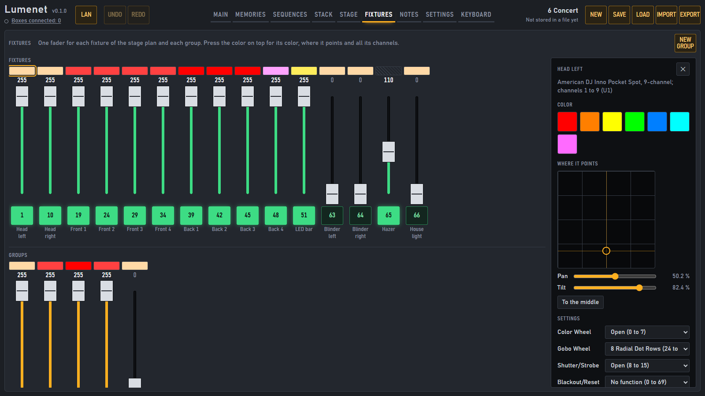

* **The Fixtures view** plays the lights of the stage plan as fixtures instead of loose channels. Each light
  has a strip, in the order of their addresses: its color on top, its intensity as a number and a fader,
  its key (to full, and to zero) and its note. The note is as the one under a channel fader on Main: two
  lines to type into, in white as typed; where nothing was typed, the name from the stage stands there,
  dimmed. The note belongs to the fixture (a group has its own too) and is saved with the stage plan; the
  name on the Stage view stays as it is. The fader moves its dimmer; a light without one, such as an
  RGB bar, keeps the mix of its colors, and comes up from dark in the color it had last (white at first); a
  moving head opens its shutter when it comes up. **Groups** stand under the fixtures, each with a fader that
  moves all its lights to its level, each in its own color; **New group** makes one of the fixture chosen,
  and its lights are ticked in the panel. Everything here moves the channel faders, so a memory saved
  afterwards holds it, and a memory that holds a light up holds its strip up too.
  * **The panel** at the right (under the strips on a phone) is always there; a press on the color on top
    of a strip shows that fixture or group in it. For a fixture: twelve colors and a field of every hue
    (white at the bottom) for a light that mixes its color, a white channel taking the white part of it; the
    colors of a moving head's color wheel; a pad for where a moving head points (pan across, tilt down; in
    16 bits with fine channels), with a slider for each that the keyboard moves too; a list for each channel
    that does several things (a gobo wheel, a shutter, a mode), each choice with its values, like "Open (32
    to 63)"; and the faders of all its channels. What the library says a channel does is there too, so its
    manual is seldom needed: the pointer on a fader's letter lists all its values ("0 to 31: Closed",
    "32 to 63: Open"), and under the faders a line says what the fader moved last does at its value
    ("S (8) at 32: Open (32 to 63)"); a screen reader hears it with the fader's value. A choice that comes
    more than once, like the four Opens of an ADJ strobe, is the same at other values: makers put steady
    light between the effects of a strobe channel. When a fixture gets a color, its shutter is opened at
    the first value of its first Open. For a group: its name, its lights and a color for all of them. The
    faders of a light, with their letters and the line under them, are the same in the Stage view.
  * **Moving heads:** a pan, a tilt, a wheel, a shutter and every other channel of a light that is not a
    dimmer or a color is an attribute. Latest takes precedence for it: the fader or the memory that took
    it last gives it, at the value it holds, not scaled by any fader. A channel fader takes its channel when
    it moves; a memory fader takes the lights its memory holds when it leaves zero (a look holds the lights
    it gives any level, a sequence those its steps use; the stack does it through the faders it moves);
    when it goes back to zero, the one that took them before gives them again. The master, Black out and a
    solo act on the light only, so a head stays where it points. Dimmers and colors still add up.
  * **The fixture libraries:** in Edit on the Stage view, the kind **From the fixture library…** searches two
    open libraries at once, each read from its copy on GitHub (the browser keeps their lists for a week):
    the Open Fixture Library (open-fixture-library.org, MIT license, about 670 lights) and the library of
    QLC+ (qlcplus.org, Apache 2.0 license, about 1,800 lights; its list is FixturesMap.xml). Each light of
    the list says which library it is from (OFL or QLC+); a model that is in both is there twice. The
    search finds every word in the maker and the model: ADJ finds American DJ, as the libraries still call
    it (HES and Claypaky work the same way), and a word may leave out spaces and dashes ("flatpro" finds
    Flat Pro). When a library cannot be reached, the list has the lights of the other and says so. The
    window shows the modes of the model chosen with their channels. The light gets the channels of the mode
    chosen, with their names and what they do at their values (wheel slots with their colors, a shutter
    that is open or closed: QLC+'s "shutter open" becomes a range called Open, which a step opens; a strobe
    keeps how fast and whether at random, like "Strobe, slow to fast" and "Random strobe"). The
    project keeps all of it, with the maker, the model, the mode and where the light is in its library,
    so the library is needed only while lights are set up. A light that is in neither is set up with
    letters, as before. **Copy the light** puts the next one of the same kind on the next free channels.
  * **Limit:** a light limited to, say, 60 per cent (a hazer) gives at most that: its dimmers and the
    channels of a device stop there, and the colors of a cell without a dimmer are dimmed together, so
    that the color stays.
  * On Main the note fields of a fixture's channels show, dimmed, what the plan says each channel is
    ("Spot 1", "Pan") where no note was typed; the lists of steps name the channels so too.

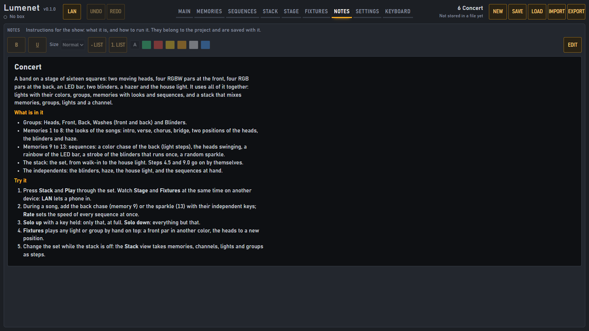

* **The Notes view** holds the notes of the project: instructions for the show, what it is and how to run
  it. They are read there; **Edit** (faint while off, full while on) makes them a text to write in, with
  the tool keys at the left: **B** (bold), **U** (underline), the **size** (small, normal, large, huge), a
  bulleted and a numbered **list**, and a **color** (the six colors of the desk, and **A** for the usual
  one). A tool key lights up when the text at the cursor has its mark, and works on the text that is
  chosen; Ctrl + B and Ctrl + U work as everywhere. Pasted text comes in as plain text. What is written goes
  to the desk program as soon as the typing rests, and when Edit goes off; every page shows it. The notes
  belong to the project: saved with it, a step of Undo (typing that goes on is one step), and locked while
  the stack is live. The page shows only those marks, whatever a file holds: anything else (a script, a
  picture, a link) is taken out, and its text stays.
* **Project:** New, Save, Load, Import and Export at the top right. A project is one JSON file in
  `Documents\Lumenet`. It holds the memories (looks and sequences), the stack, the notes under the faders
  and of the Notes view, the stage plan and what the independent keys are bound to, not the fader
  positions, so loading a project never switches a light on by itself. New empties the desk; it asks first.
  A project keeps 32 channel keys and 32 memory keys of the independents, however many the page shows. An
  older project keeps the keys it has (10 of each, or 16 channel keys from before there were memory keys);
  the others are where they are on a new desk. The layout, the colors of the keys and the shortcuts belong
  to each device, not to the project (see [Settings](#settings)); a project file of an earlier version that
  holds those of the PC is loaded without them, and Import can take them from it.
* **Autosave:** what is not saved yet is kept every five seconds in a file of its own on this PC
  (`%LOCALAPPDATA%\Lumenet\autosave.json`, the setting `Autosave:File`), and that file goes once the
  project is saved. If the desk program stops before that (a crash, Windows restarting, the window
  closed), it brings the work back when it starts: the project under its name and file, marked "not saved",
  and the top bar says so. Saving keeps it; loading the project again drops it. The faders are not brought
  back: a desk program that starts switches no light on by itself. Settings switches the autosave off and
  on and sets how often it keeps the work (see [Settings](#settings)).
* **Examples:** the Load window lists them under the projects. One opens as a project of its name, without a
  file: the example itself stays as it is, and Save asks for a name. Each has notes on what it shows and how
  to use it (the Notes view), and none brings settings or shortcuts. The first four show one thing each, the
  last two all of it together:
  * **1 Memories and the stack:** eight lamps of a small theatre, six looks in memories and a stack of nine
    cues, one of which goes on by itself.
  * **2 Sequences:** a row of six lamps, two washes and a blinder: a chase, a bounce, a random sparkle at
    1.5×, a sequence of memories, an intro that runs once and two slow breaths at 0.5×.
  * **3 Fixtures and the stage:** RGBW and RGB pars, an LED bar and a hazer, in three groups. The stack is
    made of lights and groups of the stage only, each step with its color; memory 1 holds a chase of light
    steps.
  * **4 Moving heads:** two moving heads from the fixture library (American DJ Inno Pocket Spot, 9 channels),
    a front wash and a hazer: positions with colors and gobos in memories, a swing between two of them.
  * **5 Theatre show:** the whole show of a small theatre on 17 channels: two red lights in a pot, a front
    wash, four blue back lights, a spot, an RGBW LED bar, a hazer, a mirror ball and the house light. Notes on
    every light and memory, ten looks, eleven sequences (every template, some made by hand and some recorded
    with Rec seq; in a loop, once and at random; at speeds from 0.5× to 2×), all twenty independent keys
    bound, and a stack of 14 steps with steps put in between (3.5, 4.1), waits that go on by themselves and a
    channel step for the hazer. Its stage plan lies over a drawing of the stage: a wooden floor, the back
    curtain, masking at the sides, a riser, the fire pot between its two red lights and tape marks.
  * **6 Concert:** two moving heads, front and back pars, an LED bar, blinders, a hazer and the house light,
    in five groups: looks and positions in memories, sequences of lights and of memories, and a stack that
    mixes memories, groups, a light and a channel.

  They are the files in `examples/`; the desk program takes them along when it is built, and the setting
  `Projects:Examples` names another folder for them.

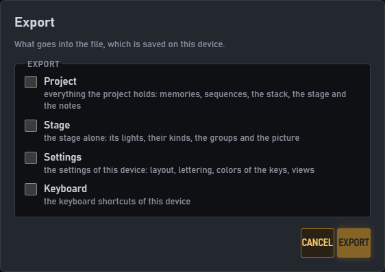

* **Export** puts parts of the desk into one file on this device: **Project** (everything the project holds,
  as its file has it), **Stage** (the stage alone: its lights, their kinds, the groups and the picture),
  **Settings** (those of this device) and **Keyboard** (its shortcuts). Each has a checkbox, none checked at
  first. Chrome and Edge on the PC ask where to save the file; other browsers put it among the downloads.
* **Import** takes parts back from such a file, here or on another device: the same checkboxes, none checked
  at first, then **File** and **Import**. It also takes a project file of the projects folder (its project
  and its stage). A project comes in place of the open one, as with Load, called after the file and not
  saved until Save; a stage comes in place of the project's stage (a step of Undo), and a step that played
  light 3 of the old stage plays light 3 of the new one; settings and shortcuts become this device's. When
  the file lacks a part that is checked, nothing is imported, and the window says which part. The window
  then says what came in. **.ASC** is the fifth checkbox, for the show of a theatre console, a file of its
  own, so it is taken alone (it unchecks the others): a file in the USITT ASCII format (`.asc`, up to 8 MB),
  the plain text in which consoles such as ETC Eos, Ion and Express, the ETC (AVAB) SmartFade or the Strand
  consoles hand a show on (on an Eos: File, Export, USITT ASCII; a SmartFade saves its shows in this format).
  It becomes the project, like Load replacing the open one, and the window warns when that has changes that
  are not saved and then says what came across and what was left out.
  * **Cues:** every cue of the first cue list becomes a memory with its look, and a step of the stack that
    brings that memory up: with the cue's number, its up time, and as down the down time of the cue after it
    (the stack takes the old step down while the new one comes up). A follow time becomes the step's wait,
    which counts from the moment the step is up. A cue in parts becomes one fade, as long as its slowest
    part; a delay is added to the fade time. A cue without a time fades in 5 seconds. A last cue that links
    to the first goes round, as the stack does; other links are left out.
  * **Submasters and groups** become memories too, after the cues, as long as memories are left. There are 128
    in all: what does not fit is left out, and the window says so.
  * **Patch:** the levels go through the file's patch onto the DMX addresses, which are Lumenet's channels;
    a file without a patch has channel 1 on address 1. The project gets as many universes as the highest
    address needs (address 600 is in the second), up to 8: addresses above 4096 are left out, and the window
    says so. The note under a channel names the console channel on that address ("Ch 7"; under it the share,
    if the patch gives less than 100 %).
  * **Notes under the memories:** the cue, submaster or group and the start of its label, like "Cue 4.5" over
    "Spot on the".
  * **Not taken over:** lines that only one maker's consoles understand (they begin with `$`: moving lights,
    effects, macros), cue lists after the first, and cue numbers the stack cannot have (more than one digit
    after the dot, or above 999.9): those steps get the next free number, and the note keeps the cue's own.
    Of cues, groups, submasters, sequence steps and labels the import keeps at most 10,000 of each kind, far
    more than a show has; a file with more is still read in well under a second.
  * **The fades:** as on the console, every light fades straight from its level in one cue to its level in
    the next: up in the up time of the cue, down in its down time. A light that stays on from one cue to the
    next does not dip.
  * **ETC SmartFade:** its files have a dialect of their own, and its show keeps its shape. Its memories become
    memories, in the order of their numbers, with a note like "Mem 25" over the memory's label. The steps of
    its stack bring those memories up, so a memory that several steps play is there once; only a step with
    levels of its own (a "state", a single channel) gets a memory of its own, and a memory that a step plays
    but the file does not hold stays empty, as on the console. Its sequences become memories that hold
    sequences: Loop and One Shot as on the console, Manual in a loop. A wait counts from the moment a step is
    up, as on the console, and a wait of 0 waits for Play. Its patch has the DMX address first; the labels of
    its channels become the notes under them, and its independents IND 1 and IND 2 get independent keys 1
    and 2. A percentage becomes a DMX value rounded up, as the console has it (17 % is 44).
  * `examples/Example theatre show.asc` is a short play for the lights of the example "5 Theatre show",
    written by hand to show all of this: a patch, a blackout, a cue in two parts with a delay, a storm whose
    cues follow on by themselves, a fade of 1:30, submasters and groups. Import it from the `examples` folder
    with .ASC checked.
* **LAN** (top left, beside the name) lets a phone or a tablet in the same network use the desk; see below.

## Universes and boxes

A universe is the 512 channels one DMX cable carries. A project has 1 to 8 of them (Settings, Universes; the
project keeps the number, and a project from before has one). The channels of every universe are numbered 1
to 512, as on the cable.

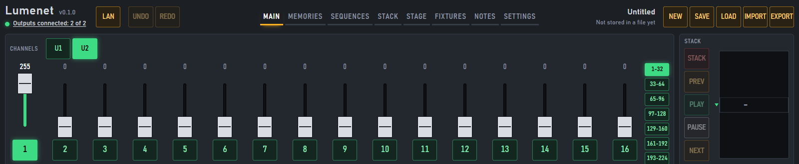

* **U keys:** in a project of several universes, a key for each stands above the channel faders: U2 shows the
  channels of the second universe, and the page keys are then its pages. The key of the universe shown is
  lit; another is half lit while a channel of it is above zero. The Memories view has U keys of its own.
* **Channel numbers:** every channel says its universe, "113 (U2)": in the lists of steps, on the Stage and
  Fixtures views, in the Memories view, in the messages of the desk and in what screen readers hear. The
  keys under the faders and the page keys print the number alone; the lit U key above them says the
  universe.
* **Typing a channel** (on a key of the independents, the address of a light): its number with the universe
  beside it, 113 U2, 113 (U2) or U2 113. A number alone stays in the universe the key or the light is in, so
  in a project of one universe the number alone is enough. The Template window has a list of the universes
  beside the channel numbers.
* **Fewer universes** are refused while a step of a sequence or of the stack, a light of the stage plan or a
  key of the independents uses a channel of a universe that would go; the top bar says which. The levels the
  memories hold there and the notes of those channels go with them; Undo brings them back.
* A light of the stage plan has all its channels in one universe: an address that would take it past the
  end of its universe moves it down until it ends there.

**The boxes.** A box has an output, a DMX socket, for each universe it sends, and says how many when the desk
finds it. The box with the Pico has one, at 192.168.7.1. A box with a number switch answers at 10.1.n.1 for
the number n on its switch, and the desk finds it by itself on the PC's network adapters.

* The top left says how many boxes answer: "Boxes connected: 2", or "Boxes connected: 2 of 3" when the
  project lists three. Its light is green while they answer, amber while a box of the list does not. The
  pointer on it says what each box plays. A click opens the **Boxes window**.

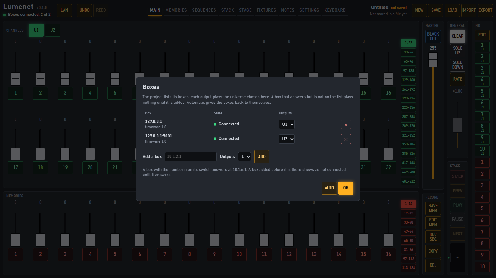

* **Automatic:** while the project lists no boxes, every box that answers plays by itself: the box with the
  Pico first, then the others in the order of the numbers on their switches, each output the next universe
  (U1, U2 and on). Outputs beyond the project's universes play none.
* **The project's list:** the first change in the window (another universe on an output, a box added or
  taken off) makes the boxes that answer the project's list, with what they play then and the change on top.
  From then on the project keeps which box plays which universe, also on another PC. Each output has a list:
  U1 to the project's last universe, or Off. Two outputs may play the same universe, as a splitter would.
* **Add a box** by its address (10.1.2.1) and its number of outputs, also before it is there: it shows as not
  connected until it answers. A box that answers but is not on the list is **new**: it plays nothing (its
  outputs send zeros) until **Add** puts it on the list. ✕ takes a box off the list. **Auto** empties the
  list: the boxes play by themselves again.
* The window says when a universe of the project reaches no cable (no box that answers plays it), and when a
  universe is on more than one output.
* The list is part of the project and its changes go into Undo. While the stack is live it cannot be changed.

## Sequences and the stack

### Steps

A sequence and the stack are both made of steps. A step stands for a channel, a memory, a
**fixture** or a **group** of fixtures (see the Fixtures view), has the value it brings that to (0 to 255),
and three times in seconds: **up** (from zero to the value), **wait** (how long it stays) and **down** (back
to zero when the next step takes over). The old step goes down while the new one goes up, and every light
moves straight from its level in the old step to its level in the new one: a light that both steps give at
the same level stays where it is, without a dip; one that rises follows the up time of the new step, one that
falls the down time of the old step (down to zero if the new step does not give it). A light at 120 in the old
step and 150 in the new one never goes below 120: it rises to 150 in the new step's up time. At 150 and then
120 it goes down to 120 in the old step's down time and stays there. The views show it the same way. A step played earlier
that is still on its way down, because its down time is longer than the steps after it, keeps its lights up
the same way, from where the newer steps have them. In the stack, a fader that both steps use moves straight
from the one value to the other in the new step's up time.

A step of a fixture or a group has a **color** too: the box before its name in the Notes column. A press on
it opens a window with the colors of the Fixtures view, the field of every hue, and White (no color): a press
or a drag there only chooses, the window shows the color chosen with its code, and **Use** gives it to the
step; Cancel or Esc leave the step as it was. Its value is the intensity of its lights: the dimmer,
and the colors mixing the step's color (a light without a dimmer mixes it at that level); a moving head's
shutter opens, and its color wheel turns to the slot nearest the color, at once. Where a head points stays
with the memories, which hold whole looks: a memory step does that. In the stack, a step of a fixture or a
group moves the channel faders of its lights. A step follows its fixture when the fixture gets another
address; a fixture that is taken off the plan leaves its steps doing nothing ("Gone").

In both tables the **kind** of a step says what it stands for: **Channel (U1)**, **Channel (U2)** and so on, one
for each universe of the project, then Memory, Fixture and Group; in the stack also **Release** (see the Stack
view). A channel step that is switched to another
universe keeps its number there (113 of U1 becomes 113 of U2). The **number** of a step is chosen from a list.
Each line of the list reads like `5: Front left`: the number, then the note that stands under that fader in
the main view (its two lines with a space between them); a fader without a note shows its number alone. For a
channel the list has the 512 channels of its universe; for a memory only the memories that hold something; for
a fixture every light of the stage plan, by its address (`18 (U1): Spot 1`, the closed field showing the
address), for a group every group (`G1: Back`).
The **Notes** column beside the number shows the note of the channel or memory the step uses, or the name
of the fixture or group. It is read there, not written: a note is changed under its fader. **Add step**
puts in a step like the last one, on the next channel, memory, fixture (by address) or group.

### The Sequences view

A memory can hold a sequence in place of a look; its key is then red running into
yellow. A sequence runs while the fader of its memory is up: it starts at its first step when the fader
leaves zero, and the fader dims what it gives, like a look. It moves no fader; the channel faders show what
it gives in red.

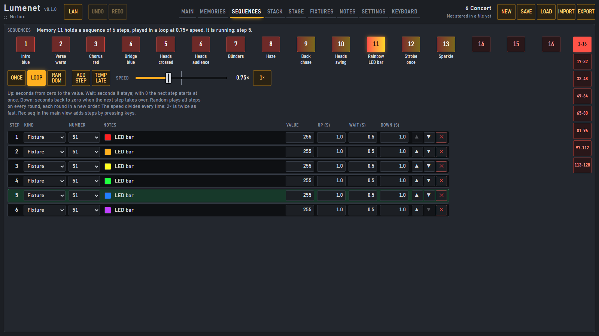

* Choose a memory with the keys along the top; the two lines of its note stand under each. Add step puts
  in a step like the last one, on the next channel or memory. Every change goes to the desk at once. Rec
  seq in the main view is the other way to put in steps: by pressing keys.
* **Once**, **Loop** or **Random:** played once, the last step stays on; in a loop the first step follows
  the last. Random loops too, but plays all steps on every round in a new order, so that a few steps never
  look like a loop (the same step never comes twice in a row between two rounds). A new sequence is played
  in a loop until you choose another.
* **Speed:** a lying fader above the table, with 1× in the middle: to the left down to 0.1× (ten times
  slower), to the right up to 10× (ten times faster), in steps of 0.05. It divides every time of the
  sequence, so 2× plays it twice as fast. A running sequence goes on from where it is; it does not start
  again. The 1× key puts it back. The arrow keys move it by 0.05 left of the middle and by 0.5 right of it.
  The speed is kept with the sequence in the project. While Rate is lit (Main, General), the sequence takes
  one step per beat of the tempo instead, and its speed counts the steps of a beat: 2× is two a beat.
* **Template** fills the sequence from a pattern, for the lights you name (channels like `1, 2` or `1-4`,
  memories, or the fixtures of a group, in the order of their addresses and in a color you choose). The
  steps it makes replace the old ones and can be changed in the table like any others.
  * **Fire:** every light flickers on its own, always between Low and High (now and then near Low, where a
    flame ducks), played at random. Low and High both at 255 give a steady full light.
    It looks best over a glow: set the faders of those lights to about 80.
  * **Chase:** one light after the other. **Wave:** each light swells and fades in turn; a single light
    breathes. **Strobe:** short flashes, light after light. For several lights at once, name a memory
    that holds them.
  * **Storm:** strikes up to High and faint flickers from Low, with dark pauses between, at random. The
    pauses are steps with the value 0: they give no light at all.
* A wait of 0 means the next step starts as soon as this one is up.
* A step that stands for a memory plays that memory's look. A memory that holds a sequence itself gives
  nothing there: sequences are not played inside sequences. So the list for a memory step offers only the
  memories that hold a look.
* A memory that holds a look is not turned into a sequence: empty it first with Del. Save mem over a
  sequence replaces it by a look; Copy and Del work on sequences as on looks; Edit mem does not.

### The Stack view

The project has one stack: a list of steps for a show. The stack moves the real faders:
going to a step moves the fader of its channel or memory up to the step's value, leaving it moves that fader
back to zero. A memory that holds a sequence starts running, because its fader goes up.

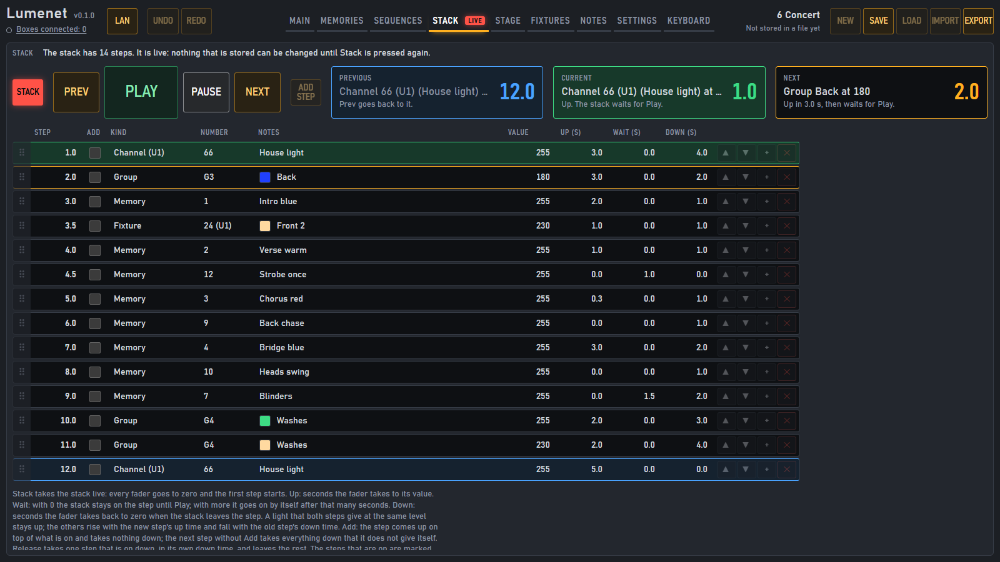

* **Stack** is the switch of the stack. Pressed, it is fully lit and the stack is **live**: every channel
  fader and memory fader goes to zero, and the first step starts. Pressed again, the stack stops and the
  faders stay where they are. While the stack is live, the link to the Stack view in the top bar carries a
  red **Live** tag, in every view.
* **While the stack is live, nothing that is stored can be changed:** not the steps of the stack, not a
  memory (Save mem, Edit mem, Rec seq, Copy and Del are locked), not a sequence, not a note, not the channels
  of the independent keys, and New and Load are locked too. The faders, the independent keys themselves,
  Clear, Black out, the master and saving the project work as always.
* While the stack is not live it does not run: Play, Pause, Next and Prev are dark. That is the time to
  change the steps.
* **Play** goes to the next step, or goes on after Pause. **Pause** holds a fade or a wait where it is.
  **Next** and **Prev** go to the next or the previous step at once, with the steps' own times.
* **The stack goes round:** after the last step comes the first, for Play, for Next and when the stack goes
  on by itself. Prev from the first step goes to the last.
* A wait of 0 means the stack stays on the step until Play. With a wait above 0 it goes on by itself that
  many seconds after the step is up.
* The view shows all steps, the **current** one in green, the **next** one with an amber edge, the
  **previous** one (the step before the current one, where Prev goes) in blue and every other step that is
  **on** (see Add) in a paler green, and for the current one how far it is. Over the table three cards say
  what the previous, the current and the next step are, each with the number of its step big at its right,
  in the card's color. Prev, Play, Pause and Next are bigger than the other keys of the desk, Play the
  biggest. Stack also puts the page on the whole screen (see Main).
* **Add** (the box after the step number): a step with Add comes up on top of what is on and takes nothing
  down. A step without Add takes down everything that is on and that it does not give itself, each in its own
  down time: the step before it and every step that added since. A light that both give stays where it is.
  For example: step 1.0 is the scene; step 2.0 is a special light, with Add: it comes up and the scene stays.
  Step 3.0 is the scene again, without Add: the special light goes down in its own down time, and the scene
  does not move.
* **Release** is a kind of step of the stack: it takes one step that is on down, in the release's own down
  time, and leaves everything else as it is. Its number is the step it takes down, chosen from the other
  steps of the stack (`2.0: Memory 5 (Special)`); it has no value and no up time, its wait counts as usual.
  In the example, a release of 2.0 as step 3.0 takes the special light down and leaves the scene, even when
  the special light is a sequence. A release of a step that is not on does nothing, and when the step it
  names is taken out of the stack, it names none. Where two steps that are on use the same fader, the later
  one's value counts; when it goes, the earlier one's counts again.
* **Prev** sets up the steps that are on as if the stack had come to that step from the top: from the last
  step before it without Add, through the steps that add. Round from the last step, the first one starts
  afresh, with nothing on under it.
* A fader the stack is moving and that you move by hand is yours from then on. Clear brings every fader down
  and takes the stack off its step; it stays live, and Play starts with the first step again.
* **Step numbers** look like 1.0, 2.0, 2.1. A new step gets the next whole number. Drag a step by its grip
  (or use the arrows at the end of its row): it gets the number of the step it now follows with the digit
  after the dot one higher, and the others keep theirs. Moved between 2.0 and 3.0, a step becomes 2.1.
  Type a number to change it: if another step has it, that one gives way (3.0 becomes 4.0, 3.1 becomes 4.1).
* **+** at the end of a row puts a new step right after that one: the step Add step would make after it
  (the next channel, memory, fixture or group, with the same times), numbered to fit there. After 2.0, with
  3.0 behind it, it becomes 2.1; if 2.1 is there already, that one gives way to 2.2.

## Screens, phones and tablets

### Window width

A window at least 1850 pixels wide shows 32 faders in a row, so 64 channels and 32 memories
at a time. A narrower window shows 16 in a row (32 channels and 16 memories) and twice as many page keys.
Settings can fix another number, and the rows, for Main. The page keys stand in a column at the right; when
they are too many for the height, they get flatter and then go on in another column.

### Small screens

In a window narrower than 900 pixels or lower than 600 pixels (a phone, a tablet held
upright) the sections stand under each other and the page scrolls. The page keys lie under the section titles,
in as many lines as they need. Narrower than 720 pixels, a row of 16 faders is shown as two lines of 8 and the
top bar as three lines (narrower than 430 pixels, its eight links stand in two rows of four). The numbering
does not change: a page is still 32 channels or 16 memories. Narrower
than 1300 pixels the top bar takes two lines, the links to the views under the rest. The limits are in
`frontend/src/app/desk/desk-types.ts`, and only there.

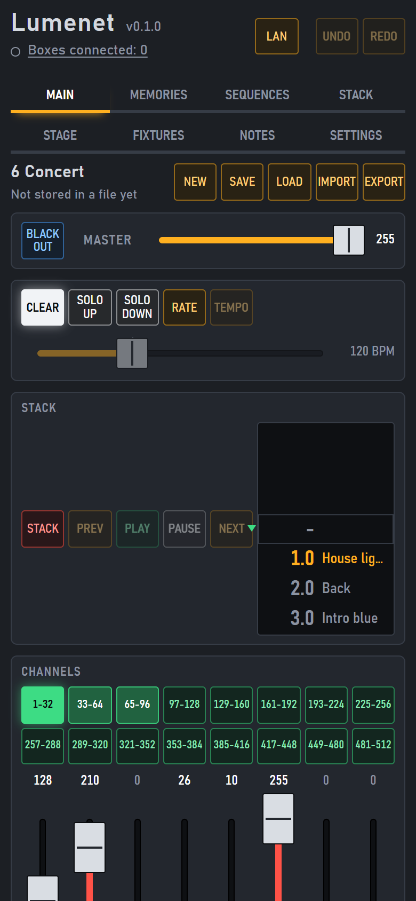

### A phone or a tablet (LAN)

The desk can be used from another device in the same network as the PC.

* Press **LAN** in the page on the PC. It is lit, and under the boxes a line appears with the address and
  the password, for example `LAN 192.168.1.20:5080 Password K7M2Q`.
* On the phone, open that address in the browser (`http://192.168.1.20:5080`). The page asks for the
  password once; the phone remembers it. Small letters and spaces do not matter.
* Press LAN again and it is off: every other device loses the desk at once, its connections are refused, and
  no password is shown. LAN is off whenever the desk starts. Only the PC can switch it; the page on a phone
  has no LAN key.
* The password has 5 letters and digits (no 0, O, 1, I or L, which are easily mixed up). It is made once and
  kept in `%LOCALAPPDATA%\Lumenet\lan-password.txt`, so a phone that knows it gets in again next time.
  Settings can type another one (5 to 20 letters and digits) or make a new one; delete that file for a new
  one too. Every phone then has to give the new password, and the connected ones lose the desk.
* When the PC is in more than one network (a cable and Wi-Fi), Settings can choose the address that phones
  use: the desk then lets devices in at that address only. Without a choice it lets them in at every address
  and shows the first. A chosen address that the PC no longer has (the router gave it another one) counts as
  no choice until it is back. The choice is kept in the same file.
* A phone is remembered by a cookie that holds a long random key, not the password, so the cookie cannot be
  guessed. Guessing the password is slowed down instead: after 5 wrong passwords within a minute a device
  has to wait, and after 20 from all devices together every device has to wait. So someone in the network
  who keeps sending wrong passwords can stop a new phone from getting in; a phone that got in before is not
  asked again, and the PC never needs the password.
* The first time the desk program starts after this change, Windows asks whether `DmxBox.Server` may use the
  network. Allow it for **private** networks only. If that window was closed with "Cancel", Windows blocks the
  program; then allow it under Windows Security, Firewall, "Allow an app through firewall".
* The phone gets a built copy of the page from the desk program (port 5080). `run.cmd` builds that copy when
  the page's files have changed since the last time; while the desk runs, `npm run build` in `frontend`
  brings it up to date. The PC itself keeps using http://localhost:4200, which shows every change at once.

### Moving a fader

Drag the handle, or press in the slot to bring the handle there. The mouse wheel moves it
in steps of 5 (with Shift: 1). With the keyboard: the arrows, Page Up, Page Down, Home and End.
With a finger a fader moves only by its handle: a touch in the slot does nothing, so a thumb that scrolls the
page cannot move a light. In the small-screen layout the mouse wheel scrolls the page and leaves the faders alone.

## Settings

The settings and the keyboard shortcuts belong to the device: its browser keeps them, every project shows
them, and a project that is loaded leaves them as they are. **Export** takes them to another device, and
**Import** brings them from one (see above). The number of universes belongs to the project, the autosave and
LAN to the desk program.

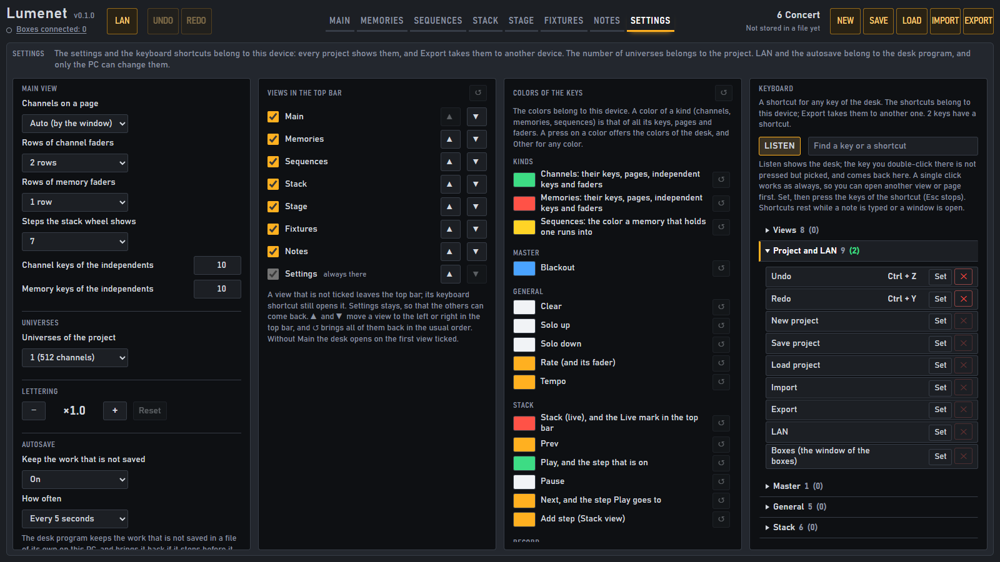

Settings has four panels side by side, as many as the window has room for, each as high as the window
lets it be and scrolling where it holds more: **Main view** (with the universes, the lettering, the
autosave and the network under it), **Views in the top bar**, **Colors of the keys** (one under the other)
and **Keyboard** (see [Keyboard](#keyboard)).

* **Channels on a page** (Main): Auto (a row of 32 or 16 by the window, as above), or 8, 16, 32, 64 or 128.
* **Rows of channel faders** and **rows of memory faders** (Main): 1 or 2 of each, at first 2 and 1. A
  channel size is spread over the rows of channels, and a row of memories is as long as a row of channels:
  with 8 in two rows, rows of 4, and 4 memories on a page, so 64 channel pages and 32 memory pages. The two
  sections share the height in the proportion of their rows. The faders keep the width the window gives
  them; when the rows are then wider than the window, they scroll sideways, the channels and the memories
  each on their own, with a big scrollbar. The Memories and Sequences views keep the rows of the window.
* **Steps the stack wheel shows** (Main): 1, 3, 5, 7 or 9; at first 7. (A browser that kept its settings
  before 7 was the first keeps the 3 it had; choose 7 here once.)
* **Keys of the independents:** how many green keys and how many red keys the column shows, 0 to 32 of each;
  with 0 of both, Main has no independents.
* **Universes of the project:** 1 to 8, of 512 channels each (see [Universes and boxes](#universes-and-boxes)).
  The project keeps it, and the list shows the project's number until the desk program has taken a new one.
  Locked while the stack is live.
* **Lettering:** the minus and plus keys make all lettering of the page smaller or bigger, from ×0.7 to ×1.5
  in steps of 0.1, numbers on keys too. The keys keep their size, so words on them grow by 15 % at most; a
  word too long for its key goes on in a second line, and so does a page range, after its dash (flat page
  keys then go on in another column sooner, so that the two lines fit).
* **Autosave:** On or Off, and how often: every 5 seconds (at first), 30 seconds, 1 minute or 5 minutes. Off,
  the desk program keeps nothing and takes away the file it kept. The desk program keeps the choice in
  `autosave-options.json` beside the autosave file. On the PC only.
* **Network (LAN):** while LAN is on, the address phones use and the password; see above. On the PC only.
* **Views in the top bar:** the views in the order of their links, each with a tick; a view that is not
  ticked leaves the top bar (its keyboard shortcut still opens it). Settings is always ticked, so that the
  others can come back. ▲ and ▼ move a view one place to the left or right in the top bar (the keyboard focus
  stays on the arrow), and ↺ beside the title brings every view back in the usual order. A desk without Main
  in its top bar opens on the first view that is. A view that came later than the order kept (Notes) stands
  after the view it follows in the usual order.
* **Colors of the keys:** a color for each kind (channels, memories, and the color a memory with a
  sequence runs into), which is that of all its keys, page keys and faders, and one for each other key, group
  by group: Black out; Clear, Solo up, Solo down, Rate (with its fader) and Tempo; Stack, Prev, Play, Pause, Next and Add step (Play also colors the
  step that is on, Next the step Play goes to); the keys of Record, of the top bar, Edit of the independents,
  the keys of the Sequences view, of the Stage view and of the Notes view. A press on a color opens the colors the keys have at
  first (green, red, yellow, amber, white and blue, the one it has ringed) to take one of them, and Other for
  any color; while that one is picked, the desk shows it at once. A press anywhere else, or Esc, closes them.
  Each has a key back to its usual color, and ↺ beside the title takes all of them back. At first Clear, Solo
  and Pause are white, Black out blue, Play green, Stack red and the others amber.

The keys that take something out, ✕ at the end of a step in the Sequences and Stack views and of a shortcut
in the Keyboard panel, are red.

## Keyboard

The Keyboard panel of Settings gives a shortcut to any key of the desk: the view links, New, Save, Load,
Import, Export, LAN, the boxes, Clear, Solo up, Solo down, Black out, Rate, Tempo, the keys of the stack and of
Record, those of the Sequences view and of the Stage view, Edit of the Notes view, Edit and every key of the
independents, every page key and U key, the key under every channel and memory fader, Undo and Redo. It lists
the channel keys and U keys of the project's universes; the shortcuts of the others are kept for a project
that has them. The shortcuts belong to this device, as the settings do. Undo and Redo have Ctrl + Z and
Ctrl + Y until they get others (or none: then they stay without). (Until 2026-11-24 the shortcuts had a view of
their own, Keyboard, with tabs; its address now opens Settings.)

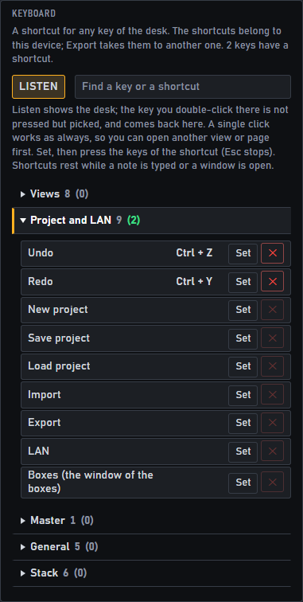

* The kinds of keys stand one under the other (Views, Project and LAN, Master, General, Stack, Record,
  Sequences view, Stage view, Notes view, Independents, Channel pages, Memory pages, Channel keys, Memory
  keys), each with the number of its keys and, in brackets, how many of them have a shortcut, in green:
  Stack 6 (4). A press on a kind opens its keys under it and closes any other: one is open at a time, and
  none at first; pressed again, it closes. The arrow keys up and down, Home and End go from kind to kind.
  The search field searches all of them: then each kind also shows how many of its keys it finds, in yellow,
  Stack 6 (4) 2; when the kind that is open finds none, the first kind that finds some opens, and when the
  search is emptied, the kind open before it opens again.
* The keys of a kind are listed at the left, their shortcuts at the right. **Set**, then press the
  keys of the shortcut (with Ctrl, Alt or Shift as wanted; Esc stops, Tab and Esc cannot be shortcuts). A
  shortcut that another key had moves over, and the page says so.
* Set tells the left Ctrl and Alt from the right ones ("Right Ctrl + B", "Left Alt + C"), and such a shortcut
  is pressed only with that side. A shortcut without a side (Ctrl + Z and Ctrl + Y of Undo and Redo at first,
  and every shortcut set before the sides were told apart) is pressed with either side; when a press fits a
  shortcut with a side and another without, the one with the side takes it. AltGr, the right Alt of many
  keyboards, counts as Right Alt (the Ctrl that Windows adds to it is left out); a shortcut set with AltGr
  before the sides were told apart shows Ctrl + Alt and still answers to it. Shift has no side, and a Ctrl
  or Alt that was already down when the page got the keyboard has none either: the page did not see which
  one went down.
* **Listen** shows the desk; the key you double-click there is not pressed but picked, and Settings comes
  back with its kind open in the Keyboard panel and the key chosen and scrolled into sight (Esc stops
  listening).
  A single click works as always, a moment later: it opens another view or page of faders, or presses the
  key, so the key to pick can be found first. Enter on a key picks it at once.
* A shortcut is the physical key, whatever letter the keyboard's language puts on it. It presses its key on
  the page as a click would, and a locked key stays locked; when the key is not on the view that is shown (a
  page of faders that is not shown, another view), it does what that key does, except the keys of the
  Sequences view and of the Stage view and Edit of the independents, which work only where they are. Shortcuts rest while a note
  or another field is typed into and while a window such as Load is open.
