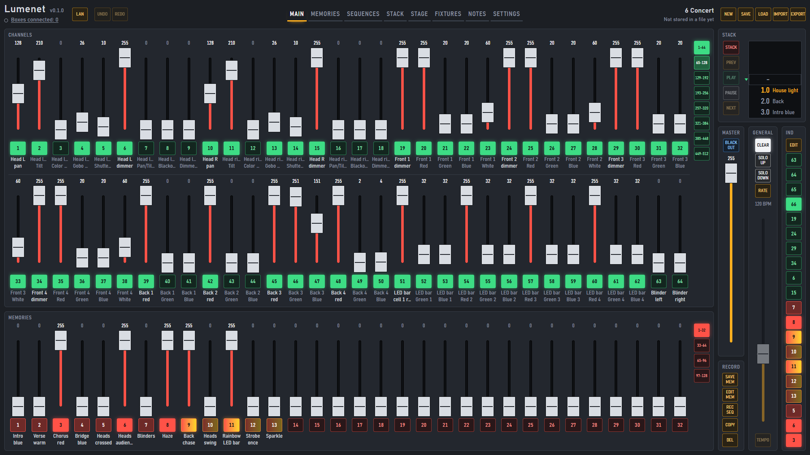
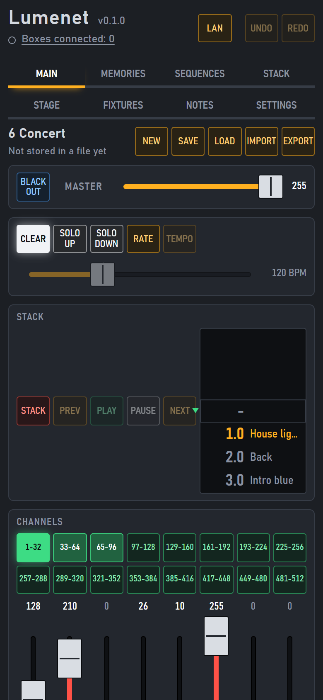
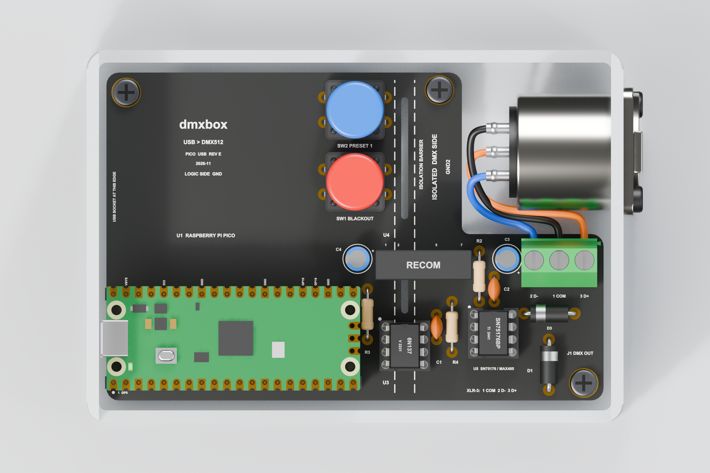

# Lumenet

A lighting desk in the browser, in the old style with faders, and **dmxbox**: a small box with a Raspberry Pi
Pico that takes what the desk sends over USB to the DMX512 cable of the lights.

## What it does

* **Faders for 1 to 8 universes** of 512 channels, a page at a time, and **128 memories**: looks stored from the
  faders, each with a fader of its own. Keys under the faders, independents at the side, a master, blackout,
  solo up and down, and a rate for everything that runs.
* **Several boxes at once**, each output playing a universe: by themselves, or as the project says. Besides
  the box, **Art-Net** nodes, **sACN** and DMX USB interfaces of the kind of the **Enttec DMX USB Pro** play the
  universes as well.
* **Sequences**, made by hand or from a template (chase, wave, strobe, fire, storm), and a **stack**: the cues
  of a show with their fades and waits, played one after the other.
* **Effects** worked out live from a shape: circles and swings of moving heads, chases and pulses, rainbows
  and color chases, and patterns over the cells of LED bars by where they are on the stage. Each has a key and
  a fader, live speed, size and spread, and a preview; on Main and in the stack too.
* **Fixtures:** lights by their kind, taken from the Open Fixture Library (666 lights) or the library of QLC+
  (1,781), played by intensity and color, moving heads by pan and tilt too; groups with one fader for all their
  lights.
* **Stage:** a plan of the rig with every light in its live color, a strobe flashing too.
* **Projects** in files, with notes for the show, undo and redo, and an autosave; export and import, also of the
  show files of theatre consoles (USITT ASCII).
* **Phones and tablets** in the same network can use the desk as well, with a password.
* **MIDI controllers** play the desk: their keys press its keys, their faders and knobs move its faders, and
  the desk lights their keys and moves their motorized faders. Learn maps a control in two presses; the Akai
  APC mini mk2, Korg nanoKONTROL2 and Behringer X-Touch Mini and Compact have ready-made mappings.
* A keyboard shortcut for every key, and settings for how each device shows the desk.
* **Seven example shows** to start from, from a few memories to a whole concert, and one of effects.

The desk also works without the box, on other DMX hardware or none. The box speaks Art-Net too, so other
lighting software such as QLC+ can use it.

## What it runs on

**The desk** runs on Windows 10 and 11 (64-bit), and its page in a current browser. With LAN switched on in
the page, phones and tablets in the same network can use it too: they get the same page, laid out for their
screen, and get in with a password.

**The box** is a Raspberry Pi Pico on a small board, with an isolated DMX output on a 3-pin XLR socket. One USB
cable powers it and carries the data. Windows sees it as a network adapter, so it needs no driver (tried on
Windows 11). It is built from through-hole parts, on a breadboard or soldered on a perfboard.

This is a render of the board's design; the boxes built so far are on a breadboard and on a perfboard.

A second box, **dmxbox 2**, has two DMX outputs (one in a smaller version), a USB-C socket and a switch on its
side that gives each box its own number, so that several work on one computer. It is drawn down to a perfboard
plan and EAGLE files, and its firmware builds, but it has not been built yet.

## Get it

**Download:** `Lumenet.exe` from the newest release on the [Releases](../../releases) page. It is the whole desk in
one file, with nothing to install. Start it: the page opens in the browser, and Lumenet sits in the
notification area of the taskbar, where its menu opens the page again, shows the log, and ends it. Windows may
say that it does not know the program, as it is not signed: More info, then Run anyway.

**From the sources:** with the .NET 10 SDK and Node.js 22, `run.cmd` starts the desk; then open
http://localhost:4200. `sim.cmd` starts a simulated box, Art-Net node, sACN receiver or USB interface for the
desk to play on, or a MIDI controller to play it with, without the hardware (see
[DEV.md](DEV.md#simulated-devices-simcmd)).

**The box:** the parts are in [BOM.md](hardware/pico/BOM.md). The schematic, the plans for a breadboard and a perfboard, and
the firmware, which is built with the Pico SDK and copied onto the Pico, are in [DEV.md](DEV.md#1-hardware).
For dmxbox 2: [its parts](hardware/pic32/BOM.md) and [its plans and firmware](DEV.md#dmxbox-2-the-pic32-box).

## More

* [MANUAL.md](MANUAL.md): every view, key and setting of the desk.
* [DEV.md](DEV.md): the box's hardware and firmware, the PC side, how the desk is built and tested, the DX
  protocol, and what has been tried so far.
