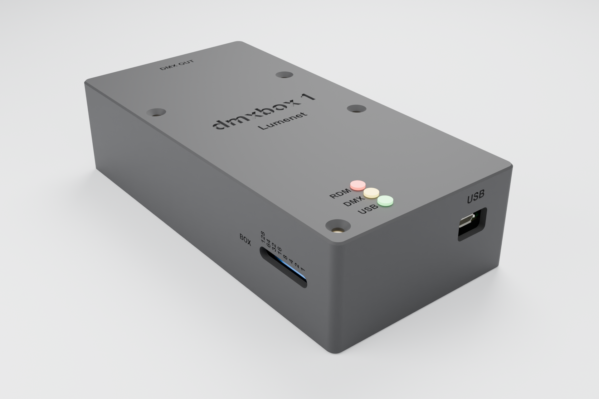
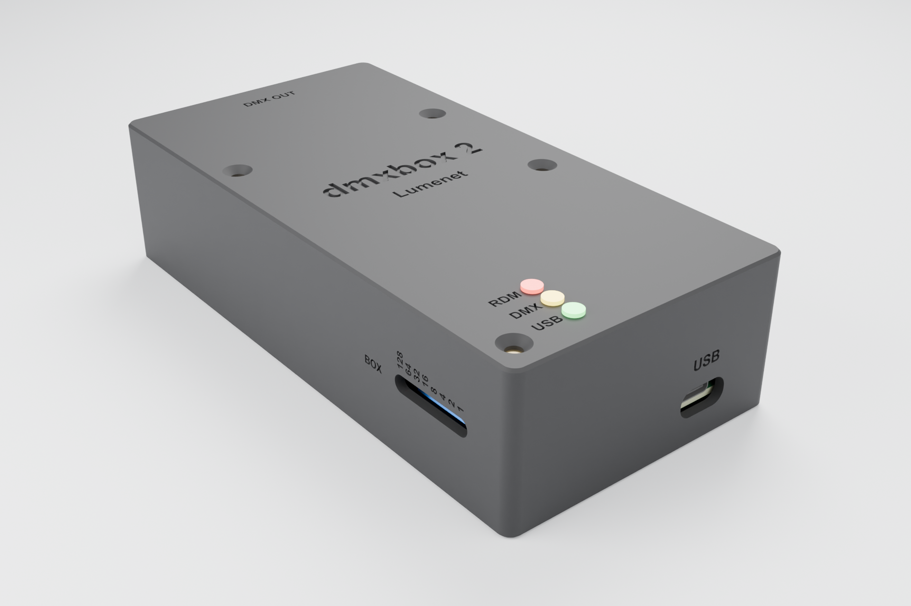
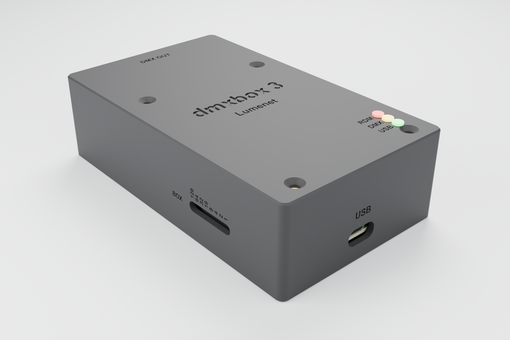
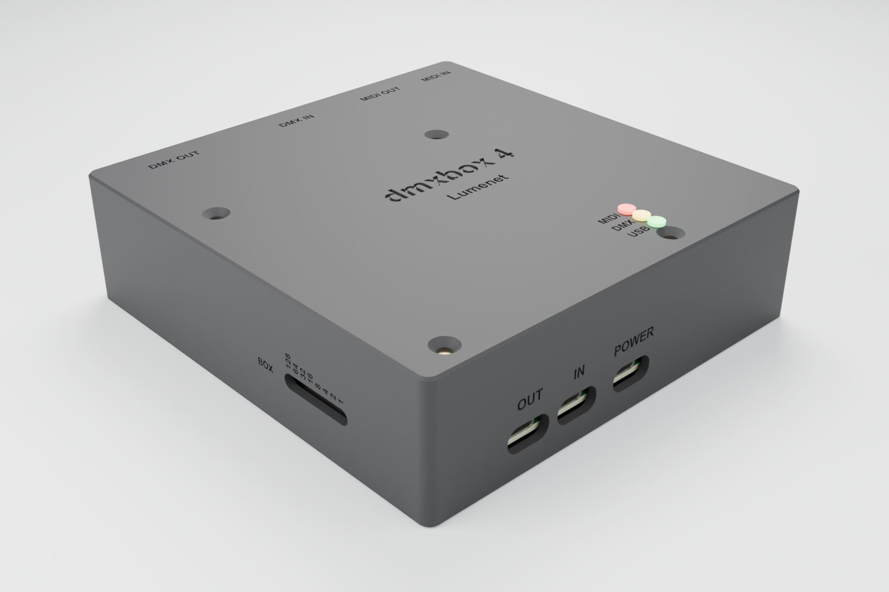

# Lumenet

A lighting desk in the browser, in the old style with faders, and **dmxbox**: a small box that takes what the
desk sends over USB to the DMX512 cable of the lights.

## What it does

* **Faders for 1 to 8 universes** of 512 channels, a page at a time, and **128 memories**: looks stored from the
  faders, each with a fader of its own. Keys under the faders, independents at the side, a master, blackout,
  solo up and down, and a rate for everything that runs.
* **Several boxes at once**, each output playing a universe: by themselves, or as the project says. Besides
  the box, **Art-Net** nodes, **sACN** and DMX USB interfaces of the kind of the **Enttec DMX USB Pro** play the
  universes as well.
* **Sequences**, made by hand or from a template (chase, wave, strobe, fire, storm), and a **stack**: the cues
  of a show with their fades and waits, played one after the other with GO, or at moments of the music;
  a cue sheet to print.
* **Effects** worked out live from a shape: circles and swings of moving heads, chases and pulses, rainbows
  and color chases, and patterns over the cells of LED bars by where they are on the stage. Each has a key and
  a fader, live speed, size and spread, and a preview; on Main and in the stack too.
* **Sounds:** music and other sounds from files, mixed by the desk program and played on a sound device of the
  PC, each with a key and a fader, its own level in decibels, fades, pan, speed, pitch, echo and reverb; a
  volume for all, MUTE and LISTEN on a second device; in the stack and in sequences, where a sound can play on
  through the steps after it until its end or a release. Beside them the tracks of the USB stick of a
  Soundcraft Ui mixer, played on the mixer's own player, its PLAYER channel the volume of all sounds and MUTE,
  both ways; the desk finds the mixer in the network by itself.
* **Fixtures:** lights by their kind, taken from the Open Fixture Library (666 lights) or the library of QLC+
  (1,781), played by intensity and color, moving heads by pan and tilt too; groups with one fader for all their
  lights.
* **Stage:** a plan of the rig with every light in its live color, a strobe flashing too.
* **Projects** in files, with notes for the show, undo and redo, an autosave, and backups into a folder that
  Google Drive, OneDrive or Dropbox syncs; export and import as one ZIP, and import of the show files of
  theatre consoles (USITT ASCII).
* **Phones and tablets** in the same network can use the desk as well, with a password.
* **MIDI controllers** play the desk: their keys press its keys, their faders and knobs move its faders, and
  the desk lights their keys and moves their motorized faders. Learn maps a control in two presses; the Akai
  APC mini mk2, Korg nanoKONTROL2 and Behringer X-Touch Mini and Compact have ready-made mappings. Other
  programs such as QLab and TouchOSC work the same keys and faders with **OSC**.
* A keyboard shortcut for every key, the usual ones from the start, and settings for how each device shows
  the desk, with a setup by the kind of show on the first start.
* **Ten example shows** to start from, from a few looks and cues to a whole concert, one of effects, two of
  sounds and one whose cues come on the music.

The desk also works without the box, on other DMX hardware or none. The box speaks Art-Net too, so other
lighting software such as QLC+ can use it.

## What it runs on

**The desk** runs on Windows 10 and 11 (64-bit), and its page in a current browser. With LAN switched on in
the page, phones and tablets in the same network can use it too: they get the same page, laid out for their
screen, and get in with a password.

**The boxes:** four dmxboxes bring the desk to DMX. Each is a USB network adapter for the computer, which
Windows, macOS and Linux take without a driver, and the desk finds it by itself. One USB cable powers it and
carries the data.

| |  [**Box 1**](boxes/box1/README.md) Pico |  [**Box 2**](boxes/box2/README.md) PIC32 |  [**Box 3**](boxes/box3/README.md) RP2040 |  [**Box 4**](boxes/box4/README.md) RP2040 |
|---|:---:|:---:|:---:|:---:|
| Isolated DMX output | ✅ | ✅ | ✅ | ✅ |
| RDM: sets up the lights | ✅ | ✅ | ✅ | ✅ |
| Number switch, for several boxes | ✅ | ✅ | ✅ | ✅ |
| USB-C | ❌ | ✅ | ✅ | ✅ |
| DMX IN: a console plays the desk | ❌ | ❌ | ❌ | ✅ |
| MIDI IN and OUT | ❌ | ❌ | ❌ | ✅ |
| USB OUT to the next box | ❌ | ❌ | ❌ | ✅ |
| POWER socket for a charger | ❌ | ❌ | ❌ | ✅ |
| Update firmware over USB | ✅ | ❌ | ✅ | ✅ |
| Assembly | THT | THT | SMD | SMD |
| Soldered by external company | ❌ | ❌ | ✅ | ✅ |
| Case | 3D printed | 3D printed | 3D printed | Aluminium or 3D printed |

The pictures are renders of the designs; none of the four has been built yet. The first box 1, a
Raspberry Pi Pico on a perfboard, was built and works with the desk.

## Get it

**Download:** `Lumenet.exe` from the newest release on the [Releases](../../releases) page. It is the whole desk in
one file, with nothing to install. Start it: the page opens in the browser, and Lumenet sits in the
notification area of the taskbar, where its menu opens the page again, shows the log, and ends it. Windows may
say that it does not know the program, as it is not signed: More info, then Run anyway. Later versions come
from the desk itself: Settings, About, says when one is out and puts it in place at a press.

**From the sources:** with the .NET 10 SDK and Node.js 22, `run.cmd` starts the desk; then open
http://localhost:4200. `sim.cmd` starts a simulated box, Art-Net node, sACN receiver or USB interface for the
desk to play on, or a MIDI controller to play it with, without the hardware (see
[DEV.md](DEV.md#simulated-devices-simcmd)).

**A box:** what to order and what to buy and fit yourself is in each box's BOM.md, for example
[box 4's](boxes/box4/BOM.md); the schematics, the boards and the firmware are in [DEV.md](DEV.md#1-hardware), and
all four boxes in [boxes/](boxes/README.md).

## More

* [MANUAL.md](MANUAL.md): every view, key and setting of the desk.
* [DEV.md](DEV.md): the box's hardware and firmware, the PC side, how the desk is built and tested, the DX
  protocol, and what has been tried so far.
