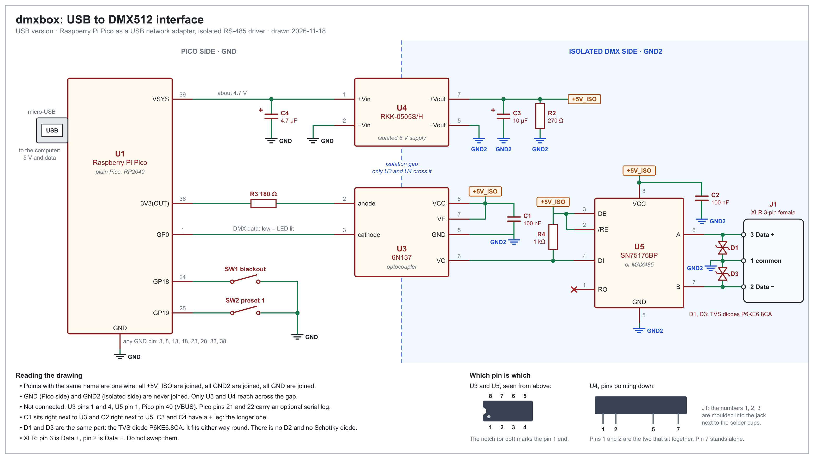
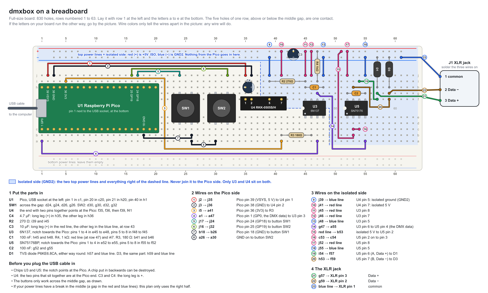
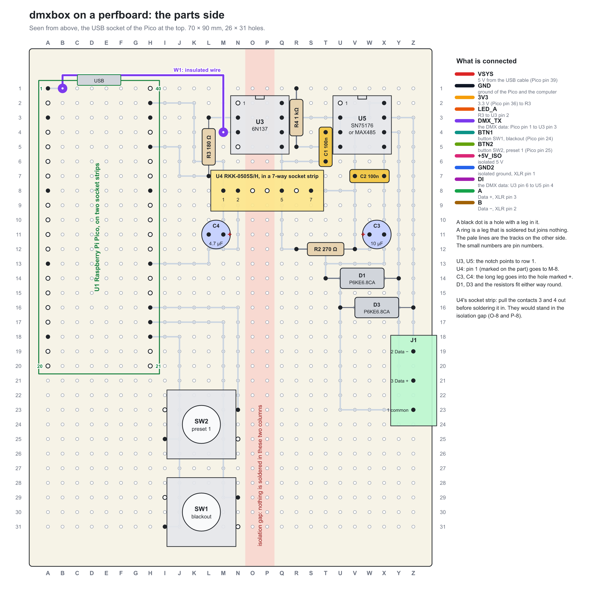

# Box 1 on a perfboard: the box with the Pico

The first dmxbox (2026-11-12 to 2026-11-26): a Raspberry Pi Pico in sockets, one DMX output (transmit only), the
Pico's own micro-USB and two buttons (blackout, preset). It was built on a breadboard and on a 70 × 90 mm
perfboard, and it works with a real light. Its firmware is in `firmware/archive/pico`; the desk still plays it at
192.168.7.1. This is what DEV.md said about it on 2026-11-26.

## 1. Hardware

Parts: see [BOM.md](BOM.md). Pictures: [top](3d/dmxbox_usb_top.png), [solder side](3d/dmxbox_usb_bottom.png),
[USB end](3d/dmxbox_usb_usb_side.png), [DMX end](3d/dmxbox_usb_dmx_side.png), [closed box](3d/dmxbox_usb_closed.png).

Schematic: [drawing](schematic-1-universe/dmxbox_schematic.png). To try the circuit on a breadboard first:
[breadboard plan](schematic-1-universe/dmxbox_breadboard.png). Both are in [one PDF](schematic-1-universe/dmxbox_drawings.pdf) for printing.
To solder it on a perfboard: [perfboard plan](#building-it-on-a-perfboard).

Tracks: the board is 100 × 66 mm and has every track on the solder side
([drawing](3d/dmxbox_usb_routing.png), [SVG](3d/dmxbox_usb_routing.svg)).

Everything with many pins sits in a socket (Pico, 6N137, RS-485 transceiver, DC-DC converter), so it can be
replaced. U5 can be an SN75176BP or a MAX485: same pins, same socket (see [BOM.md](BOM.md)).

The Pico sits at the left end of the board, with its micro-USB socket at the wall of the box. The cable plugs
straight into the Pico through an opening in the wall.

### Pin map

| Pico pin | GPIO | Connects to |
|---|---|---|
| 1 | GP0 | 6N137 pin 3 (LED cathode) |
| 24 | GP18 | Button SW1 "blackout" to GND |
| 25 | GP19 | Button SW2 "preset 1" to GND |
| 36 | 3V3(OUT) | R3 (180 Ω) to 6N137 pin 2 (LED anode) |
| 39 | VSYS | DC-DC converter U4 pin 1, and capacitor C4 |
| 23, 28, 33 | GND | Ground. The other five ground pins have no track: the Pico joins all eight itself. |
| 21, 22 | GP16, GP17 | Serial log (TX, RX, 115200 baud). No track; connect a serial adapter only if you want to read the log. |
| 40 | VBUS | Not connected |

All pins can be changed in `firmware/archive/pico/src/config.h`.

### Schematic (signal level)



The same in text:

```
              LOGIC SIDE (Pico GND)                   ║           ISOLATED SIDE (GND2)
                                                      ║
 USB 5 V ──►|── VSYS (Pico 39) ──┬── U4 pin 1 (+in)   ║   U4 pin 7 ── +5V_ISO ──┬── U3 pin 8 and pin 7
     (diode on the Pico)      C4 ┴ 4.7µ               ║   (RKK-0505S/H)         ├── R4 1k ── U3 pin 6 ──► U5 pin 4 (DI)
 GND (Pico 23, 28, 33) ──────────┴── U4 pin 2 (−in)   ║                         ├── U5 pin 8, pin 3 (DE), pin 2 (/RE)
                                                      ║                         ├── R2 270R ── GND2
 Pico 3V3 ── R3 180R ── U3 pin 2 (LED anode)          ║                         └── C1, C2 100n and C3 10µ ── GND2
 Pico GP0 ───────────── U3 pin 3 (LED cathode)        ║   U4 pin 5 ── GND2 ── U3 pin 5, U5 pin 5, XLR pin 1
 Pico GP18 ── SW1 ── GND                              ║   U5 pin 6 (A) ── XLR pin 3 (Data+)   and D1 to GND2
 Pico GP19 ── SW2 ── GND                              ║   U5 pin 7 (B) ── XLR pin 2 (Data−)   and D3 to GND2

 U3 = 6N137, U4 = Recom RKK-0505S/H, U5 = SN75176BP or MAX485
 D1, D3 = P6KE6.8CA, a TVS protection diode (both the same part, either way round)
```

U4 has seven pin positions, of which four have a pin: 1 and 2 on the logic side, 5 and 7 on the isolated side.

How the data path works: GP0 low lights the optocoupler LED, the 6N137 output goes low, the transceiver
drives the line low. An unlit LED means "line idle", so the line stays quiet while the Pico boots.
DE is tied high: the box only transmits.

Rules that matter:

* **A = Data+ = XLR pin 3, B = Data− = XLR pin 2**, pin 1 is the common. Swapping A and B is the most common DMX build mistake.
* **Never connect GND2 to the Pico's GND.** That would defeat the isolation. The Pico's ground is the
  computer's ground now, so the isolation is also what protects the computer from faults on the DMX line.
* **No 120 Ω terminator in the box.** The box is the start of the line. Terminate at the last fixture.
* Keep the logic and the isolated side apart on the board. Only the 6N137 and the DC-DC converter bridge the gap.
* DMX512 officially uses 5-pin XLR. Many fixtures have 3-pin; the wiring of pins 1 to 3 is the same.

### Building it on a breadboard



The picture lists every part and every wire with its holes. It is drawn for one full-size breadboard
(830 holes, rows 1 to 63). The circuit does not fit on a half-size board (400 holes).

* Lay the board with row 1 at the left and the letters a to e at the bottom. If the letters on your board
  run the other way, go by the picture.
* **The two power lines at the top edge are the isolated side:** red (+) is +5V_ISO, blue (−) is GND2.
  Nothing from the Pico goes into them. The two power lines at the bottom edge stay empty.
* The plan only uses the right half of the power lines, so it also works on boards whose lines have a break
  in the middle.
* The chips sit across the middle gap with the notch towards the Pico. U4 sits with its two close pins
  towards the Pico. The buttons only work across the middle gap.
* On the breadboard the Pico's ground comes from pins 38 and 18. Any ground pin will do: the Pico joins them.
* A breadboard keeps the two sides only one hole apart. That is fine for a test on the desk, but it is not
  the isolation the real board will have.

A safe order:

1. Put in the parts, but leave U3 and U5 out. Put in wires 1 to 20.
2. Plug in the USB cable. Between the red and the blue line there should be about 5 V (4.6 to 5.5 V).
   If not, unplug and check U4, C3 and wires 1, 2, 9 and 10.
3. Unplug. Put in U3 and U5. Solder three wires to the XLR jack and plug them in (wires 21 to 23).
4. Plug in again and measure with a multimeter (DC volts) from XLR pin 3 (red probe) to pin 2 (black probe).
   What to expect depends on the Pico:
   * **Without firmware** the line rests: pin 3 is 2 V or more above pin 2 (4.28 V on the first build).
   * **With the firmware** the Pico sends DMX all the time, and the meter shows the average of it. With all
     channels at 0 that is about −2.5 V (pin 3 *below* pin 2). Now set all channels to full, in
     PowerShell: `dmxbox set 1 (,255 * 512)`. The reading turns positive, about +3.5 V.
     `dmxbox set 1 (,0 * 512)` brings it back. If the reading follows like this, the whole path from the Pico
     to the jack works. If the signs are the other way round, Data + and Data − are swapped.
   * **A steady positive reading that never changes** although the firmware runs means the data does not
     reach U5. First press the Pico firmly into the board: one pin without contact is enough.
5. If the firmware is not on the Pico yet, [flash](#flash) it. Then go on with [Check that it works](#check-that-it-works).

The plan is checked by the script that draws it (`boxes/box1/perfboard/schematic-1-universe/draw.py`): every leg and wire end has a hole of
its own, and the holes joined by the board and the wires give exactly the connections of the schematic.

### Building it on a perfboard



The soldered version, on a 70 × 90 mm perfboard with 26 × 31 holes (lettered A to Z, numbered 1 to 31), the
kind where every hole has a solder pad of its own. If the pads of your board are joined in strips or in
groups, this plan does not fit it.

* [The solder side](schematic-1-universe/dmxbox_perfboard_solder.png) shows the tracks, as you see them with the board
  turned over.
* [The lists](schematic-1-universe/dmxbox_perfboard.md) give the holes of every part and every track from hole to hole.
* [One PDF](schematic-1-universe/dmxbox_perfboard.pdf) has both drawings for printing.

The 50 × 70 mm board (18 × 24 holes) is not used: the Pico alone takes 8 of its 18 columns and 20 of its 24
rows, which leaves too little room for the isolated side behind a gap.

How to read the plan:

* A hole is written with a dash: N-3 is column N, row 3. (C1, R3 or U4 without a dash are parts.)
* **Columns O and P stay empty from top to bottom.** That is the isolation gap. Everything left of it belongs
  to the Pico and the computer, everything right of it to the DMX line. Only U3 and U4 reach across.
* The Pico stands at the left edge with its USB socket at row 1. Everything with many pins sits in a socket.
* A track is a line of neighbouring pads joined on the solder side: lay a bare wire along them, or run solder
  from pad to pad. A pad in a track with no leg in it is just a place the track passes.
* One connection is an insulated wire (W1, from B-1 to M-4), because it has to get past the Pico's socket
  strip. Run it on whichever side you like.
* Each button has four legs. Its signal goes to one corner and ground to the opposite corner; the other two
  legs are soldered for a firm seat but join nothing. That works whichever way the button is joined inside.
* The screw terminal J1 has, from the top: XLR pin 2 (Data −), pin 3 (Data +), pin 1 (common).
* U4's socket strip has seven contacts, the converter only four pins. Pull contacts 3 and 4 out of the strip
  before soldering it in: they would stand in the gap (O-8 and P-8).

A safe order:

1. Solder the socket strips and sockets, then the resistors and diodes, then the capacitors, the buttons
   and J1. Mind the notch of U3 and U5 (towards row 1) and the plus leg of C3 and C4.
2. Join the pads track by track after the solder-side drawing, and tick each track off in the list.
3. Before anything is plugged in, test with a multimeter set to continuity. Every track must conduct from end
   to end. Tracks of different colors must not conduct to each other. **Nothing left of the gap may conduct
   to anything right of it.**
4. Plug in the Pico and U4, leave U3 and U5 out, and connect the USB cable. Between S-8 (plus) and Q-8 (minus)
   there should be about 5 V (4.6 to 5.5 V).
5. Unplug, put in U3 and U5 (pin 1 at the notch), wire J1 to the XLR jack, and go on with step 4 of the
   breadboard list above: the measurement between XLR pin 3 and pin 2.

How the plan is made: the places of the parts are chosen by hand, and `boxes/box1/perfboard/schematic-1-universe/perfboard.py` finds the
tracks. A separate check in the same script then confirms that the joined pads give exactly the connections
of the schematic (whichever way the buttons are joined inside), that every leg has a hole of its own, that
nothing reaches across the gap, and that no two parts stand in each other's way. Run with `--selftest`, the
script plants 19 mistakes (a missing piece of track in each connection, Data + and Data − swapped at J1, U5
turned round, a solder bridge, a track across the gap, and others) and confirms that the check notices each.

### Power

* **From the USB cable.** The box draws about 0.2 A (estimate: about 30 mA for the Pico and 100 to 150 mA
  into the DC-DC converter). A normal USB port gives 0.5 A. The box tells the computer it may take up to 0.3 A,
  so a port that only allows 0.1 A (an unpowered hub, some phones) refuses it.
* **While the computer sleeps** the box keeps drawing its normal current and keeps the DMX line going. Strictly,
  USB asks a sleeping device to draw almost nothing; computers do not enforce that.
* **Without a computer:** any USB charger or power bank. The buttons and the stored presets keep working.
* **Why U4 hangs on VSYS and not on VBUS.** VSYS is the USB voltage behind the Pico's own diode, about 4.7 V.
  U4 is not regulated: its output follows its input and rises a few percent when little current is drawn.
  Fed from VSYS, the isolated side ends up close to 5 V.
* **3.3 V:** the Pico's regulator only feeds the optocoupler LED (about 9 mA).
* **Isolated side:** R2 is a base load for U4. It keeps the output voltage from rising when the line is idle.

### Box

* The model's box is 108 × 75 × 38 mm outside (103 × 70 × 33 mm inside).
* The opening for the USB plug is 12 × 8 mm, so that the plug's plastic grip fits into the wall. The Pico's
  socket ends 0.2 mm short of the wall's inner face when the board's left edge is 1.5 mm from it.
* One of the four board screws is under the Pico, between its pin rows. Put it in before you plug the Pico in.
* The two buttons are on the board, inside the box. The lid in the model has no openings for them.

---

## 2. Firmware

### Build

You need the Pico SDK (2.1.0 or newer, with its TinyUSB submodule), an ARM toolchain (`gcc-arm-none-eabi`),
CMake, and Ninja or Make. It is built and tried with Pico SDK 2.3.1 and Arm GNU Toolchain 14.2.Rel1.

**Windows:** `firmware\archive\pico\build.cmd` does it in one step. It expects the tools in the folder `.pico-sdk` in your
user folder, laid out the way the VS Code "Raspberry Pi Pico" extension lays them out:

| Folder in `.pico-sdk` | What it holds |
|---|---|
| `sdk\2.3.1` | The Pico SDK from GitHub, with its submodule `lib/tinyusb` |
| `toolchain\14_2_Rel1` | Arm GNU Toolchain for Windows, from arm.com |
| `picotool\2.3.1\picotool` | `picotool`, ready-made in Raspberry Pi's `pico-sdk-tools` releases on GitHub |
| `tools\2.3.1\pioasm` | `pioasm`, from the same place |

CMake and Ninja are taken from the PATH, or from Visual Studio if it is installed.

**Linux and macOS** (this line has not been run yet):

```bash
cd firmware
mkdir build && cd build
PICO_SDK_PATH=/path/to/pico-sdk cmake ..
make -j
```

Both produce `build/dmxbox.uf2`; `build.cmd` also puts a copy into `firmware/archive/pico/`, next to `flash.cmd`. For a
Pico W or Pico 2 add `-DPICO_BOARD=pico_w` or `-DPICO_BOARD=pico2` after `build.cmd` or to the `cmake` line,
and start with an empty `build` folder. On a Pico W the LED stays dark.

### Flash

Flashing replaces whatever was on the Pico before, for example MicroPython and the scripts stored with it.

**Windows:** `firmware\archive\pico\flash.cmd` does it. It takes the `dmxbox.uf2` in its own folder, so the two files can
also be copied together to another computer. Start it, then unplug the box, hold **BOOTSEL** on the Pico and
plug the USB cable in again. It finds the Pico's drive by itself (if there are several, it asks which one),
writes the file, waits until the Pico has restarted and then until the box answers at 192.168.7.1, showing
each of the four steps as it goes. At the end it says whether it was successful and waits for a key.

**By hand:** hold **BOOTSEL** while plugging the Pico into USB. It mounts as a drive named RPI-RP2; copy
`dmxbox.uf2` onto it. The Pico then restarts by itself and the drive disappears. If the drive stays, wait a
few seconds and copy the file again.

### Configure

Edit `firmware/archive/pico/src/config.h`:

* The address of the box (default **192.168.7.1**) and the address it gives the computer (192.168.7.2)
* Art-Net universe (default 0)
* Number of channels sent per frame (default 512)
* Pins, and the button preset and fade time

### Check that it works

* **Plug it in.** A new network adapter appears on the computer and gets the address 192.168.7.2 from the
  box within a few seconds.
* **Ping:** `ping 192.168.7.1` is answered by the box.
* **Control:** `dmxbox ping` shows the firmware version and the state of the box (see [Command line](../../../DEV.md#command-line)).
* **Windows shows "This device cannot start (code 10)":** the firmware was built without the correction
  described under `usb_net.c` below. Build it from the current sources.
* **On-board LED:**

| LED | Meaning |
|---|---|
| slow blink (1 Hz) | Powered, but no computer attached (for example on a charger) |
| on | Connected to a computer, idle |
| flicker | Art-Net or control packets arriving |

There is no USB serial port any more. The log goes to the serial pins GP16 / GP17 instead.

### How it works

* **`dmx_tx.pio`:** a 9-instruction PIO program. It generates the break (176 µs), the mark-after-break (12 µs)
  and 250 kbaud 8N2 bytes, with exact timing and no CPU involvement. DMA feeds it the 513-byte packet.
  A full universe refreshes at **43 Hz**. Lower `DMX_CHANNELS` for a faster refresh.
* **`usb_net.c`:** makes the Pico a USB network adapter, using the USB library that comes with the Pico SDK
  (TinyUSB, class CDC-NCM). It only moves raw Ethernet frames between the USB cable and `net.c`.
  One question of the computer it answers itself instead of leaving it to TinyUSB: how the blocks of frames
  are laid out. TinyUSB up to 0.18 (the version in Pico SDK 2.3.1) gives numbers there that Windows has
  refused since an update of September 2026.
* **`dhcp_server.c`:** hands the computer its address, so nothing has to be configured by hand.
* **`net.c`:** the network stack, about 200 lines: it answers ARP and ping, and receives and sends UDP.
  The box never starts a conversation, so every packet goes straight back to where the request came from.
  No ARP cache, no gateway setting.
* **`engine.c`:** two layers, merged:
  * The **cue layer** is driven by the DX protocol and the buttons. Every channel has its own fade,
    computed in 16-bit at frame rate.
  * The **Art-Net layer** holds the last ArtDmx data.
  * `output = merge(cue, artnet) × master`, or 0 during blackout.
* **Merge modes:**
  * **HTP** (default): the highest value wins. The Art-Net look is *held* even if the PC goes to sleep,
    until you call `release-artnet`.
  * **Override:** Art-Net replaces the cue layer while packets keep arriving. After 3 s of silence, the
    cue layer takes over again.
* **Presets:** 16 snapshots of the current look, stored in the last 12 KB of flash with a CRC.
  They survive power cycles. While flash is being written, core 1 is paused safely (`flash_safe_execute`),
  and the DMX line just idles for about 150 ms, which the DMX standard allows.
* **Losing the computer:** as long as the box has power, it keeps outputting the last state. The buttons work
  without a computer: GP18 toggles blackout, and GP19 fades to preset slot 0 in 2 s.

> **The box's own master and blackout act on every channel.** That is right for dimmers and RGB PARs; with
> moving heads a blackout of the box also sends pan and tilt to 0. Lumenet therefore does its master and
> blackout in the levels it sends, on the light only (see the Fixtures view), and keeps the box's own
> master at full; the box's blackout is only that of its button.

### Testing the network code on a PC

`firmware\archive\pico\test\build.cmd` (Visual Studio C compiler) builds and runs a test program. It runs the real
network stack, the address server, the USB glue and the firmware's main program on pretend hardware, and
checks ARP, ping, UDP, DHCP, Art-Net and the control protocol, including damaged packets (198 checks). On Linux or macOS use the `cc` line at the top of `test_net.c`.
