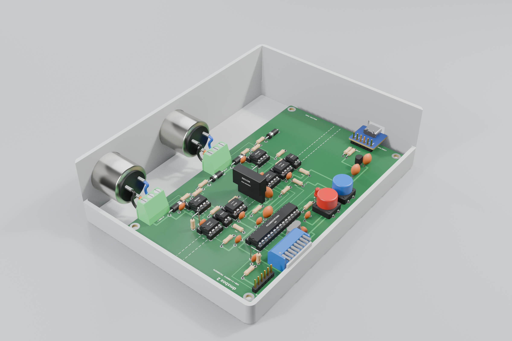
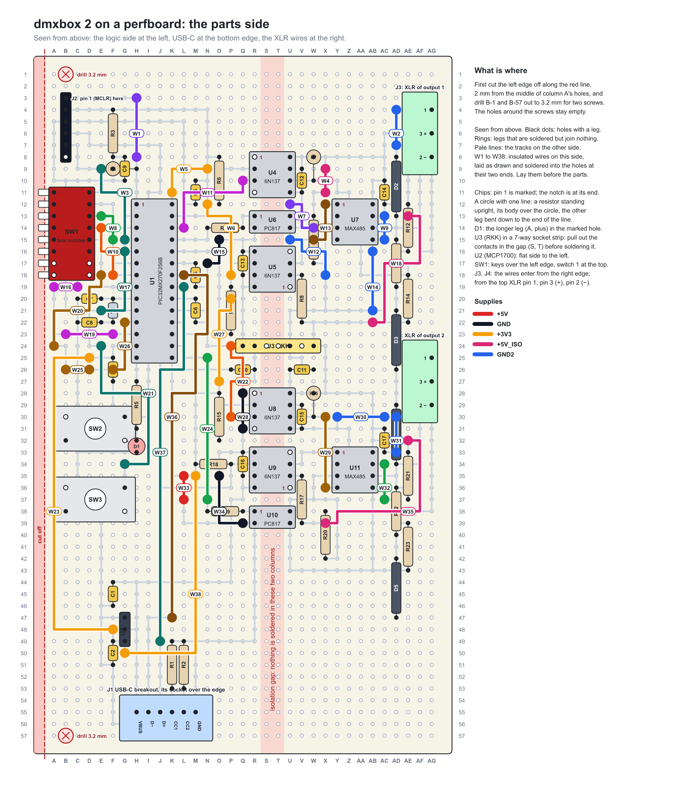

# Box 2 on a perfboard: dmxbox 2 with a PIC32

The PIC32 box as it was drawn on 2026-11-23, for a 90 × 150 mm perfboard, with one or two DMX outputs; it was
never built. Its firmware, compiled but never run, is in `firmware/archive/pic32`. [PRICES.md](PRICES.md)
prices it on a JLCPCB board. This is what DEV.md said about it on 2026-11-26; "the Pico box" is
[box 1](../../box1/perfboard/README.md).

## 1. Hardware



**Not built yet.** Everything here is drawn and checked by scripts, and the firmware compiles; none of it has
run on a real board. It comes in two versions with the same board design:

* **Two outputs** (two universes): `boxes/box2/perfboard/schematic-2-universes/`, files `dmxbox2_*`.
* **One output** (one universe): `boxes/box2/perfboard/schematic-1-universe/`, files `dmxbox2_1_universe_*`. The same
  box with output 2 left out (U8 to U11, R15 to R23, C15 to C17, D4, D5, J4): U1 pins 16, 17 and 18 stay free,
  and the firmware is built with `build.cmd 1`.

The box with the Pico has its drawings in `boxes/box1/perfboard/schematic-1-universe/`: each folder's name says how
many universes the box plays.

* **Chip:** a Microchip PIC32MX270F256B in a 28-pin DIP socket: 256 KB flash, 64 KB RAM, full-speed USB and
  two UARTs. It runs at 40 MHz from an 8 MHz crystal; USB gets its own 48 MHz from the same crystal.
* **Power:** from the USB-C socket, which sits on a small breakout board, about 0.25 A. U2 (MCP1700) makes the
  3.3 V of the chip; U3, the same Recom RKK-0505S/H as on the Pico box, the isolated 5 V of both outputs.
* **Two outputs**, each with its own XLR jack: box n plays Art-Net universes 2n and 2n + 1, and the desk
  gives its two outputs two universes.
* **Ready for RDM**, which the firmware does not speak yet: each output can also listen to the line, through
  a second optocoupler, and the chip switches the line driver between sending and listening.
* **The box number:** switches 1 to 6 of SW1 give the box its number n and its address 10.1.n.1
  ([BOM.md](BOM.md#the-box-number)). The desk looks for the boxes by itself. SW1 is a piano
  DIP switch with long keys (ONPOW DPL08RGT) at the left edge of the board, which is cut off right beside
  it: its keys reach into the box's left wall and end level with the floor of a pocket in it, so the number
  is set from outside, with a fingernail or a pen ([picture](3d/dmxbox2_box_number.png)).
* **Buttons and LED** as on the Pico box: SW2 blackout, SW3 preset 1, D1 the state. The two buttons share
  the chip's programming pins: do not press them while a programmer writes the firmware.
* **J2** is the programming header: a new PIC32 takes its first firmware only through a programmer (see
  [flashing it](#flash)).

In each folder the drawings are made from one net list, `circuit.py`, and each script checks its drawing
against it before writing it. The files of the box with two outputs (the other folder has the same ones):

| What | Files in `boxes/box2/perfboard/schematic-2-universes/` | Made by |
|---|---|---|
| Schematic | [PNG](schematic-2-universes/dmxbox2_schematic.png), [PDF](schematic-2-universes/dmxbox2_schematic.pdf) | `draw.py` |
| Breadboard plan | [parts](schematic-2-universes/dmxbox2_breadboard.png), [wires](schematic-2-universes/dmxbox2_breadboard_wires.png), [lists](schematic-2-universes/dmxbox2_breadboard.md), [PDF](schematic-2-universes/dmxbox2_breadboard.pdf) | `breadboard.py` |
| Perfboard plan | [parts side](schematic-2-universes/dmxbox2_perfboard.png), [solder side](schematic-2-universes/dmxbox2_perfboard_solder.png), [lists](schematic-2-universes/dmxbox2_perfboard.md), [PDF](schematic-2-universes/dmxbox2_perfboard.pdf) | `perfboard.py` |
| EAGLE files: schematic and a printed board with tracks on both sides | `dmxbox2.sch`, `dmxbox2.brd` | `eagle_export.py` |

The box with one output: [schematic](schematic-1-universe/dmxbox2_1_universe_schematic.png),
[breadboard plan](schematic-1-universe/dmxbox2_1_universe_breadboard.png),
[perfboard plan](schematic-1-universe/dmxbox2_1_universe_perfboard.png), and
`dmxbox2_1_universe.sch` / `.brd`.

The finished box with two outputs, the printed board in it: [Blender file](3d/dmxbox2.blend),
[from above](3d/dmxbox2_top.png), [the board from below](3d/dmxbox2_bottom.png),
[the USB end](3d/dmxbox2_usb_side.png), [the DMX end](3d/dmxbox2_dmx_side.png),
[the box number side](3d/dmxbox2_box_number.png), [closed](3d/dmxbox2_closed.png).
The parts are KiCad's 3D models (SW1 is KiCad's piano DIP switch with its keys made as long as a DPL's); the
box is 123 × 163 × 44 mm. Its left wall stands 0.3 mm from the cut edge of the board; around the window for
SW1's keys it has a pocket 1.4 mm deep, and the lid comes down over the keys through a notch that a tab of
the base fills below the window.
The parts list for both versions is [BOM.md](BOM.md).

Run a script with `uv run --no-project --python 3.13 --with resvg-py --with pillow python
boxes/box2/perfboard/schematic-2-universes/<script>`. `perfboard.py` and `eagle_export.py` take a minute, because they
look for the tracks; `perfboard.py --selftest` plants mistakes and confirms that its check notices each of them.

**EAGLE files.** `.sch` and `.brd` are EAGLE's own format (XML), which EAGLE, Fusion Electronics and KiCad
(File, Import) open; the box with the Pico has them too (`boxes/box1/perfboard/schematic-1-universe/dmxbox.sch` and
`.brd`, its carrier board from the 3D model, written by `eagle_export.py` there from `dmxbox_board.json`).
The schematic is a working one: every part a box with its pins, joined by the names of the nets. The board of
dmxbox 2 has the parts where the perfboard plan has them, 87.6 × 150 mm (the perfboard with its left edge cut
off as the plan cuts it, the screw holes where the plan drills them), with plated holes and tracks on both
sides (the router of the perfboard plan with the top side as copper); the script checks it as it checks the
perfboard, and reads both files back and compares them with the net list. They are not fabrication data yet:
no design rule check of a board maker, no ground plane, and they have not been opened in EAGLE here.

### Pin map

| PIC pin | Port | Connects to |
|---|---|---|
| 26 | RB15 (UART 1 send) | output 1: U4 pin 3, the send optocoupler |
| 25 | RB14 | output 1: direction, through R10 to U6 pin 1 |
| 24 | RB13 (UART 1 receive) | output 1: U5 pin 6, the receive optocoupler |
| 18 | RB9 (UART 2 send) | output 2: U8 pin 3 |
| 16 | RB7 | output 2: direction, through R19 to U10 pin 1 |
| 17 | RB8 (UART 2 receive) | output 2: U9 pin 6 |
| 2, 3, 6, 7, 11, 12 | RA0, RA1, RB2, RB3, RB4, RA4 | SW1, switches 1 to 6 (the chip's own pull-ups) |
| 4 | RB0 (PGED1) | SW2 blackout, and J2 pin 4 |
| 5 | RB1 (PGEC1) | SW3 preset 1, and J2 pin 5 |
| 14 | RB5 | through R5 to the LED D1 |
| 1 | MCLR | R3 and R4 (C9 behind R4), J2 pin 1 |
| 9, 10 | OSC1, OSC2 | the crystal Y1 with C7 and C8 |
| 21, 22 | D+, D− | the USB-C breakout |
| 15 | VBUS | 5 V from USB: the chip sees the cable |
| 13, 28, 23 | VDD, AVDD, VUSB3V3 | 3.3 V, each with a 100 nF capacitor |
| 20 | VCAP | C6, 10 µF ceramic: the chip's own core supply |
| 8, 19, 27 | VSS, AVSS | ground |

The send and receive pins are fixed by which pins the chip can give its UARTs; the others are set in
`firmware/archive/pic32/src/board.c`.

### One output

```
 PIC send pin ──► 6N137 (send) ──────► MAX485 DI      MAX485 A ──► XLR pin 3 (Data +)
 PIC receive  ◄── 6N137 (receive) ◄─── MAX485 RO      MAX485 B ──► XLR pin 2 (Data −)
 PIC direction ─► PC817 ─────────────► MAX485 DE, /RE    GND2 ──► XLR pin 1
```

* **Direction:** low sends, high listens (the PC817 lit pulls DE and /RE down). While the chip starts, its
  pins are not driven: the PC817 stays dark, R11 keeps the driver on and the dark send optocoupler keeps the
  line at rest. So the line is quiet from power-up on.
* **Bias and termination:** 560 Ω from A up to the isolated 5 V, 560 Ω from B down to GND2 and 130 Ω between
  A and B. A line that nobody drives rests at about +0.26 V with the terminator at its far end, above the
  0.2 V that RS-485 needs, so that the box can listen for RDM answers. The last fixture still gets its 120 Ω
  terminator.
* **TVS diodes** (P6KE6.8CA) from A and from B to GND2, at the jack's side.
* The rules of the Pico box hold: A = Data + = XLR pin 3, B = Data − = XLR pin 2; GND2 never meets GND; only
  U3 and the optocouplers cross the gap.

### On a perfboard



The board is 90 × 150 mm with 33 × 57 holes, every hole with a pad of its own: columns A to Z and AA to AG,
rows 1 to 57. Read the plan as the one of the Pico box (a hole is written with a dash, AB-12; tracks are
joined pads on the solder side), with these differences:

* **Columns S and T stay empty from top to bottom:** the gap. The logic side (USB, chip, switch, buttons) is
  at the left, the two DMX outputs at the right.
* **Resistors with a circle** stand upright: the body over the circled hole, the other leg bent down beside it.
  The others lie flat.
* **Insulated wires** (W1, W2 ...) on the parts side join what the tracks cannot: where nets have to cross on a
  single side, a wire goes over the top, laid along the holes the plan draws and soldered into the hole at each
  end. The plan needs 38 of them (the box with one output 26); the lists give each one's way. Lay them before
  the parts. The printed board (the EAGLE files) needs none.
* **J3 and J4**, the screw terminals of the XLR wires: from the top XLR pin 1, pin 3 (+), pin 2 (−); the wires
  enter from the right edge.
* **U3's socket strip** has seven contacts, the converter four pins: pull contacts 3 and 4 out of the strip
  before soldering it, they would stand in the gap (S-24 and T-24).
* **J2**, the programming header, at the top left: pin 1 (MCLR) at B-3.
* **SW1**, the box number, at the left edge in the columns A and D: its keys towards the edge, switch 1 at the
  top (row 11).
* **The left edge is cut off** along the red line, 2 mm from the middle of column A's holes (the board is then
  about 87.6 mm wide), so that SW1's keys reach the wall of the box. Its left corners go with it: **B-1 and
  B-57 are drilled out to 3.2 mm** for the two screws at the left; the right corners keep their own holes.
  The holes around each screw stay empty.
* **The USB-C breakout** stands on its own six pins in row 55, straight below the PIC, its socket over the
  bottom edge of the board: D+ and D− run straight down to it.

A safe order:

1. Cut the left edge off and drill B-1 and B-57, before anything is soldered (a saw or a sharp knife and a
   file; the cut runs 1 mm beside the pads of column A). Then solder the insulated wires, then the resistors,
   diodes and the crystal, then the sockets (without the chips),
   the capacitors, SW1, the buttons, the terminals, J2, U2 and the USB-C breakout. Mind the notches (towards
   row 1, or towards the bottom for U5 and U9 as the plan shows them) and the flat side of U2.
2. Join the pads track by track after the solder-side drawing and tick each one off in the lists.
3. Before anything is plugged in, test with a multimeter set to continuity: every track conducts from end to
   end, tracks of different colors do not conduct to each other, and **nothing left of the gap conducts to
   anything right of it**.
4. Plug in the USB-C cable, still without chips and without U3. Between the socket contacts of U1 pin 13 (H-24)
   and pin 8 (H-19) there should be 3.3 V (3.2 to 3.4 V).
5. Unplug, put in U3 and plug in again: between the socket contacts of U7 pin 8 (AB-12) and pin 5 (AB-15)
   about 5 V (4.6 to 5.5 V).
6. Unplug, put in the chips (pin 1 at the notch), and [flash the firmware](#flash).

The plan is made like the Pico box's: the places of the parts by hand, the tracks found by the script, then a
separate check of the result. The script lays the tracks on two layers, the solder side and the wires over
the top; a wire's two ends cost it as much as a long track, so it uses as few as it can. When the nets cannot
agree where to go, it starts again with them in another order. The check also looks at the parts themselves:
every leg in a hole of its own, the legs of each resistor, capacitor, diode and the crystal as far apart as the
part allows, no part standing on another (a socket covers all the holes between its pins, a screw terminal the
two columns behind its pins), no wire over a leg or under a socket, and nothing where a screw goes.

---

## 2. Firmware

### Build

`firmware\archive\pic32\build.cmd` builds `firmware\archive\pic32\build\dmxbox2.hex` and puts a copy next to itself. It needs
three things, all free:

| What | Where `build.cmd` looks for it | Tried with |
|---|---|---|
| MPLAB XC32, Microchip's C compiler | `C:\Program Files\Microchip\xc32\v...`, or the variable `XC32` set to the folder of one version | v6.00 |
| The PIC32MX device pack (PIC32MX_DFP) | `%USERPROFILE%\.mchp_packs\Microchip\PIC32MX_DFP\...`, where MPLAB X puts its packs, or `DFP` | 1.7.380 |
| TinyUSB, the USB library | the copy in the Pico SDK of the Pico box (`%USERPROFILE%\.pico-sdk\sdk\2.3.1\lib\tinyusb`), or `TINYUSB` | 0.18 |

It compiles the shared code of `firmware/common` with the box's own files in `firmware/archive/pic32/src`:

* `config.h`: the numbers (addresses, Art-Net universes, two outputs of 512 channels, 8 presets, USB names).
* `board.c`: the configuration bits (the crystal, 40 MHz, the USB clock, JTAG off because its pins are pins of
  the board), the pins, the switch, the buttons, the LED, a 1 ms timer and the USB interrupt.
* `dmx_out.c`: each output on a UART of its own, driven by interrupts, both at the same time. The break is a 0
  sent at 50,000 baud: its nine low bits are the 180 µs break, its stop bits the 40 µs mark after it. Then the
  start code and the 512 levels at 250,000 baud with two stop bits: about 44 frames a second.
* `storage_flash.c`: the 8 presets, 1024 levels each, in the chip's own flash.
* `main.c`: puts it together like the Pico's main program. The box number from the switch gives the
  addresses, the Ethernet addresses and the USB serial number ("box-07").

The firmware takes about 40 KB of the 256 KB flash and 48 KB of the 64 KB RAM (both outputs' levels and fades,
and the USB network buffers). It builds without warnings; TinyUSB's own files get two warnings switched off.
`build.cmd 1` builds the firmware of the box with one output, `dmxbox2-1-universe.hex` (36 KB flash, 32 KB
RAM): it drives UART 1 only, leaves U1 pins 16 to 18 alone and tells the desk 512 channels.
TinyUSB has a driver for the USB port of the PIC32MX, but its authors list it as untested.

The simulator plays this box too: `firmware\sim\dmxbox_sim2.exe` has two outputs (`--show` prints both).

### Flash

A new PIC32 has no USB drive to copy the firmware to, as the Pico has. The first firmware goes on with a
programmer, a Microchip MPLAB Snap (PG164100), PICkit 4 or PICkit 5, and MPLAB IPE, the programming tool that
comes with the free MPLAB X IDE.

1. Put the chips into their sockets and plug the box into USB: the programmer does not power it.
2. Plug the programmer onto J2, its pin 1 (the arrow) on J2 pin 1 (MCLR, at B-3, the top of J2).
3. In MPLAB IPE choose the device PIC32MX270F256B and Apply, then the tool and Connect. Browse to
   `firmware\archive\pic32\dmxbox2.hex` (the box with one output: `dmxbox2-1-universe.hex`) and press Program. Do not
   press the box's buttons meanwhile.
4. Unplug the programmer. The box starts: the computer finds a new network adapter, which gets 10.1.n.2 from
   the box (n is the number on its switch).

Then `dmxbox -H 10.1.0.1 ping` (for box 0) shows the firmware version and 1024 channels, and the desk finds the
box by itself. There is no boot loader yet, so every new firmware needs the programmer.
