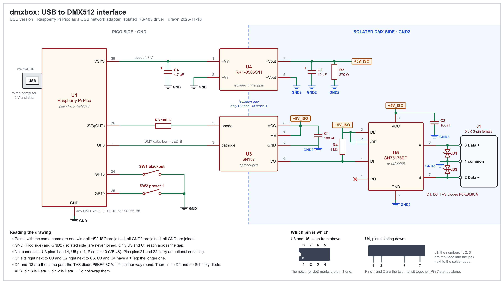
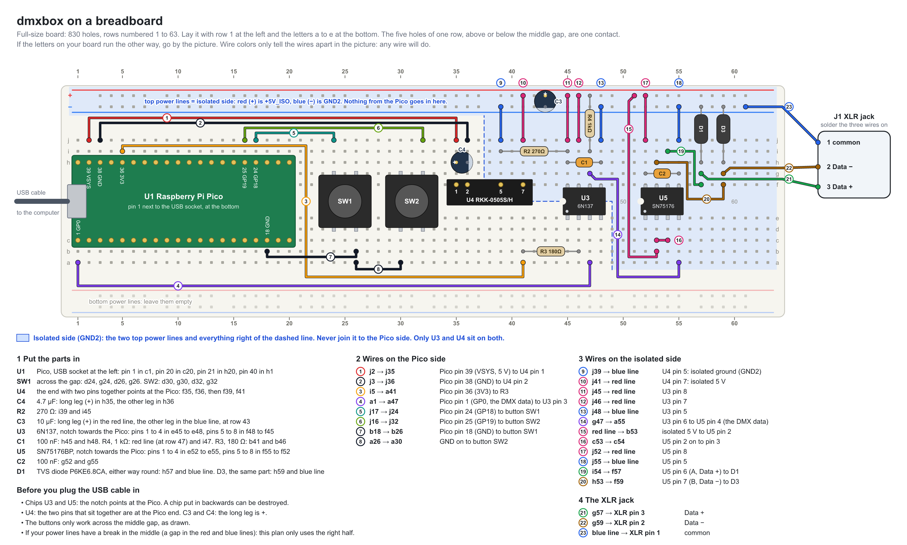
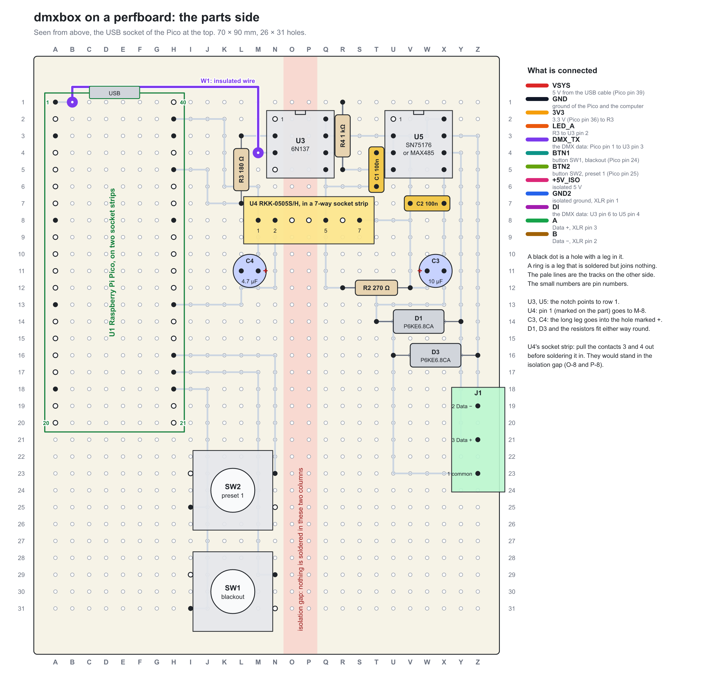
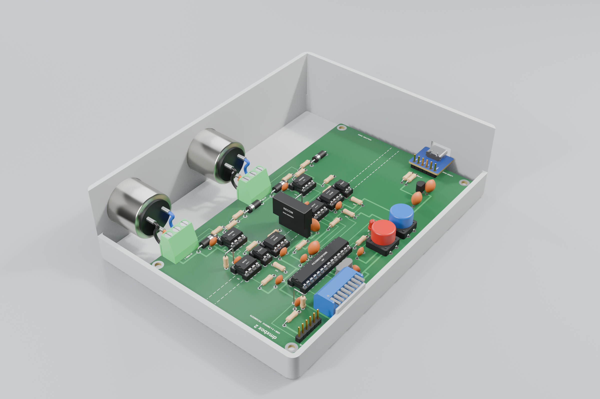
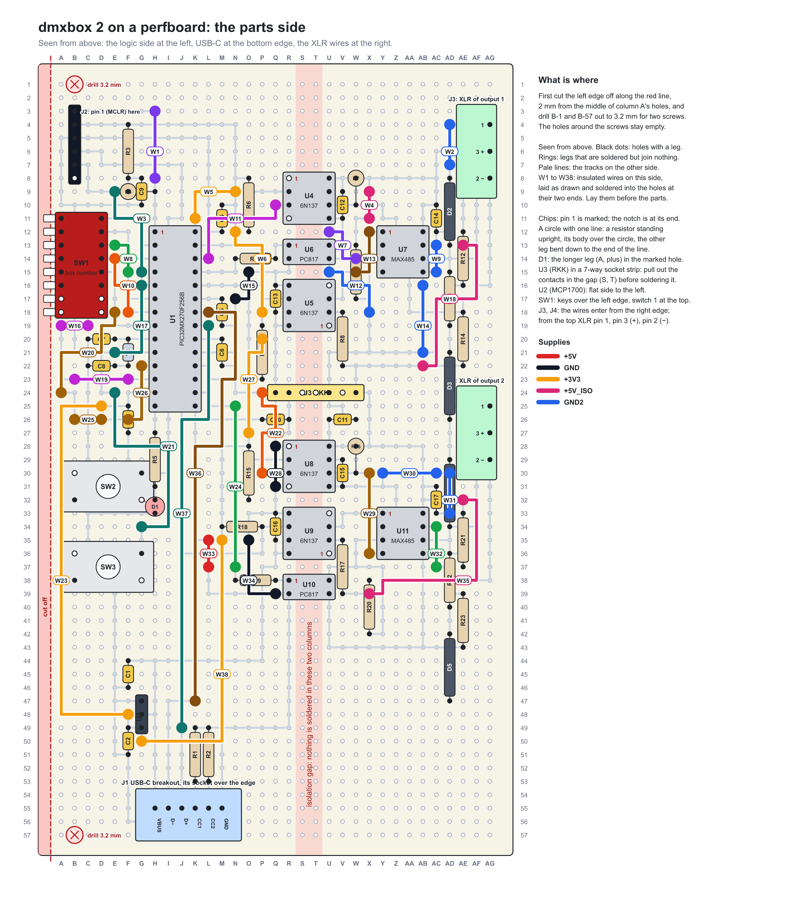

# The box with the Pico and dmxbox 2: hardware and firmware

Sections 1 and 2 of DEV.md as they stood on 2026-11-26, when dmxbox 3 replaced both boxes. The box with the
Pico was built and works; dmxbox 2 was drawn and its firmware compiled, but it was never built. Their files are
in this folder (`pico/`, `pic32/`) and in `firmware/archive/`; the paths below were changed to point there. The
desk still plays the box with the Pico (192.168.7.1). Links to other parts of DEV.md lead to the file as it is now.

## 1. Hardware

Parts: see [BOM.md](pico/BOM.md). Pictures: [top](pico/3d/dmxbox_usb_top.png), [solder side](pico/3d/dmxbox_usb_bottom.png),
[USB end](pico/3d/dmxbox_usb_usb_side.png), [DMX end](pico/3d/dmxbox_usb_dmx_side.png), [closed box](pico/3d/dmxbox_usb_closed.png).

Schematic: [drawing](pico/schematic-1-universe/dmxbox_schematic.png). To try the circuit on a breadboard first:
[breadboard plan](pico/schematic-1-universe/dmxbox_breadboard.png). Both are in [one PDF](pico/schematic-1-universe/dmxbox_drawings.pdf) for printing.
To solder it on a perfboard: [perfboard plan](#building-it-on-a-perfboard).

Tracks: the board is 100 × 66 mm and has every track on the solder side
([drawing](pico/3d/dmxbox_usb_routing.png), [SVG](pico/3d/dmxbox_usb_routing.svg)).

Everything with many pins sits in a socket (Pico, 6N137, RS-485 transceiver, DC-DC converter), so it can be
replaced. U5 can be an SN75176BP or a MAX485: same pins, same socket (see [BOM.md](pico/BOM.md)).

The Pico sits at the left end of the board, with its micro-USB socket at the wall of the box. The cable plugs
straight into the Pico through an opening in the wall.

### Pin map

| Pico pin | GPIO | Connects to |
|---|---|---|
| 1 | GP0 | 6N137 pin 3 (LED cathode) |
| 24 | GP18 | Button SW1 "blackout" to GND |
| 25 | GP19 | Button SW2 "preset 1" to GND |
| 36 | 3V3(OUT) | R3 (180 Ω) to 6N137 pin 2 (LED anode) |
| 39 | VSYS | DC-DC converter U4 pin 1, and capacitor C4 |
| 23, 28, 33 | GND | Ground. The other five ground pins have no track: the Pico joins all eight itself. |
| 21, 22 | GP16, GP17 | Serial log (TX, RX, 115200 baud). No track; connect a serial adapter only if you want to read the log. |
| 40 | VBUS | Not connected |

All pins can be changed in `firmware/archive/pico/src/config.h`.

### Schematic (signal level)



The same in text:

```
              LOGIC SIDE (Pico GND)                   ║           ISOLATED SIDE (GND2)
                                                      ║
 USB 5 V ──►|── VSYS (Pico 39) ──┬── U4 pin 1 (+in)   ║   U4 pin 7 ── +5V_ISO ──┬── U3 pin 8 and pin 7
     (diode on the Pico)      C4 ┴ 4.7µ               ║   (RKK-0505S/H)         ├── R4 1k ── U3 pin 6 ──► U5 pin 4 (DI)
 GND (Pico 23, 28, 33) ──────────┴── U4 pin 2 (−in)   ║                         ├── U5 pin 8, pin 3 (DE), pin 2 (/RE)
                                                      ║                         ├── R2 270R ── GND2
 Pico 3V3 ── R3 180R ── U3 pin 2 (LED anode)          ║                         └── C1, C2 100n and C3 10µ ── GND2
 Pico GP0 ───────────── U3 pin 3 (LED cathode)        ║   U4 pin 5 ── GND2 ── U3 pin 5, U5 pin 5, XLR pin 1
 Pico GP18 ── SW1 ── GND                              ║   U5 pin 6 (A) ── XLR pin 3 (Data+)   and D1 to GND2
 Pico GP19 ── SW2 ── GND                              ║   U5 pin 7 (B) ── XLR pin 2 (Data−)   and D3 to GND2

 U3 = 6N137, U4 = Recom RKK-0505S/H, U5 = SN75176BP or MAX485
 D1, D3 = P6KE6.8CA, a TVS protection diode (both the same part, either way round)
```

U4 has seven pin positions, of which four have a pin: 1 and 2 on the logic side, 5 and 7 on the isolated side.

How the data path works: GP0 low lights the optocoupler LED, the 6N137 output goes low, the transceiver
drives the line low. An unlit LED means "line idle", so the line stays quiet while the Pico boots.
DE is tied high: the box only transmits.

Rules that matter:

* **A = Data+ = XLR pin 3, B = Data− = XLR pin 2**, pin 1 is the common. Swapping A and B is the most common DMX build mistake.
* **Never connect GND2 to the Pico's GND.** That would defeat the isolation. The Pico's ground is the
  computer's ground now, so the isolation is also what protects the computer from faults on the DMX line.
* **No 120 Ω terminator in the box.** The box is the start of the line. Terminate at the last fixture.
* Keep the logic and the isolated side apart on the board. Only the 6N137 and the DC-DC converter bridge the gap.
* DMX512 officially uses 5-pin XLR. Many fixtures have 3-pin; the wiring of pins 1 to 3 is the same.

### Building it on a breadboard



The picture lists every part and every wire with its holes. It is drawn for one full-size breadboard
(830 holes, rows 1 to 63). The circuit does not fit on a half-size board (400 holes).

* Lay the board with row 1 at the left and the letters a to e at the bottom. If the letters on your board
  run the other way, go by the picture.
* **The two power lines at the top edge are the isolated side:** red (+) is +5V_ISO, blue (−) is GND2.
  Nothing from the Pico goes into them. The two power lines at the bottom edge stay empty.
* The plan only uses the right half of the power lines, so it also works on boards whose lines have a break
  in the middle.
* The chips sit across the middle gap with the notch towards the Pico. U4 sits with its two close pins
  towards the Pico. The buttons only work across the middle gap.
* On the breadboard the Pico's ground comes from pins 38 and 18. Any ground pin will do: the Pico joins them.
* A breadboard keeps the two sides only one hole apart. That is fine for a test on the desk, but it is not
  the isolation the real board will have.

A safe order:

1. Put in the parts, but leave U3 and U5 out. Put in wires 1 to 20.
2. Plug in the USB cable. Between the red and the blue line there should be about 5 V (4.6 to 5.5 V).
   If not, unplug and check U4, C3 and wires 1, 2, 9 and 10.
3. Unplug. Put in U3 and U5. Solder three wires to the XLR jack and plug them in (wires 21 to 23).
4. Plug in again and measure with a multimeter (DC volts) from XLR pin 3 (red probe) to pin 2 (black probe).
   What to expect depends on the Pico:
   * **Without firmware** the line rests: pin 3 is 2 V or more above pin 2 (4.28 V on the first build).
   * **With the firmware** the Pico sends DMX all the time, and the meter shows the average of it. With all
     channels at 0 that is about −2.5 V (pin 3 *below* pin 2). Now set all channels to full, in
     PowerShell: `dmxbox set 1 (,255 * 512)`. The reading turns positive, about +3.5 V.
     `dmxbox set 1 (,0 * 512)` brings it back. If the reading follows like this, the whole path from the Pico
     to the jack works. If the signs are the other way round, Data + and Data − are swapped.
   * **A steady positive reading that never changes** although the firmware runs means the data does not
     reach U5. First press the Pico firmly into the board: one pin without contact is enough.
5. If the firmware is not on the Pico yet, [flash](#flash) it. Then go on with [Check that it works](#check-that-it-works).

The plan is checked by the script that draws it (`hardware/pico/schematic-1-universe/draw.py`): every leg and wire end has a hole of
its own, and the holes joined by the board and the wires give exactly the connections of the schematic.

### Building it on a perfboard



The soldered version, on a 70 × 90 mm perfboard with 26 × 31 holes (lettered A to Z, numbered 1 to 31), the
kind where every hole has a solder pad of its own. If the pads of your board are joined in strips or in
groups, this plan does not fit it.

* [The solder side](pico/schematic-1-universe/dmxbox_perfboard_solder.png) shows the tracks, as you see them with the board
  turned over.
* [The lists](pico/schematic-1-universe/dmxbox_perfboard.md) give the holes of every part and every track from hole to hole.
* [One PDF](pico/schematic-1-universe/dmxbox_perfboard.pdf) has both drawings for printing.

The 50 × 70 mm board (18 × 24 holes) is not used: the Pico alone takes 8 of its 18 columns and 20 of its 24
rows, which leaves too little room for the isolated side behind a gap.

How to read the plan:

* A hole is written with a dash: N-3 is column N, row 3. (C1, R3 or U4 without a dash are parts.)
* **Columns O and P stay empty from top to bottom.** That is the isolation gap. Everything left of it belongs
  to the Pico and the computer, everything right of it to the DMX line. Only U3 and U4 reach across.
* The Pico stands at the left edge with its USB socket at row 1. Everything with many pins sits in a socket.
* A track is a line of neighbouring pads joined on the solder side: lay a bare wire along them, or run solder
  from pad to pad. A pad in a track with no leg in it is just a place the track passes.
* One connection is an insulated wire (W1, from B-1 to M-4), because it has to get past the Pico's socket
  strip. Run it on whichever side you like.
* Each button has four legs. Its signal goes to one corner and ground to the opposite corner; the other two
  legs are soldered for a firm seat but join nothing. That works whichever way the button is joined inside.
* The screw terminal J1 has, from the top: XLR pin 2 (Data −), pin 3 (Data +), pin 1 (common).
* U4's socket strip has seven contacts, the converter only four pins. Pull contacts 3 and 4 out of the strip
  before soldering it in: they would stand in the gap (O-8 and P-8).

A safe order:

1. Solder the socket strips and sockets, then the resistors and diodes, then the capacitors, the buttons
   and J1. Mind the notch of U3 and U5 (towards row 1) and the plus leg of C3 and C4.
2. Join the pads track by track after the solder-side drawing, and tick each track off in the list.
3. Before anything is plugged in, test with a multimeter set to continuity. Every track must conduct from end
   to end. Tracks of different colors must not conduct to each other. **Nothing left of the gap may conduct
   to anything right of it.**
4. Plug in the Pico and U4, leave U3 and U5 out, and connect the USB cable. Between S-8 (plus) and Q-8 (minus)
   there should be about 5 V (4.6 to 5.5 V).
5. Unplug, put in U3 and U5 (pin 1 at the notch), wire J1 to the XLR jack, and go on with step 4 of the
   breadboard list above: the measurement between XLR pin 3 and pin 2.

How the plan is made: the places of the parts are chosen by hand, and `hardware/pico/schematic-1-universe/perfboard.py` finds the
tracks. A separate check in the same script then confirms that the joined pads give exactly the connections
of the schematic (whichever way the buttons are joined inside), that every leg has a hole of its own, that
nothing reaches across the gap, and that no two parts stand in each other's way. Run with `--selftest`, the
script plants 19 mistakes (a missing piece of track in each connection, Data + and Data − swapped at J1, U5
turned round, a solder bridge, a track across the gap, and others) and confirms that the check notices each.

### Power

* **From the USB cable.** The box draws about 0.2 A (estimate: about 30 mA for the Pico and 100 to 150 mA
  into the DC-DC converter). A normal USB port gives 0.5 A. The box tells the computer it may take up to 0.3 A,
  so a port that only allows 0.1 A (an unpowered hub, some phones) refuses it.
* **While the computer sleeps** the box keeps drawing its normal current and keeps the DMX line going. Strictly,
  USB asks a sleeping device to draw almost nothing; computers do not enforce that.
* **Without a computer:** any USB charger or power bank. The buttons and the stored presets keep working.
* **Why U4 hangs on VSYS and not on VBUS.** VSYS is the USB voltage behind the Pico's own diode, about 4.7 V.
  U4 is not regulated: its output follows its input and rises a few percent when little current is drawn.
  Fed from VSYS, the isolated side ends up close to 5 V.
* **3.3 V:** the Pico's regulator only feeds the optocoupler LED (about 9 mA).
* **Isolated side:** R2 is a base load for U4. It keeps the output voltage from rising when the line is idle.

### Box

* The model's box is 108 × 75 × 38 mm outside (103 × 70 × 33 mm inside).
* The opening for the USB plug is 12 × 8 mm, so that the plug's plastic grip fits into the wall. The Pico's
  socket ends 0.2 mm short of the wall's inner face when the board's left edge is 1.5 mm from it.
* One of the four board screws is under the Pico, between its pin rows. Put it in before you plug the Pico in.
* The two buttons are on the board, inside the box. The lid in the model has no openings for them.

### dmxbox 2: the PIC32 box



**Not built yet.** Everything here is drawn and checked by scripts, and the firmware compiles; none of it has
run on a real board. It comes in two versions with the same board design:

* **Two outputs** (two universes): `hardware/pic32/schematic-2-universes/`, files `dmxbox2_*`.
* **One output** (one universe): `hardware/pic32/schematic-1-universe/`, files `dmxbox2_1_universe_*`. The same
  box with output 2 left out (U8 to U11, R15 to R23, C15 to C17, D4, D5, J4): U1 pins 16, 17 and 18 stay free,
  and the firmware is built with `build.cmd 1`.

The box with the Pico has its drawings in `hardware/pico/schematic-1-universe/`: each folder's name says how
many universes the box plays.

* **Chip:** a Microchip PIC32MX270F256B in a 28-pin DIP socket: 256 KB flash, 64 KB RAM, full-speed USB and
  two UARTs. It runs at 40 MHz from an 8 MHz crystal; USB gets its own 48 MHz from the same crystal.
* **Power:** from the USB-C socket, which sits on a small breakout board, about 0.25 A. U2 (MCP1700) makes the
  3.3 V of the chip; U3, the same Recom RKK-0505S/H as on the Pico box, the isolated 5 V of both outputs.
* **Two outputs**, each with its own XLR jack: box n plays Art-Net universes 2n and 2n + 1, and the desk
  gives its two outputs two universes.
* **Ready for RDM**, which the firmware does not speak yet: each output can also listen to the line, through
  a second optocoupler, and the chip switches the line driver between sending and listening.
* **The box number:** switches 1 to 6 of SW1 give the box its number n and its address 10.1.n.1
  ([BOM.md](pic32/BOM.md#the-box-number)). The desk looks for the boxes by itself. SW1 is a piano
  DIP switch with long keys (ONPOW DPL08RGT) at the left edge of the board, which is cut off right beside
  it: its keys reach into the box's left wall and end level with the floor of a pocket in it, so the number
  is set from outside, with a fingernail or a pen ([picture](pic32/3d/dmxbox2_box_number.png)).
* **Buttons and LED** as on the Pico box: SW2 blackout, SW3 preset 1, D1 the state. The two buttons share
  the chip's programming pins: do not press them while a programmer writes the firmware.
* **J2** is the programming header: a new PIC32 takes its first firmware only through a programmer (see
  [flashing it](#the-pic32-box-flashing)).

In each folder the drawings are made from one net list, `circuit.py`, and each script checks its drawing
against it before writing it. The files of the box with two outputs (the other folder has the same ones):

| What | Files in `hardware/pic32/schematic-2-universes/` | Made by |
|---|---|---|
| Schematic | [PNG](pic32/schematic-2-universes/dmxbox2_schematic.png), [PDF](pic32/schematic-2-universes/dmxbox2_schematic.pdf) | `draw.py` |
| Breadboard plan | [parts](pic32/schematic-2-universes/dmxbox2_breadboard.png), [wires](pic32/schematic-2-universes/dmxbox2_breadboard_wires.png), [lists](pic32/schematic-2-universes/dmxbox2_breadboard.md), [PDF](pic32/schematic-2-universes/dmxbox2_breadboard.pdf) | `breadboard.py` |
| Perfboard plan | [parts side](pic32/schematic-2-universes/dmxbox2_perfboard.png), [solder side](pic32/schematic-2-universes/dmxbox2_perfboard_solder.png), [lists](pic32/schematic-2-universes/dmxbox2_perfboard.md), [PDF](pic32/schematic-2-universes/dmxbox2_perfboard.pdf) | `perfboard.py` |
| EAGLE files: schematic and a printed board with tracks on both sides | `dmxbox2.sch`, `dmxbox2.brd` | `eagle_export.py` |

The box with one output: [schematic](pic32/schematic-1-universe/dmxbox2_1_universe_schematic.png),
[breadboard plan](pic32/schematic-1-universe/dmxbox2_1_universe_breadboard.png),
[perfboard plan](pic32/schematic-1-universe/dmxbox2_1_universe_perfboard.png), and
`dmxbox2_1_universe.sch` / `.brd`.

The finished box with two outputs, the printed board in it: [Blender file](pic32/3d/dmxbox2.blend),
[from above](pic32/3d/dmxbox2_top.png), [the board from below](pic32/3d/dmxbox2_bottom.png),
[the USB end](pic32/3d/dmxbox2_usb_side.png), [the DMX end](pic32/3d/dmxbox2_dmx_side.png),
[the box number side](pic32/3d/dmxbox2_box_number.png), [closed](pic32/3d/dmxbox2_closed.png).
The parts are KiCad's 3D models (SW1 is KiCad's piano DIP switch with its keys made as long as a DPL's); the
box is 123 × 163 × 44 mm. Its left wall stands 0.3 mm from the cut edge of the board; around the window for
SW1's keys it has a pocket 1.4 mm deep, and the lid comes down over the keys through a notch that a tab of
the base fills below the window.
The parts list for both versions is [BOM.md](pic32/BOM.md).

Run a script with `uv run --no-project --python 3.13 --with resvg-py --with pillow python
hardware/pic32/schematic-2-universes/<script>`. `perfboard.py` and `eagle_export.py` take a minute, because they
look for the tracks; `perfboard.py --selftest` plants mistakes and confirms that its check notices each of them.

**EAGLE files.** `.sch` and `.brd` are EAGLE's own format (XML), which EAGLE, Fusion Electronics and KiCad
(File, Import) open; the box with the Pico has them too (`hardware/pico/schematic-1-universe/dmxbox.sch` and
`.brd`, its carrier board from the 3D model, written by `eagle_export.py` there from `dmxbox_board.json`).
The schematic is a working one: every part a box with its pins, joined by the names of the nets. The board of
dmxbox 2 has the parts where the perfboard plan has them, 87.6 × 150 mm (the perfboard with its left edge cut
off as the plan cuts it, the screw holes where the plan drills them), with plated holes and tracks on both
sides (the router of the perfboard plan with the top side as copper); the script checks it as it checks the
perfboard, and reads both files back and compares them with the net list. They are not fabrication data yet:
no design rule check of a board maker, no ground plane, and they have not been opened in EAGLE here.

#### Pin map of dmxbox 2

| PIC pin | Port | Connects to |
|---|---|---|
| 26 | RB15 (UART 1 send) | output 1: U4 pin 3, the send optocoupler |
| 25 | RB14 | output 1: direction, through R10 to U6 pin 1 |
| 24 | RB13 (UART 1 receive) | output 1: U5 pin 6, the receive optocoupler |
| 18 | RB9 (UART 2 send) | output 2: U8 pin 3 |
| 16 | RB7 | output 2: direction, through R19 to U10 pin 1 |
| 17 | RB8 (UART 2 receive) | output 2: U9 pin 6 |
| 2, 3, 6, 7, 11, 12 | RA0, RA1, RB2, RB3, RB4, RA4 | SW1, switches 1 to 6 (the chip's own pull-ups) |
| 4 | RB0 (PGED1) | SW2 blackout, and J2 pin 4 |
| 5 | RB1 (PGEC1) | SW3 preset 1, and J2 pin 5 |
| 14 | RB5 | through R5 to the LED D1 |
| 1 | MCLR | R3 and R4 (C9 behind R4), J2 pin 1 |
| 9, 10 | OSC1, OSC2 | the crystal Y1 with C7 and C8 |
| 21, 22 | D+, D− | the USB-C breakout |
| 15 | VBUS | 5 V from USB: the chip sees the cable |
| 13, 28, 23 | VDD, AVDD, VUSB3V3 | 3.3 V, each with a 100 nF capacitor |
| 20 | VCAP | C6, 10 µF ceramic: the chip's own core supply |
| 8, 19, 27 | VSS, AVSS | ground |

The send and receive pins are fixed by which pins the chip can give its UARTs; the others are set in
`firmware/archive/pic32/src/board.c`.

#### One output

```
 PIC send pin ──► 6N137 (send) ──────► MAX485 DI      MAX485 A ──► XLR pin 3 (Data +)
 PIC receive  ◄── 6N137 (receive) ◄─── MAX485 RO      MAX485 B ──► XLR pin 2 (Data −)
 PIC direction ─► PC817 ─────────────► MAX485 DE, /RE    GND2 ──► XLR pin 1
```

* **Direction:** low sends, high listens (the PC817 lit pulls DE and /RE down). While the chip starts, its
  pins are not driven: the PC817 stays dark, R11 keeps the driver on and the dark send optocoupler keeps the
  line at rest. So the line is quiet from power-up on.
* **Bias and termination:** 560 Ω from A up to the isolated 5 V, 560 Ω from B down to GND2 and 130 Ω between
  A and B. A line that nobody drives rests at about +0.26 V with the terminator at its far end, above the
  0.2 V that RS-485 needs, so that the box can listen for RDM answers. The last fixture still gets its 120 Ω
  terminator.
* **TVS diodes** (P6KE6.8CA) from A and from B to GND2, at the jack's side.
* The rules of the Pico box hold: A = Data + = XLR pin 3, B = Data − = XLR pin 2; GND2 never meets GND; only
  U3 and the optocouplers cross the gap.

#### dmxbox 2 on a perfboard



The board is 90 × 150 mm with 33 × 57 holes, every hole with a pad of its own: columns A to Z and AA to AG,
rows 1 to 57. Read the plan as the one of the Pico box (a hole is written with a dash, AB-12; tracks are
joined pads on the solder side), with these differences:

* **Columns S and T stay empty from top to bottom:** the gap. The logic side (USB, chip, switch, buttons) is
  at the left, the two DMX outputs at the right.
* **Resistors with a circle** stand upright: the body over the circled hole, the other leg bent down beside it.
  The others lie flat.
* **Insulated wires** (W1, W2 ...) on the parts side join what the tracks cannot: where nets have to cross on a
  single side, a wire goes over the top, laid along the holes the plan draws and soldered into the hole at each
  end. The plan needs 38 of them (the box with one output 26); the lists give each one's way. Lay them before
  the parts. The printed board (the EAGLE files) needs none.
* **J3 and J4**, the screw terminals of the XLR wires: from the top XLR pin 1, pin 3 (+), pin 2 (−); the wires
  enter from the right edge.
* **U3's socket strip** has seven contacts, the converter four pins: pull contacts 3 and 4 out of the strip
  before soldering it, they would stand in the gap (S-24 and T-24).
* **J2**, the programming header, at the top left: pin 1 (MCLR) at B-3.
* **SW1**, the box number, at the left edge in the columns A and D: its keys towards the edge, switch 1 at the
  top (row 11).
* **The left edge is cut off** along the red line, 2 mm from the middle of column A's holes (the board is then
  about 87.6 mm wide), so that SW1's keys reach the wall of the box. Its left corners go with it: **B-1 and
  B-57 are drilled out to 3.2 mm** for the two screws at the left; the right corners keep their own holes.
  The holes around each screw stay empty.
* **The USB-C breakout** stands on its own six pins in row 55, straight below the PIC, its socket over the
  bottom edge of the board: D+ and D− run straight down to it.

A safe order:

1. Cut the left edge off and drill B-1 and B-57, before anything is soldered (a saw or a sharp knife and a
   file; the cut runs 1 mm beside the pads of column A). Then solder the insulated wires, then the resistors,
   diodes and the crystal, then the sockets (without the chips),
   the capacitors, SW1, the buttons, the terminals, J2, U2 and the USB-C breakout. Mind the notches (towards
   row 1, or towards the bottom for U5 and U9 as the plan shows them) and the flat side of U2.
2. Join the pads track by track after the solder-side drawing and tick each one off in the lists.
3. Before anything is plugged in, test with a multimeter set to continuity: every track conducts from end to
   end, tracks of different colors do not conduct to each other, and **nothing left of the gap conducts to
   anything right of it**.
4. Plug in the USB-C cable, still without chips and without U3. Between the socket contacts of U1 pin 13 (H-24)
   and pin 8 (H-19) there should be 3.3 V (3.2 to 3.4 V).
5. Unplug, put in U3 and plug in again: between the socket contacts of U7 pin 8 (AB-12) and pin 5 (AB-15)
   about 5 V (4.6 to 5.5 V).
6. Unplug, put in the chips (pin 1 at the notch), and [flash the firmware](#the-pic32-box-flashing).

The plan is made like the Pico box's: the places of the parts by hand, the tracks found by the script, then a
separate check of the result. The script lays the tracks on two layers, the solder side and the wires over
the top; a wire's two ends cost it as much as a long track, so it uses as few as it can. When the nets cannot
agree where to go, it starts again with them in another order. The check also looks at the parts themselves:
every leg in a hole of its own, the legs of each resistor, capacitor, diode and the crystal as far apart as the
part allows, no part standing on another (a socket covers all the holes between its pins, a screw terminal the
two columns behind its pins), no wire over a leg or under a socket, and nothing where a screw goes.

---

## 2. Firmware

### Build

You need the Pico SDK (2.1.0 or newer, with its TinyUSB submodule), an ARM toolchain (`gcc-arm-none-eabi`),
CMake, and Ninja or Make. It is built and tried with Pico SDK 2.3.1 and Arm GNU Toolchain 14.2.Rel1.

**Windows:** `firmware\archive\pico\build.cmd` does it in one step. It expects the tools in the folder `.pico-sdk` in your
user folder, laid out the way the VS Code "Raspberry Pi Pico" extension lays them out:

| Folder in `.pico-sdk` | What it holds |
|---|---|
| `sdk\2.3.1` | The Pico SDK from GitHub, with its submodule `lib/tinyusb` |
| `toolchain\14_2_Rel1` | Arm GNU Toolchain for Windows, from arm.com |
| `picotool\2.3.1\picotool` | `picotool`, ready-made in Raspberry Pi's `pico-sdk-tools` releases on GitHub |
| `tools\2.3.1\pioasm` | `pioasm`, from the same place |

CMake and Ninja are taken from the PATH, or from Visual Studio if it is installed.

**Linux and macOS** (this line has not been run yet):

```bash
cd firmware
mkdir build && cd build
PICO_SDK_PATH=/path/to/pico-sdk cmake ..
make -j
```

Both produce `build/dmxbox.uf2`; `build.cmd` also puts a copy into `firmware/archive/pico/`, next to `flash.cmd`. For a
Pico W or Pico 2 add `-DPICO_BOARD=pico_w` or `-DPICO_BOARD=pico2` after `build.cmd` or to the `cmake` line,
and start with an empty `build` folder. On a Pico W the LED stays dark.

### Flash

Flashing replaces whatever was on the Pico before, for example MicroPython and the scripts stored with it.

**Windows:** `firmware\archive\pico\flash.cmd` does it. It takes the `dmxbox.uf2` in its own folder, so the two files can
also be copied together to another computer. Start it, then unplug the box, hold **BOOTSEL** on the Pico and
plug the USB cable in again. It finds the Pico's drive by itself (if there are several, it asks which one),
writes the file, waits until the Pico has restarted and then until the box answers at 192.168.7.1, showing
each of the four steps as it goes. At the end it says whether it was successful and waits for a key.

**By hand:** hold **BOOTSEL** while plugging the Pico into USB. It mounts as a drive named RPI-RP2; copy
`dmxbox.uf2` onto it. The Pico then restarts by itself and the drive disappears. If the drive stays, wait a
few seconds and copy the file again.

### Configure

Edit `firmware/archive/pico/src/config.h`:

* The address of the box (default **192.168.7.1**) and the address it gives the computer (192.168.7.2)
* Art-Net universe (default 0)
* Number of channels sent per frame (default 512)
* Pins, and the button preset and fade time

### Check that it works

* **Plug it in.** A new network adapter appears on the computer and gets the address 192.168.7.2 from the
  box within a few seconds.
* **Ping:** `ping 192.168.7.1` is answered by the box.
* **Control:** `dmxbox ping` shows the firmware version and the state of the box (see [Command line](../../DEV.md#command-line)).
* **Windows shows "This device cannot start (code 10)":** the firmware was built without the correction
  described under `usb_net.c` below. Build it from the current sources.
* **On-board LED:**

| LED | Meaning |
|---|---|
| slow blink (1 Hz) | Powered, but no computer attached (for example on a charger) |
| on | Connected to a computer, idle |
| flicker | Art-Net or control packets arriving |

There is no USB serial port any more. The log goes to the serial pins GP16 / GP17 instead.

### How it works

* **`dmx_tx.pio`:** a 9-instruction PIO program. It generates the break (176 µs), the mark-after-break (12 µs)
  and 250 kbaud 8N2 bytes, with exact timing and no CPU involvement. DMA feeds it the 513-byte packet.
  A full universe refreshes at **43 Hz**. Lower `DMX_CHANNELS` for a faster refresh.
* **`usb_net.c`:** makes the Pico a USB network adapter, using the USB library that comes with the Pico SDK
  (TinyUSB, class CDC-NCM). It only moves raw Ethernet frames between the USB cable and `net.c`.
  One question of the computer it answers itself instead of leaving it to TinyUSB: how the blocks of frames
  are laid out. TinyUSB up to 0.18 (the version in Pico SDK 2.3.1) gives numbers there that Windows has
  refused since an update of September 2026.
* **`dhcp_server.c`:** hands the computer its address, so nothing has to be configured by hand.
* **`net.c`:** the network stack, about 200 lines: it answers ARP and ping, and receives and sends UDP.
  The box never starts a conversation, so every packet goes straight back to where the request came from.
  No ARP cache, no gateway setting.
* **`engine.c`:** two layers, merged:
  * The **cue layer** is driven by the DX protocol and the buttons. Every channel has its own fade,
    computed in 16-bit at frame rate.
  * The **Art-Net layer** holds the last ArtDmx data.
  * `output = merge(cue, artnet) × master`, or 0 during blackout.
* **Merge modes:**
  * **HTP** (default): the highest value wins. The Art-Net look is *held* even if the PC goes to sleep,
    until you call `release-artnet`.
  * **Override:** Art-Net replaces the cue layer while packets keep arriving. After 3 s of silence, the
    cue layer takes over again.
* **Presets:** 16 snapshots of the current look, stored in the last 12 KB of flash with a CRC.
  They survive power cycles. While flash is being written, core 1 is paused safely (`flash_safe_execute`),
  and the DMX line just idles for about 150 ms, which the DMX standard allows.
* **Losing the computer:** as long as the box has power, it keeps outputting the last state. The buttons work
  without a computer: GP18 toggles blackout, and GP19 fades to preset slot 0 in 2 s.

> **The box's own master and blackout act on every channel.** That is right for dimmers and RGB PARs; with
> moving heads a blackout of the box also sends pan and tilt to 0. Lumenet therefore does its master and
> blackout in the levels it sends, on the light only (see the Fixtures view), and keeps the box's own
> master at full; the box's blackout is only that of its button.

### Testing the network code on a PC

`firmware\archive\pico\test\build.cmd` (Visual Studio C compiler) builds and runs a test program. It runs the real
network stack, the address server, the USB glue and the firmware's main program on pretend hardware, and
checks ARP, ping, UDP, DHCP, Art-Net and the control protocol, including damaged packets (198 checks). On Linux or macOS use the `cc` line at the top of `test_net.c`.

### The PIC32 box: building the firmware

`firmware\archive\pic32\build.cmd` builds `firmware\archive\pic32\build\dmxbox2.hex` and puts a copy next to itself. It needs
three things, all free:

| What | Where `build.cmd` looks for it | Tried with |
|---|---|---|
| MPLAB XC32, Microchip's C compiler | `C:\Program Files\Microchip\xc32\v...`, or the variable `XC32` set to the folder of one version | v6.00 |
| The PIC32MX device pack (PIC32MX_DFP) | `%USERPROFILE%\.mchp_packs\Microchip\PIC32MX_DFP\...`, where MPLAB X puts its packs, or `DFP` | 1.7.380 |
| TinyUSB, the USB library | the copy in the Pico SDK of the Pico box (`%USERPROFILE%\.pico-sdk\sdk\2.3.1\lib\tinyusb`), or `TINYUSB` | 0.18 |

It compiles the shared code of `firmware/common` with the box's own files in `firmware/archive/pic32/src`:

* `config.h`: the numbers (addresses, Art-Net universes, two outputs of 512 channels, 8 presets, USB names).
* `board.c`: the configuration bits (the crystal, 40 MHz, the USB clock, JTAG off because its pins are pins of
  the board), the pins, the switch, the buttons, the LED, a 1 ms timer and the USB interrupt.
* `dmx_out.c`: each output on a UART of its own, driven by interrupts, both at the same time. The break is a 0
  sent at 50,000 baud: its nine low bits are the 180 µs break, its stop bits the 40 µs mark after it. Then the
  start code and the 512 levels at 250,000 baud with two stop bits: about 44 frames a second.
* `storage_flash.c`: the 8 presets, 1024 levels each, in the chip's own flash.
* `main.c`: puts it together like the Pico's main program. The box number from the switch gives the
  addresses, the Ethernet addresses and the USB serial number ("box-07").

The firmware takes about 40 KB of the 256 KB flash and 48 KB of the 64 KB RAM (both outputs' levels and fades,
and the USB network buffers). It builds without warnings; TinyUSB's own files get two warnings switched off.
`build.cmd 1` builds the firmware of the box with one output, `dmxbox2-1-universe.hex` (36 KB flash, 32 KB
RAM): it drives UART 1 only, leaves U1 pins 16 to 18 alone and tells the desk 512 channels.
TinyUSB has a driver for the USB port of the PIC32MX, but its authors list it as untested.

The simulator plays this box too: `firmware\sim\dmxbox_sim2.exe` has two outputs (`--show` prints both).

### The PIC32 box: flashing

A new PIC32 has no USB drive to copy the firmware to, as the Pico has. The first firmware goes on with a
programmer, a Microchip MPLAB Snap (PG164100), PICkit 4 or PICkit 5, and MPLAB IPE, the programming tool that
comes with the free MPLAB X IDE.

1. Put the chips into their sockets and plug the box into USB: the programmer does not power it.
2. Plug the programmer onto J2, its pin 1 (the arrow) on J2 pin 1 (MCLR, at B-3, the top of J2).
3. In MPLAB IPE choose the device PIC32MX270F256B and Apply, then the tool and Connect. Browse to
   `firmware\archive\pic32\dmxbox2.hex` (the box with one output: `dmxbox2-1-universe.hex`) and press Program. Do not
   press the box's buttons meanwhile.
4. Unplug the programmer. The box starts: the computer finds a new network adapter, which gets 10.1.n.2 from
   the box (n is the number on its switch).

Then `dmxbox -H 10.1.0.1 ping` (for box 0) shows the firmware version and 1024 channels, and the desk finds the
box by itself. There is no boot loader yet, so every new firmware needs the programmer.

---
